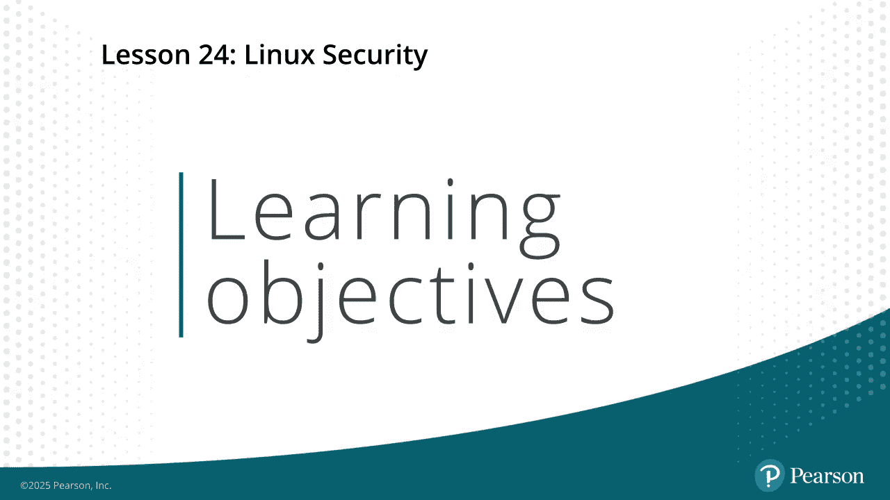
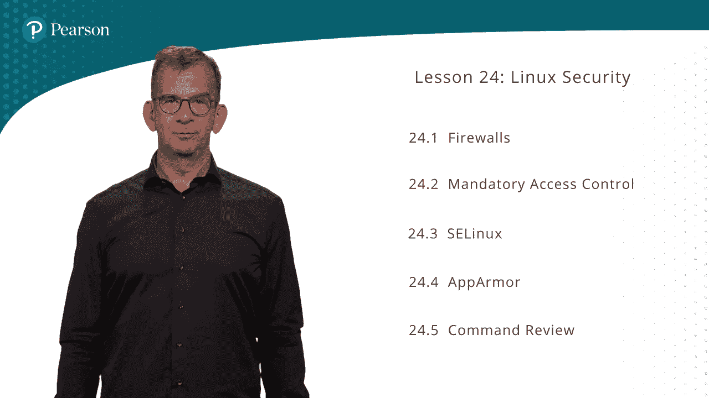

# Linux Security：🔒：01：Linux 安全基础介绍

在本节课中我们将要学习 Linux 安全方面的基础知识。首先欢迎大家来到 Linux 安全课程，这节课是一个快速入门，主要讲解一些能让 Linux 系统更安全的重要解决方案。如果你是刚开始接触 Linux 安全，完全不需要担心，我们会用大白话把每个概念都讲清楚，让你明白这些工具到底是在做什么，以及为什么需要它们。学完之后，你应该能对 Linux 的安全机制有一个初步的印象，知道怎么保护自己的系统不受网络攻击。

## 1. Linux 防火墙

上一节我们介绍了这节课的整体目标，本节中我们先来看看 Linux 防火墙。防火墙是系统安全的第一道防线，作用非常基础但也非常关键。



以下是关于 Linux 防火墙的核心内容。

Linux 防火墙就像是一位站在大门口的保安，它检查每一条进出电脑的网络流量，然后根据你预先设定的规则决定放行还是拦截。你可以把它想象成一道门禁，只有符合条件的访客才能进来，否则就会被挡在门外。这样一来，黑客或者恶意程序就很难通过网络直接攻击你的系统，因为所有的数据包都要先经过防火墙的检查。

防火墙规则可以用下面的公式来表示：

```
防火墙规则 = {源地址, 目标地址, 端口, 协议, 动作}
动作 ∈ {允许, 拒绝}
```

这个公式的意思是，一条防火墙规则由五个部分组成，分别是数据包来自哪里、要去哪里、使用哪个端口、使用什么协议，以及最后采取什么动作。动作只有两种选择，要么允许通过，要么直接拒绝。

## 2. 强制访问控制

了解完防火墙之后，我们继续来看看另一个重要的安全机制，也就是强制访问控制。这部分内容比防火墙稍微深入一点，但我们还是会用简单的话来解释。

以下是强制访问控制的主要概念和常见框架。

强制访问控制是一种更严格的安全方式，它不允许普通用户随意修改安全设置，而是由系统管理员统一制定策略。你可以把它理解为一套不可随意更改的规则，哪怕是一个拥有较高权限的程序，也必须遵守这些规则。在 Linux 中，主要有两个框架用来实现强制访问控制，分别是 AppArmor 和 SELinux。它们可以限制程序能访问哪些文件、能运行哪些操作，即使某个程序被攻破，攻击者也很难越过这些限制去做坏事。

强制访问控制策略可以用下面的公式来表示：

```
MAC 策略 = {主体, 客体, 操作, 决定}
决定 ∈ {允许, 拒绝}
框架 ∈ {AppArmor, SELinux}
```

这个公式说明，强制访问控制策略由四部分组成，也就是谁在做什么、针对哪个对象，以及系统最终做出什么决定。决定同样只有两种结果，允许或拒绝，而把这些策略落地的常用框架就是 AppArmor 和 SELinux。

以下是两个框架的简单对比：
- AppArmor：基于文件路径进行访问控制，配置比较简单，适合快速上手。
- SELinux：基于安全标签进行访问控制，功能更强大，但学习曲线相对较陡。

## 3. 实验与实验解答

理论部分讲完之后，按照惯例，这节课的最后部分会有动手实践环节，帮助你把所学知识应用到实际操作中。

本节课最后会安排一个实验，让你在真实的 Linux 环境中操作防火墙和强制访问控制，并且会提供实验的参考答案。通过动手配置和测试，你可以更好地掌握刚才讲的知识点，也能发现自己在哪些地方还需要加强。实验不仅是检验学习效果的方式，也是熟悉命令和工具的最好机会。



## 总结

本节课中我们一起学习了 Linux 安全的基础内容。首先介绍了 Linux 防火墙的作用和基本规则，然后讲解了强制访问控制的概念以及 AppArmor 和 SELinux 两个主要框架，最后安排了实验和实验解答。希望这些内容能帮你建立起对 Linux 安全的初步认识，为后续深入学习打下坚实的基础。
