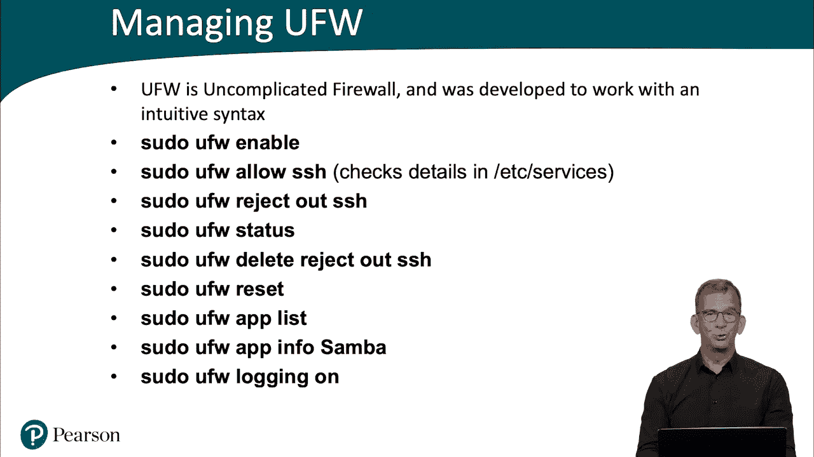
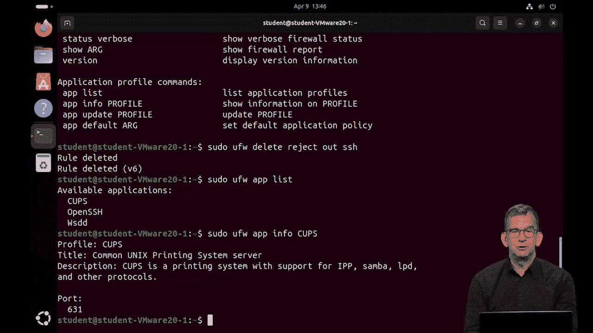

CompTIA Linux+ V8：232-241：Linux 防火墙基础🧱

在本节课中，我们将要学习 Linux 系统中的防火墙基础知识。防火墙的核心作用是过滤进入计算机的网络流量，决定哪些数据包可以通过，哪些数据包应该被阻挡。在 Linux 操作系统中，防火墙功能直接由内核实现，属于操作系统最深层的部分，也就是系统运行的最底层。不同的 Linux 发行版会选择不同的防火墙管理工具，例如 Red Hat 系发行版通常使用 Firewalld，而 Ubuntu 默认使用 UFW。这两种工具虽然目的相同，但是具体的操作命令和配置方式完全不同。接下来，我们将分别介绍这两种防火墙解决方案，并展示如何通过命令行完成基础配置。

防火墙的核心概念可以用下面的公式来描述：

防火墙过滤 = 检查进出网络流量 + 根据规则决定允许或拒绝

在 Linux 中，这个过滤过程发生在内核层面，对普通用户来说是透明的，但系统管理员需要通过配置工具来定义具体的过滤规则。

上一节我们介绍了防火墙的基本概念，本节中我们来看看 Firewalld 这种防火墙解决方案。Firewalld 是 Red Hat 系列发行版使用的标准防火墙工具，而 Ubuntu 则采用完全不同的 UFW 方案。如果你想在系统中使用 Firewalld，主要的操作界面是 firewall-cmd 命令行工具。

以下是 Firewalld 的常用操作命令：

- 查看当前防火墙配置：`firewall-cmd --list-all`
- 显示所有可用服务：`firewall-cmd --get-services`
- 向防火墙添加某个服务：`firewall-cmd --add-service=<服务名称>`
- 使配置在重启后依然生效：在命令中加上 `--permanent`
- 重新加载防火墙配置使更改立即生效：`firewall-cmd --reload`

下面是一个完整的命令示例，展示如何添加 HTTP 服务并使其永久生效：

```bash
firewall-cmd --list-all
firewall-cmd --get-services
firewall-cmd --add-service=http --permanent
firewall-cmd --reload
```

使用 Firewalld 时，需要特别注意运行时配置与持久化配置之间的区别。运行时配置是指当前立即生效的设置，但系统重启后会失效。持久化配置是指写入配置文件、重启后仍然保留的设置。如果你只想让某条规则在重启后依然有效，必须在命令中添加 `--permanent` 参数。不过，添加持久化配置之后，并不会自动改变当前正在运行的防火墙状态，这时候需要使用 `firewall-cmd --reload` 来重新加载配置，这样新规则才会立刻生效。

实际操作演示通常是这样进行的：先执行 `firewall-cmd --list-all` 查看当前配置，然后使用 `firewall-cmd --get-services` 浏览可用的服务列表，找到需要的服务，例如 HTTP。接着执行 `firewall-cmd --add-service=http --permanent` 把 HTTP 服务加入持久化配置。此时如果再次查看状态，你可能会发现当前运行状态并没有立即改变。最后执行 `firewall-cmd --reload` 重新加载防火墙，HTTP 服务就正式启用了，你就可以开始使用该服务了。这就是在 Firewalld 中创建基础配置的完整流程。



在 Firewalld 的介绍结束后，本节中我们来看看 Ubuntu 上的另一种防火墙工具 UFW。UFW 的全称是 Uncomplicated Firewall，中文意思是简单防火墙，它的设计目标是提供直观、容易理解的命令语法，方便新手快速上手。

以下是 UFW 的常用操作命令：

- 启用防火墙：`sudo ufw enable`
- 允许 SSH 服务通过防火墙：`sudo ufw allow SSH`
- 查看服务详细信息：查看 `/etc/services` 文件
- 拒绝出站 SSH 流量：`sudo ufw reject out SSH`
- 查看防火墙当前状态：`sudo ufw status`
- 删除某条规则：`sudo ufw delete <规则>`
- 重置防火墙配置：`sudo ufw reset`
- 显示可用应用程序列表：`sudo ufw app list`
- 显示特定应用的详细信息：`sudo ufw app info <应用名称>`
- 开启防火墙日志：`sudo ufw logging on`

下面是实际操作演示的步骤。首先执行 `sudo ufw status` 查看状态，系统会提示当前处于 inactive 状态，也就是防火墙没有启用。如果你想启用它，就需要执行 `sudo ufw enable`，这时防火墙就会变为 active，并且设置为随系统启动自动开启。接着你可以使用 `sudo ufw allow SSH` 来允许 SSH 服务，这条命令会添加一条规则，允许来自任何地址的 SSH 连接。你可以再次运行 `sudo ufw status` 来确认规则是否已经生效。

如果你想禁止出站的 SSH 流量，可以使用 `sudo ufw reject out SSH`，这样入站 SSH 依然被允许，但出站 SSH 会被阻挡。如果操作失误或者不想保留某条规则，可以使用 `sudo ufw delete` 来删除它，比如删除刚才添加的拒绝出站 SSH 规则。UFW 还支持针对应用程序进行更复杂的配置，例如使用 `sudo ufw app list` 查看系统中注册的应用程序，使用 `sudo ufw app info cups` 查看 CUPS 打印服务器的相关配置。与直接指定服务名称相比，使用应用程序配置可以包含更多复杂的规则设置。此外，执行 `sudo ufw logging on` 可以开启日志功能，方便你排查防火墙的工作情况，找出到底发生了什么。



本节课中我们一起学习了 Linux 防火墙的基础知识。我们了解到防火墙本质上是内核层面的网络流量过滤机制，并且掌握了两种常见防火墙工具的使用方法。对于 Red Hat 系系统，可以使用 firewall-cmd 管理 Firewalld，关键在于区分运行时配置和持久化配置，并通过 --permanent 和 --reload 来管理规则生命周期。对于 Ubuntu 系系统，可以使用 ufw 管理 UFW，它的语法更加直观，支持 enable、allow、status 等操作，也可以针对具体应用程序进行规则配置。希望这些内容能帮助你初步掌握 Linux 防火墙的配置方法，为后续的系统安全管理打下基础。
