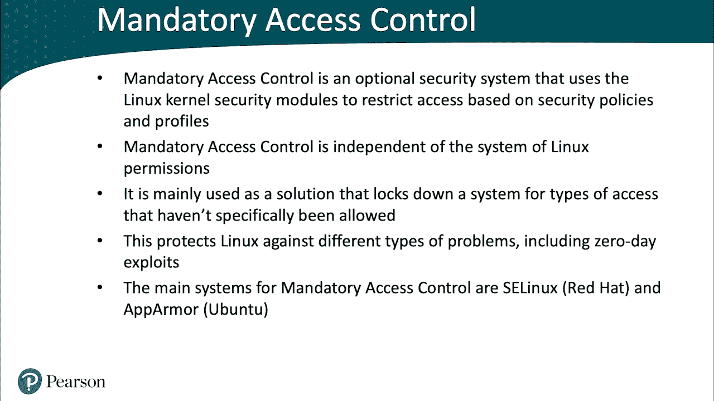

# 🔒 CompTIA Linux+ V8: 233: 强制访问控制 Mandatory Access Control


在本节课中我们将学习强制访问控制，也就是 Mandatory Access Control，通常缩写为 MAC。强制访问控制是 Linux 系统里一种可选的安全机制，它借助内核安全模块，根据安全策略和配置文件来限制用户和进程对资源的访问。这节课我们会先聊聊 MAC 是什么，为什么 Linux 需要它，然后看看它和我们平时用的文件权限有什么区别，再讲讲它是怎么帮助系统抵御未知威胁的，最后介绍目前常见的两种实现方式。


## 什么是强制访问控制

强制访问控制是一个可选的安全系统。它不属于必须安装的组件，但可以加在系统上提供额外的保护。它的工作原理是调用 Linux 内核安全模块，读取预先定义好的安全策略和配置文件，然后决定某个请求是否可以通过。简单来说，系统不会凭直觉放行，而是严格按照事先写好的规则来处理访问请求。

以下是描述访问决策的核心公式：

```text
访问决策 = 安全策略 + 配置文件 + 内核安全模块
```

这个公式的意思是，系统要判断一个访问请求能不能通过，需要结合三样东西：一是安全策略，二是配置文件，三是内核安全模块。缺一不可，最终结果才会生效。搞清楚这个公式后，我们再来看看 MAC 是为什么被提出来的。


## 为什么 Linux 需要强制访问控制

在强制访问控制出现之前，Linux 的安全设计并没有从整体角度来考虑。早期的开发者更多是关注操作系统的不同组件，比如文件系统、网络栈、进程管理等等，各自为政，缺乏一个统一的安全视角。这种分散的设计方式导致系统在面对复杂攻击时，容易出现防护盲区。

为了解决这个问题，强制访问控制被引入到 Linux 中。它提供了一种集中的方式来管理访问限制，不再让每个组件各自打理安全事务，而是由内核层面的安全模块统一把关。有了这个背景，接下来我们看看 MAC 和日常使用的 Linux 权限之间有什么关系。


## 强制访问控制与普通 Linux 权限的关系

强制访问控制是独立于系统原有 Linux 权限的，两者会同时生效。也就是说，当一个用户或进程想要访问某个资源时，系统会先检查普通权限，再检查强制访问控制规则。如果任何一方拒绝了请求，那么访问就不会被允许。

这里有个关键点：强制访问控制不会覆盖或者改变普通权限的决定。如果普通权限已经说不行，强制访问控制也不会说可以。

以下公式展示了两者共同作用的方式：

```text
最终允许 = 普通权限允许 AND 强制访问控制允许
```

这个 AND 关系意味着，只有当两边都同意时，访问才会成功。只要一边说不，整个请求就会被拒绝。了解了权限之间的关系后，我们继续看 MAC 具体是怎么保护系统的。


## 强制访问控制如何保护系统

强制访问控制主要用来给系统加锁，只允许那些明确被许可的访问类型，其他没有明确允许的访问全部拒绝。这种策略可以保护 Linux 免受多种问题的影响，其中包括零日漏洞利用。

零日漏洞利用是指应用程序中尚未被发现的未知问题。因为开发者和安全人员都不知道这个问题的存在，所以很难提前打补丁或者写规则去防御。强制访问控制的思路就是拒绝意外行为，只允许明确允许的行为。即使攻击者利用了一个未知漏洞，只要它试图执行的操作不在允许列表里，就会被阻止。

以下公式总结了这种防御逻辑：

```text
允许行为 = 明确允许的行为列表
```

换句话说，所有不在列表里的行为，默认都是不允许的。这比起传统的“默认允许，只有明确禁止的才拒绝”要安全得多。讲完防御原理，最后我们介绍一下目前常用的两种实现系统。


## 主流的强制访问控制系统

目前 Linux 社区中主要有两种强制访问控制系统被广泛使用。

以下是这两种系统的简要介绍：

- SELinux：主要用于 RedHat 系列发行版，功能强大但配置相对复杂。
- AppArmor：主要用于 Ubuntu 系列发行版，配置相对简单，上手更容易。

这两个系统虽然实现方式不同，但目标一致，都是在内核层面限制程序的行为，防止未授权的访问和操作。




## 总结


本节课中我们一起学习了强制访问控制的基本概念，了解了它为什么会出现，以及它和普通 Linux 权限之间的关系。我们还讨论了零日漏洞是什么，强制访问控制如何通过拒绝意外行为来保护系统，最后介绍了 SELinux 和 AppArmor 两个主要系统。希望这些内容能帮助你建立对 Linux 高级安全机制的初步认识。

