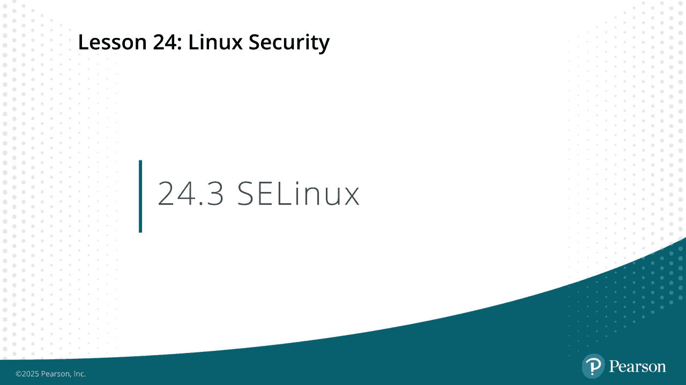
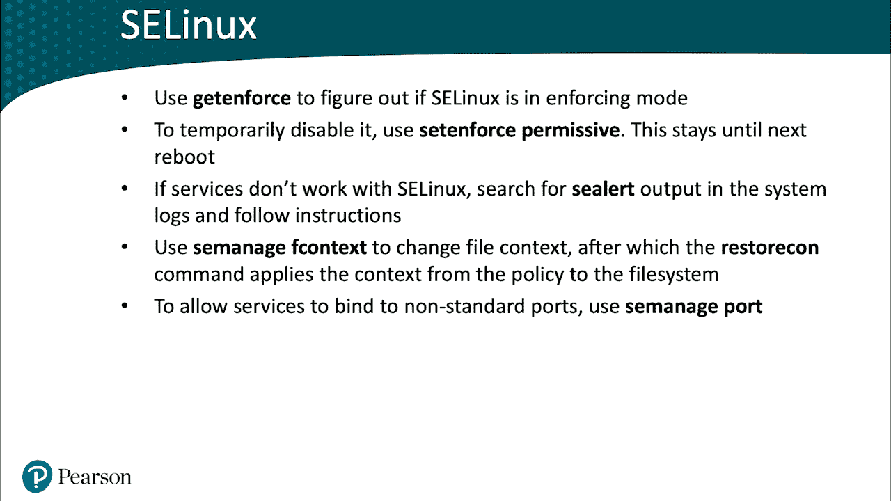
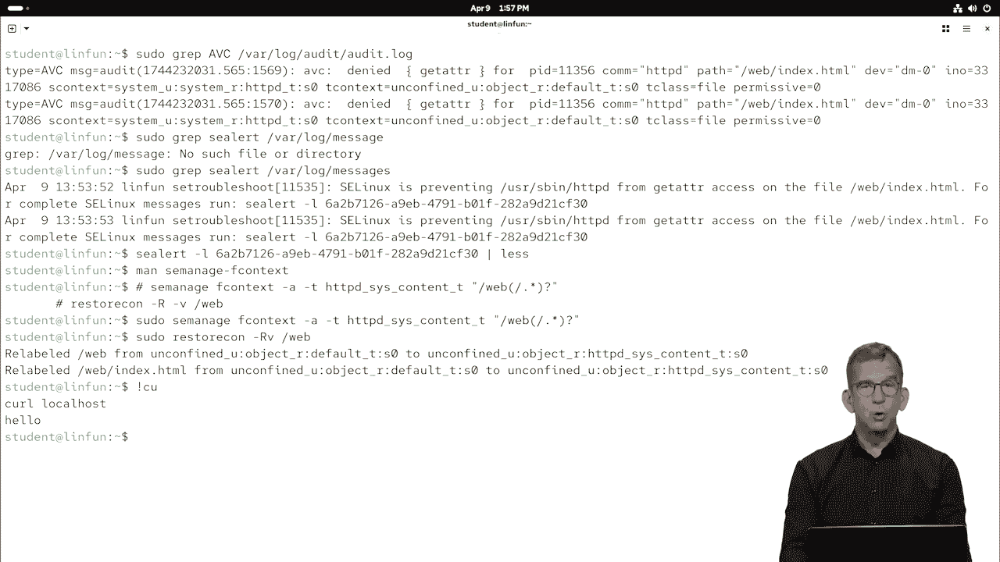

CompTIA Linux+ V8：34：SELinux基础入门 🛡️



在本节课中我们将要学习SELinux的基础知识。SELinux是Linux系统中的安全模块，它通过上下文标签来控制进程对文件的访问权限。即使你是初学者，也不用担心，我们会用大白话把每一个概念讲清楚，并且会配合实际操作演示来帮助你理解。SELinux的内容其实非常多，平台上甚至有五个小时的专门课程，但那对于现在来说太多了，所以本节课只做一个快速入门演示，让你了解最常用的几个要点。

### 1. SELinux是什么及其工作原理 🛡️

首先，我们来看看SELinux到底是做什么的。SELinux的全称是安全增强型Linux。它的核心工作机制是基于上下文来定义策略规则。简单来说，SELinux会给系统里的每一个进程和每一个文件都贴上一个标签，这个标签就是上下文。当一个进程想要访问一个文件时，SELinux会检查这两个标签是否满足策略中的规则。如果满足，就允许访问；如果不满足，就会拒绝访问。这种机制可以防止被攻破的进程随意读写系统中的任意文件，从而提升系统安全性。你可以把SELinux想象成一个严格的门卫，它只凭身份证上的标签来决定谁能进哪个房间。

访问决策可以用下面的逻辑来表示：

```
访问决策 = 策略规则匹配(进程标签, 文件标签, 请求操作)
```

如果规则匹配成功，访问被允许；否则访问被拒绝。

接下来，我们来看看SELinux默认策略里关于网页服务器的设置。

### 2. 默认策略与HTTPD访问 🌐

接下来，我们来看看SELinux默认策略里关于网页服务器的设置。SELinux自带的默认策略非常丰富，它预先定义好了许多常见服务的访问权限。以Apache网页服务器为例，默认情况下HTTPD进程被允许访问位于`/var/www`目录下的文档根目录。在这里，HTTPD进程使用的上下文类型是`httpd_t`，而文档根目录及其下的文件也需要对应的上下文类型，通常是`httpd_sys_content_t`。如果访问被SELinux阻止，系统会把相关信息发送到审计系统。你可以使用命令在审计日志中查找这些拒绝记录。同时，你可以使用`getenforce`命令查看SELinux当前运行的模式，如果显示`Enforcing`，表示SELinux正在强制执行策略。

常用命令如下：

```
查看审计日志：grep AVC /var/log/audit/audit.log
查看当前模式：getenforce
```

有时候出于故障排查的需要，我们可能需要临时调整SELinux的运行模式。

### 3. 临时禁用SELinux ⏸️

本节我们介绍如何在遇到问题时临时关闭SELinux的强制执行。如果你怀疑某些问题是由SELinux引起的，可以暂时将其切换到宽容模式，也就是Permissive模式。在这种模式下，SELinux不会真的阻止操作，但仍然会记录下本会被阻止的行为。需要注意的是，如果你不手动切换回来，这个设置会一直保持到系统下一次重启为止。因此，排查完问题后，记得把它改回强制模式，以免系统长期处于缺乏保护的状态。临时禁用只是为了排查故障，不建议长期保持宽容模式。

当服务因为SELinux而无法正常运作时，我们该如何找到具体原因呢？

### 4. 服务异常时的排查 🔍

下面我们来看看服务异常时的排查方法。如果某些服务在SELinux开启的情况下无法正常工作，你可以在系统日志中搜索SELinux的警报输出。系统日志里会包含有用的信息，告诉你哪个进程试图访问哪个资源，以及为什么被拒绝。根据这些提示，你可以按照系统给出的指示进行后续处理，找到问题的根源。查看日志是排查SELinux问题的第一步，也是最重要的一步。

接下来，我们重点介绍如何手动设置文件的上下文标签。

### 5. 设置文件上下文标签 🏷️




这一节我们学习如何为文件设置正确的上下文标签。SELinux的核心就是上下文标签。如果你需要修改某个文件或目录的上下文，可以使用`semanage fcontext`命令来更改文件上下文类型。执行完这个命令之后，还需要使用`restorecon`命令，把策略中定义的上下文真正应用到文件系统上。只有两步都完成，新的标签才会生效。单独运行其中一条命令通常不足以让更改立即生效。

相关命令如下：

```
修改文件上下文规则：semanage fcontext -a -t 类型 路径
应用上下文到文件系统：restorecon -Rv 路径
```

除了文件访问，SELinux还控制进程对网络端口的绑定。

### 6. 非标准端口绑定 🔌

下面我们看看如何允许进程绑定到非标准端口。默认情况下，SELinux限制进程只能使用标准端口。如果你想让某个服务监听一个非标准端口，就需要使用`semanage port`命令来告诉SELinux这个端口是允许的。否则，即使你在服务配置里写对了端口号，SELinux也可能会拒绝该进程绑定到该端口，导致服务无法启动或无法接受连接。

相关命令如下：

```
管理端口策略：semanage port -a -t 类型 -p 协议 端口号
```

理论部分讲完了，现在我们进入实际演示环节，看看在真实系统中SELinux是如何工作的。

### 7. 实战演示：Apache与自定义文档根目录 🖥️

本节我们通过一个实际案例，演示SELinux对Apache的访问控制。假设我们要修改Apache的文档根目录，把它从默认的位置改成`/web`目录。首先，我们需要确认Apache进程已经在运行。可以使用`ps ax | grep httpd`命令来查看Apache进程。如果想在输出中看到SELinux相关的信息，可以给`ps`命令加上大写的`Z`选项。加上这个选项后，输出里会显示进程的安全上下文。我们真正关心的是其中的下划线T部分，也就是上下文类型。其他部分比如用户和角色，在日常操作中通常不需要关注，暂时可以忽略。

常用命令如下：

```
查看Apache进程：ps ax | grep httpd
显示SELinux信息：ps axZ | grep httpd
```

接下来，我们看看Apache默认能访问哪些目录。

### 8. 查看默认目录上下文 📂

下面我们检查Apache默认有权访问的目录及其上下文标签。使用`ls -Z /var/www`命令，我们可以查看`/var/www`下面各个子目录的默认上下文标签。你会发现，`html`目录的上下文类型是`httpd_sys_content_t`，而`cgi-bin`目录的上下文类型是`httpd_sys_script_exec_t`。这意味着，如果你想从某个目录运行CGI脚本，那个目录必须拥有对应的特定上下文标签，否则SELinux不会允许Apache执行里面的脚本。只要你使用的是标准功能，SELinux通常都能正常工作，不需要额外配置。但如果你打算修改默认行为，比如更改文档根目录，就需要手动处理上下文标签了。

相关命令和类型如下：

```
查看目录上下文：ls -Z /var/www
html目录类型：httpd_sys_content_t
cgi-bin目录类型：httpd_sys_script_exec_t
```

现在我们要修改Apache的配置文件，把文档根目录改为`/web`。

### 9. 修改Apache配置 ⚙️

下面我们来修改Apache的主配置文件。Apache的主配置文件位于`/etc/httpd/conf/httpd.conf`。在这个文件中，找到`DocumentRoot`指令，把它的值改为`/web`。修改完成后，你还需要确保Apache知道这个变化，否则Apache会拒绝对新目录的访问。修改配置文件只是告诉Apache去哪里找网页文件，但并不会自动处理SELinux的权限问题，这一点非常重要，很多初学者容易在这里踩坑。

配置文件和修改内容如下：

```
配置文件路径：/etc/httpd/conf/httpd.conf
修改内容：DocumentRoot /web
```

配置修改好之后，我们需要创建新的文档根目录并放入测试文件。

### 10. 创建测试目录与文件 📄

本节我们创建`/web`目录，并往里面放一个简单的网页文件。使用`mkdir`命令创建`/web`目录，然后用`ls -lzd /web`命令查看这个目录的详细信息和上下文标签。你会看到，新建目录的默认上下文类型通常是`default_t`。这在SELinux策略里会成为一个大问题。因为SELinux策略中有一条规则允许`httpd_t`类型的进程访问类型为`httpd_sys_content_t`的目标，但是没有规则允许`httpd_t`访问类型为`default_t`的目标。如果允许这样的访问，Apache就可以读写系统上的任意文件，这违背了SELinux设计的初衷。接下来，我们在`/web`目录下创建一个简单的`index.html`文件，用来测试访问。

相关命令如下：

```
创建目录：mkdir /web
查看目录信息：ls -lzd /web
创建测试文件：sudo sh -c 'echo ... > /web/index.html'
```

文件准备好之后，我们重启Apache并测试访问。

### 11. 重启服务与测试访问 🔄

下面我们重启Apache，并用curl测试是否能正常访问。修改完配置并创建好文件后，需要使用`systemctl restart httpd`命令重启Apache进程，让它加载新的配置。然后使用`curl localhost`来快速测试。你会发现，测试失败了，Apache没有正确显示新的文档根目录内容。这时，我们需要去查看系统日志，找出失败的具体原因。不要慌张，这正是SELinux在正常工作，它阻止了不符合策略的访问。

相关命令如下：

```
重启Apache：systemctl restart httpd
测试访问：curl localhost
```

访问失败后，我们需要分析审计日志，看看SELinux到底拒绝了什么操作。

### 12. 查看审计日志拒绝记录 📜

本节我们分析SELinux拒绝访问的日志记录。使用`sudo grep AVC /var/log/audit/audit.log`命令，你可以看到审计日志中关于访问被拒绝的记录。日志会显示，Apache进程被拒绝访问`index.html`文件。原因在于，源进程的上下文类型是`httpd_t`，而目标文件的上下文类型是`default_t`，这两个类型之间的访问在策略中是不被允许的。这就是权限被拒绝的根本原因。

查看审计日志的命令如下：

```
查看审计日志：sudo grep AVC /var/log/audit/audit.log
拒绝信息：源=httpd_t，目标=default_t，操作=拒绝
```

除了直接查看审计日志，我们还可以使用sealert工具来获取更友好的分析信息。

### 13. 使用sealert分析拒绝原因 📊

下面我们介绍如何使用sealert来辅助分析。你也可以使用`sudo grep sealert /var/log/messages`命令，或者通过`journalctl`查看日志，同样能找到SELinux的拒绝信息。sealert会给出一段总结性的说明，并且有时会附带一条建议执行的命令。你可以把这条命令复制下来，通过`less`命令查看详细解释。有时候解释很有帮助，有时候则不太够用。sealert可能会告诉你需要修改`/web/index.html`的标签，但给出的标签选项可能有六个屏那么多，让人难以选择。尽管如此，你仍然应该始终查看警报输出，因为有时候它提供的信息非常准确且有用。

既然知道了问题出在标签上，接下来我们来修复`/web`目录的上下文标签。

### 14. 修复文件上下文标签 🛠️

本节我们修复`/web`目录及其内容的上下文标签。我们需要确保`/web`目录及其内部的所有内容都拥有合适的上下文标签。最好的方法是查看`semanage fcontext`的帮助页面。在这里，我们可以看到需要执行的操作。使用`semanage fcontext -a -t httpd_sys_content_t`命令，并指定路径为`/web`。命令后面跟着的奇怪写法其实是一个正则表达式，它的作用是确保上下文标签不仅应用到`/web`目录本身，也应用到目录内部可能存在的所有文件和子目录。然后，使用`restorecon -Rv /web`命令，把新的上下文标签应用到文件系统中。完成这些步骤后，如果我们再次运行之前的curl命令，就会发现这次访问成功了。

相关命令如下：

```
添加上下文规则：semanage fcontext -a -t httpd_sys_content_t "/web(/.*)?"
应用新标签：restorecon -Rv /web
验证访问：curl localhost
```

到这里，我们的SELinux五分钟快速入门演示就结束了。



本节课中我们一起学习了SELinux的基础概念，包括上下文标签、默认策略、审计日志、强制模式与宽容模式的区别，以及如何使用`semanage fcontext`和`restorecon`来修复文件上下文。我们还通过一个Apache修改文档根目录的实例，完整演示了从配置修改、权限拒绝到日志分析、最后修复标签的全过程。希望这篇教程能帮助你初步理解SELinux的工作原理，并在实际操作中避免常见的权限问题。
