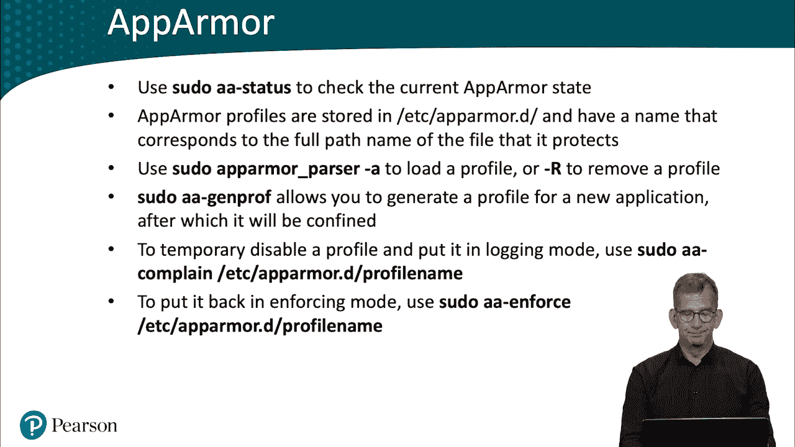
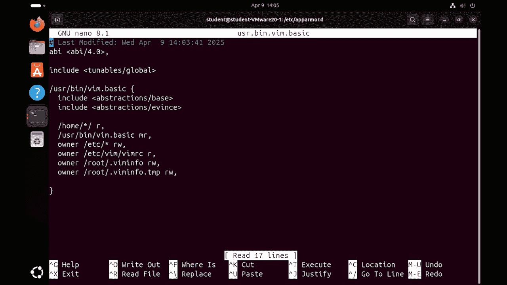

# 🛡️ CompTIA Linux+ V8：235：AppArmor 基础操作

在本节课中，我们将学习 Linux 系统中的 AppArmor 安全模块。AppArmor 是一种强制访问控制机制，它可以为每个应用程序定义访问规则，从而限制程序能够访问哪些文件和资源。我们会先了解它的基本原理，然后学习如何查看当前的配置状态，接着介绍常用的管理命令，最后通过一个真实的示例，演示如何为 Vim 编辑器创建并调整自己的安全配置文件。通过这些内容，你将掌握 AppArmor 的日常使用方法。

在学习具体操作之前，我们先来搞清楚 AppArmor 到底是做什么的。

AppArmor 是 Linux 内核中的一个安全模块，它的作用就像给每个应用程序穿上一件“防护衣”。当一个程序运行时，AppArmor 会检查这个程序是否有对应的配置文件，如果有，程序就只能按照配置文件里写的规则运行，超出规则的操作会被阻止；如果没有配置文件，程序就可以随意做任何事情，系统不会进行限制。这种机制可以防止被攻击的程序随意修改系统文件或泄露敏感数据。

所有的 AppArmor 配置文件都存放在系统的 `/etc/apparmor.d` 目录下，每个配置文件的名称都对应它所保护的程序的完整路径名。只有当一个应用程序拥有 AppArmor 配置文件时，它才会受到保护，否则它可以做它想做的任何事情。

了解了 AppArmor 的基本概念之后，接下来我们来看看如何查看系统当前的 AppArmor 运行状态。

最简单的方法是使用 `sudo aa-status` 命令。执行这条命令后，系统会显示当前处于强制模式的所有配置文件。这些配置文件是真正生效的规则，意味着对应的服务正在受到 AppArmor 的保护。你可以看到有些服务出现在列表中，而很多服务并没有出现，说明它们还没有配置文件或者没有启用保护。

查看状态只是第一步，实际工作中我们还需要知道如何加载、移除以及生成配置文件，下面是几个最常用的命令。

以下是常用的 AppArmor 管理命令及其用途：
- `sudo apparmor_parser -a <配置文件路径>`：加载一个新的 AppArmor 配置文件。
- `sudo apparmor_parser -R <配置文件路径>`：移除一个已加载的配置文件。
- `aa-genprof <程序路径>`：为新应用程序生成配置文件，会记录程序运行时的行为并生成规则。
- `aa-complain <配置文件名称>`：将配置文件临时切换到投诉模式（日志模式），只记录违规行为而不阻止，方便优化规则。
- `aa-enforce <配置文件名称>`：将配置文件切换回强制模式，开始真正阻止违规操作。

命令介绍完了，接下来我们通过一个实际的例子，来看看如何为 Vim 编辑器创建自己的 AppArmor 配置文件。

首先，我们需要确认系统中是否安装了生成配置文件所需的工具。如果发现 `aa-genprof` 命令找不到，可以使用 `apt search apparmor` 查找相关软件包，然后使用 `apt install` 进行安装。工具准备好之后，就可以使用 `sudo aa-genprof /usr/bin/vim` 为 Vim 生成配置文件了。

在这个过程中，你不需要一直盯着屏幕，而是应该开始正常使用 Vim。实际使用中，建议尽可能多地使用程序的各种功能，这样生成的规则才更完整。不过为了演示方便，我们只做简单操作：用 Vim 打开 `/etc/motd` 文件，写入一些内容，然后保存退出。

当 Vim 运行时，AppArmor 会捕获程序尝试执行的操作，并询问你是否允许。你可以按 `S` 查看所有发生的事件，系统会列出程序创建或修改的文件，比如 `vim.info.tmp`，并询问是否允许。如果你选择允许，Vim 就可以对 `/etc/motd` 执行写入操作。

在继续之前，请思考一下允许操作的后果。如果只允许写入 `/etc/motd`，那么 Vim 只能修改这一个文件。如果你希望 Vim 可以写入 `/etc` 目录下的所有文件，可以选择 `G` 选项，这表示允许写入 `/etc` 目录中的所有内容。演示中我选择 `A` 表示允许第二个操作，之后会陆续遇到更多提示，我直接选择尽可能多地允许，以确保程序可以正常运行。我也会同意允许读取主目录下的所有内容，之后按 `S` 保存更改，按 `F` 完成配置，最终生成名为 `/usr/bin/vim.t.basics` 的配置文件。

配置文件生成之后，我们需要确认它是否真的生效，并且了解当程序违规时 AppArmor 会如何表现。

可以使用 `sudo aa-status | grep -C 5 vim` 命令来检查 Vim 的配置文件是否已经激活。这里使用了 `-C5` 参数，这样可以显示匹配行之前和之后各五行的上下文，方便我们确认配置状态。

接下来，我们尝试用 `sudo vim /root/hello` 创建一个新文件，按 `i` 进入插入模式并输入文字。这时你会收到“无法打开文件进行写入”的错误提示。这就是 AppArmor 配置文件在发挥作用，它阻止了 Vim 访问未授权的路径。

如果你想知道具体发生了什么，需要去 `/etc/apparmor.d` 目录下查看对应的配置文件。这里可以找到 `/usr/bin/vim.t.basics`，使用 `sudo nano` 打开它就能看到里面的规则。这是一个非常简单的配置，从现在起允许 Vim 读取主目录，读写 `/etc` 目录下的任何内容，以及一些其他文件。

在实际工作中，这只是开始。你会继续使用 Vim，分析它尝试访问的资源，然后不断修改配置文件，直到它完全按照你想要的方式运行。这就是使用 AppArmor 的核心流程。

本节课中，我们一起学习了 AppArmor 的基本原理，了解了配置文件存放在 `/etc/apparmor.d` 目录下，掌握了 `sudo aa-status`、`apparmor_parser`、`aa-genprof`、`aa-complain` 和 `aa-enforce` 等常用命令，并通过为 Vim 创建自定义配置文件的实战演示，学会了如何生成、验证和调试 AppArmor 规则。希望这些内容能帮助你更好地保护 Linux 系统上的应用程序。
