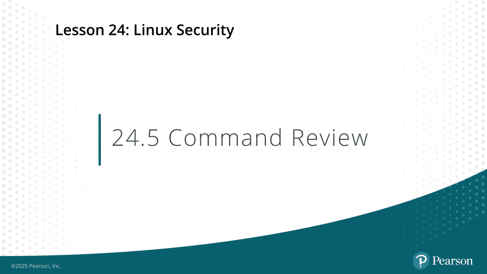
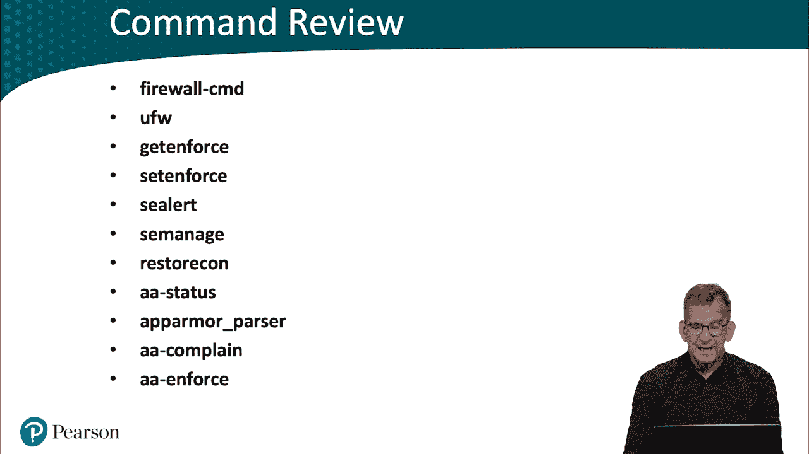

# CompTIA Linux+ V8：第36课：命令复习（防火墙与强制访问控制）🛡️

在本节课中我们将要学习 Linux 系统中防火墙管理与强制访问控制的常用命令。内容涵盖 Red Hat 系统上的 firewalld、Ubuntu 系统上的 UFW，以及 SELinux 和 AppArmor 的模式查看、切换与故障排查方法。每一条命令都会用大白话解释清楚，方便初学者快速上手。即使你以前没有接触过这些安全工具，也能通过本节课快速了解它们的基本用法。


## 防火墙管理命令 🧱


上一节我们介绍了基本的网络安全概念，本节中我们来看看防火墙怎么管理。不同的发行版使用不同的防火墙工具，Red Hat 家族通常使用 firewalld，而 Ubuntu 家族通常使用 UFW。防火墙的作用就像是一道门禁，决定哪些网络流量可以进来，哪些流量必须被拦截在外面。

以下是常见防火墙管理命令：



- Red Hat 系统防火墙管理工具：firewalld
- Ubuntu 系统防火墙管理工具：UFW

```bash
# Red Hat 系统示例
firewall-cmd --state

# Ubuntu 系统示例
ufw status
```


## SELinux 模式查看与切换 🔐

刚才我们聊了防火墙，接下来继续看 SELinux。SELinux 是一种强制访问控制机制，它会限制程序能做什么，哪怕程序运行在 root 权限下也是如此。了解怎么查看和切换 SELinux 模式，是排查权限问题的第一步。

getenforce 是用来显示当前 SELinux 模式的命令，setenforce 则允许你切换 SELinux 的运行模式。

以下是两个核心命令的说明：

- getenforce：查看当前 SELinux 处于 Enforcing、Permissive 还是 Disabled 状态
- setenforce：切换 SELinux 模式，例如从 Enforcing 切换到 Permissive

```bash
getenforce
setenforce 0
setenforce 1
```

核心概念可以用下面这个简单的代码块来表示：

```
当前模式 = getenforce 的输出结果
目标模式 = setenforce 执行后生效的新模式
```


## SELinux 审计与上下文恢复 🧹

在知道了怎么查看和切换 SELinux 模式之后，实际工作中更常遇到的是 SELinux 挡住了某个程序，导致服务无法启动。这时候你需要知道 SELinux 到底拦截了什么，以及怎么恢复正常。排查思路通常是先看日志，再修改或恢复文件的安全上下文。

sealert 是用来分析 SELinux 拦截记录的工具，它能告诉你被拦截了什么，并给出恢复建议。chcon 和 restorecon 是用来修改或恢复文件安全上下文的命令。

以下是常用排查命令：

- sealert：查看 SELinux 阻塞日志并获得修复提示
- chcon：手动修改文件或目录的 SELinux 安全上下文
- restorecon：将文件或目录的安全上下文恢复到默认策略

```bash
sealert -a /var/log/audit/audit.log
chcon -t httpd_sys_content_t /var/www/html
restorecon -Rv /var/www/html
```

这些命令组合在一起，就像是给系统做一次体检，找出哪里被 SELinux 挡住了，再把它放回正确的轨道上。


## AppArmor 状态与模式管理 🛠️

说完了 SELinux，我们转向另一个常见的强制访问控制工具 AppArmor。AppArmor 主要在 Ubuntu 和 Debian 系统中使用，它通过配置文件来限制程序能访问哪些资源。掌握 AppArmor 的状态查看和模式切换，可以帮你更好地保护系统安全。

aa-status 用于查看当前 AppArmor 的运行状态以及加载了哪些配置文件。AppArmor 解析器则是一个比较容易使用的接口，用于加载和管理 AppArmor 配置文件。

以下是 AppArmor 相关命令：

- aa-status：显示当前 AppArmor 状态和已加载的配置文件
- apparmor_parser：加载或重新加载 AppArmor 配置文件
- aa-complain：将指定程序设置为投诉模式，只记录违规行为而不阻止，适合生成配置文件
- aa-enforce：将指定程序设置为强制模式，真正阻止违规行为，确保 AppArmor 完全启用

```bash
aa-status
apparmor_parser -r /etc/apparmor.d/
aa-complain /usr/bin/firefox
aa-enforce /usr/bin/firefox
```

两种模式的关系可以用下面这段代码块来理解：

```
投诉模式 = 只记录不拦截
强制模式 = 记录并拦截
```




## 本节总结 📝

本节课中我们一起学习了 Red Hat 和 Ubuntu 上的防火墙管理命令，掌握了 getenforce 与 setenforce 用于查看和切换 SELinux 模式，学会了用 sealert、chcon 和 restorecon 来排查 SELinux 拦截问题，还了解了 aa-status、apparmor_parser、aa-complain 与 aa-enforce 这几个 AppArmor 管理命令。希望这些内容能帮助你更好地理解 Linux 系统中的访问控制机制。
