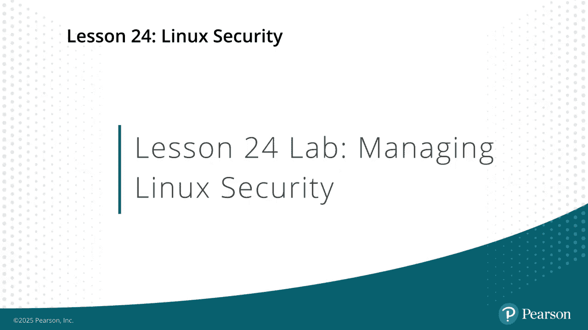
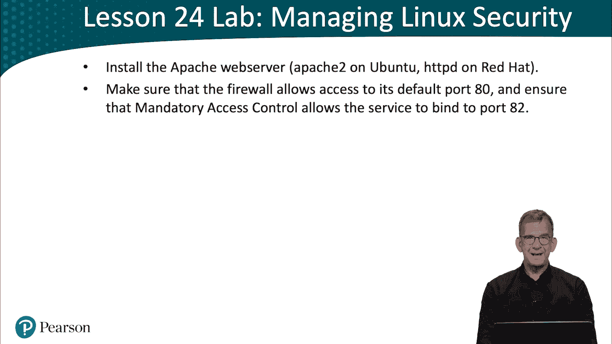

# 🖥️ CompTIA Linux+ V8：Lesson 24：Managing Linux Security Lab

在本节课中我们将要学习如何在 Linux 系统上管理 Web 服务器的安全设置。具体来说，我们会动手安装 Apache Web 服务器，然后检查防火墙和强制访问控制是否放行了相关端口。这是一个实验课，适合刚接触 Linux 网络服务的新手跟着操作一遍。

## 📦 第一步：安装 Apache Web 服务器

好了，上面说了要做实验，那我们从安装 Web 服务器开始吧。这是整个实验的第一步，没有 Web 服务器就谈不上后面的端口和安全配置。


不同的 Linux 发行版对软件包的命名习惯不太一样，所以安装 Apache 的命令也会有所区别。在 Ubuntu 系统上，这个软件包通常叫做 apache2；而在 Red Hat 系列系统（比如 CentOS、Fedora、RHEL）上，它叫做 httpd。你可以根据自己正在使用的系统选择对应的命令来安装。

```bash
# Ubuntu/Debian 系统
sudo apt update
sudo apt install apache2

# Red Hat/CentOS 系统
sudo yum install httpd
# 或者
sudo dnf install httpd
```



安装好 Web 服务器之后，下一步得让外部用户能够访问它。这时候就要涉及防火墙设置了，否则请求根本到不开服务器。

## 🔥 第二步：配置防火墙开放端口 80

Apache Web 服务器默认使用 80 号端口来提供 HTTP 服务。这就像是一栋大楼的大门，如果门锁着，外面的人进不来，网站自然无法访问。所以我们需要告诉系统防火墙，允许流量通过 80 号端口。

防火墙放行条件：`端口 = 80` 且 `协议 = TCP` 且 `动作 = 允许`

以下是常见防火墙工具的操作命令：

- ufw（Ubuntu 常用）：`sudo ufw allow 80/tcp`
- firewalld（Red Hat 常用）：`sudo firewall-cmd --add-port=80/tcp --permanent` 然后执行 `sudo firewall-cmd --reload`
- iptables：`sudo iptables -A INPUT -p tcp --dport 80 -j ACCEPT`

防火墙设置好之后，还有另一道安全层需要检查，那就是强制访问控制。有些系统默认会限制服务绑定到某些端口，即使防火墙开了也可能不行。

## 🛡️ 第三步：配置强制访问控制允许绑定端口 82

强制访问控制（Mandatory Access Control，简称 MAC）是一种比普通文件权限更严格的安全机制。在 Linux 上最常见的实现是 SELinux。它会决定哪些进程可以访问哪些资源，包括网络端口。原文中提到要确保服务能够绑定到端口 82，这通常是指在特定配置下让 Apache 监听非默认端口，或者实验中特意设定的一个测试端口。无论如何，核心思想是：MAC 策略不得阻止服务占用所需的网络端口。

SELinux 端口绑定检查命令：
```bash
# 查看 httpd 当前允许绑定的端口
sudo semanage port -l | grep http

# 允许 httpd 绑定到 82 号端口（示例）
sudo semanage port -a -t http_port_t -p tcp 82
```

处理强制访问控制时，通常需要注意以下几点：



- 检查当前 SELinux 模式：`getenforce`
- 如果是强制模式（Enforcing），策略会阻止未授权的端口绑定
- 使用 semanage 工具永久添加允许的端口类型
- 修改后重启服务使配置生效：`sudo systemctl restart httpd` 或 `sudo systemctl restart apache2`

本节课中我们一起学习了如何在 Linux 上安装 Apache Web 服务器，如何让防火墙放行默认端口 80，以及如何配置强制访问控制让服务绑定到指定端口。这三个步骤是让 Web 服务正常对外运行的基础，希望你能动手实践一遍，加深理解。
