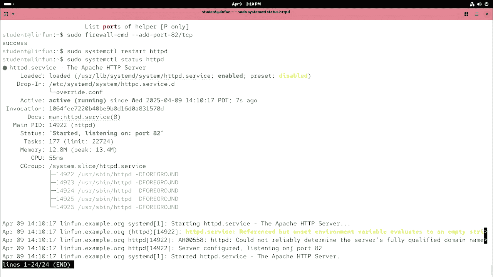

# CompTIA Linux+ V8：第24课：管理 Linux 安全实验解答 🔐

在本节课中，我们将一起学习如何完成管理 Linux 安全的实验任务。具体来说，我们会修改 Web 服务器的监听端口，配置防火墙允许新端口通过，最后重启服务并检查运行状态。这节课适合初学者，所有的命令都会用大白话解释清楚，跟着操作一遍就能掌握基本思路。如果你之前没有接触过 Apache 配置文件或防火墙规则，也不用担心，我们会一步一步来，把每个命令背后的意思都讲明白。


## 1. 打开 Web 服务器配置文件 🖥️

上一节我们介绍了 Linux 基础安全概念，本节中我们来看看如何在实验环境中实际操作。首先，我们需要进入系统，使用文本编辑器打开 Apache Web 服务器的配置文件。这个文件通常位于 `/etc/httpd/conf/httpd.conf`，里面定义了 Web 服务器的运行参数，比如监听哪个端口、允许哪些目录访问等等。

以下是打开配置文件的常用方式：

```bash
sudo vim /etc/httpd/conf/httpd.conf
```

使用 `sudo` 是因为修改系统配置文件需要管理员权限。如果你不熟悉 Vim，可以把它理解为一种在终端里直接编辑文本的工具，打开后就可以用键盘浏览和修改文件内容了。打开文件之后，不要急着改动，先花一点时间熟悉一下里面的结构。


## 2. 修改监听端口 📡

在配置文件打开之后，接下来我们要找到控制 Web 服务器监听端口的参数。默认情况下，Apache 通常监听 80 号端口，也就是普通 HTTP 流量的默认端口，大多数网站就是用这个端口提供服务。

在文件中向下查找，你会看到类似下面这一行：

```
Listen 80
```

这行的意思是 Web 服务器目前只监听 80 号端口。为了完成实验要求，我们需要把它改成 82 号端口，修改后的内容如下：

```
Listen 82
```

保存文件并退出编辑器后，Web 服务器的配置就已经变更了，但此时服务还没有重新加载，所以暂时不会生效，还需要后续步骤来让新设置起作用。


## 3. 查看端口管理相关手册 📖

修改完监听端口之后，我们还需要知道如何让系统允许这个新端口通过。这时候可以使用 Linux 的手册页面来查找相关命令的用法，手册里通常会解释每个参数的含义，还会给出实际例子。

以下是查看命令帮助的常用方式：

```bash
man firewall-cmd
```

手册页面通常比较长，很多有用的示例都放在页面的末尾部分。你可以根据示例稍微修改一下命令，就能得到自己需要的参数格式。比如手册里可能会提到端口的通用写法是“端口号/协议”，这对我们下一步配置防火墙很有帮助，不用死记硬背语法。


## 4. 配置防火墙放行新端口 🧱

有了手册页面的参考后，下一步就是配置系统防火墙，把 82 号端口加入允许列表。如果不做这一步，外部请求就无法到达 Web 服务器，哪怕服务器本身已经在监听 82 号端口也没用。

以下是添加防火墙端口规则的命令：

```bash
sudo firewall-cmd --add-port=82/tcp
```

这条命令的意思是向防火墙添加一条规则，允许 TCP 协议的 82 号端口通信。执行成功后，Web 服务器就可以在端口 82 上接受连接了。需要注意的是，如果防火墙没有重新加载，规则可能不会立即生效，不过在这个实验场景中，这一步通常已经足够让新端口被系统认可。


## 5. 重启 Web 服务并验证状态 🔄

防火墙配置完成之后，我们还得让 Web 服务器重新读取配置文件，否则它还是会按旧设置运行，继续监听 80 号端口。最后还要检查服务是否真的在监听 82 号端口，确保实验目标达成。

以下是重启服务并查看状态的命令：

```bash
sudo systemctl restart httpd
sudo systemctl status httpd
```

第一条命令重启 Apache 服务，使新的监听端口生效。第二条命令用来查看服务当前的运行状态，如果输出里显示 `listening on port 82`，就说明配置成功，Web 服务器已经在 82 号端口上等待连接了。这时候实验的主要任务就全部完成了。




## 本节小结


本节课中，我们一起学习了如何管理 Linux 下的 Web 服务器安全设置。首先打开 Apache 配置文件，将监听端口从 80 改成 82；然后查阅手册页面了解端口参数格式；接着使用防火墙命令放行 82/tcp；最后重启 httpd 服务并通过状态命令确认它正在监听 82 号端口。按照这个顺序操作，你就能完成这节实验，掌握修改 Web 服务端口和配置防火墙的基本方法，为后续学习更复杂的网络安全内容打下基础。

