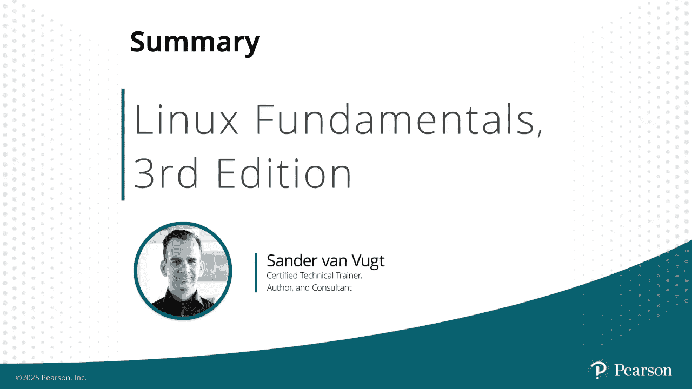
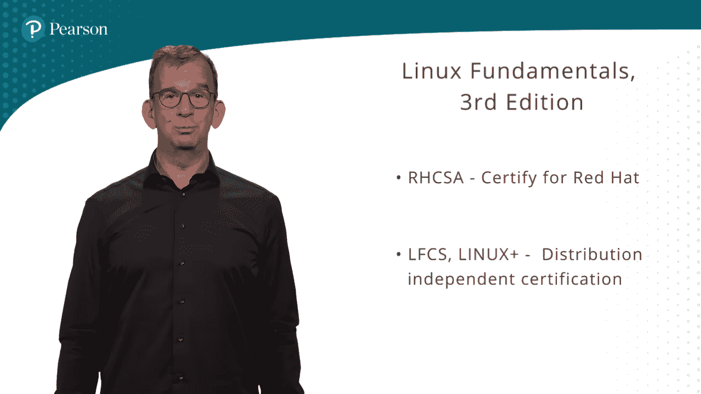

CompTIA Linux+ V8：p39：Linux 基础总结 🎓




在本节课中，我们将一起回顾整个 Linux 基础课程的学习情况，并听听讲师对学习者完成课程的祝福。这节课不介绍新的命令或配置，主要是课程的收尾部分。讲师会表达对学习者坚持到底的高兴，并推荐一些适合继续深造的 Linux 认证方向。如果你已经走到了这一步，说明你已经掌握了一些 Linux 的基础知识，接下来的内容会帮助你规划后续的学习路径。


我非常高兴看到你完成了这门课程。能够坚持学完所有内容，说明你对 Linux 操作系统有真正的兴趣，这本身就是一件很不容易的事情。学习操作系统需要花费时间和精力，你能够走到这里，已经证明了自己的学习能力和毅力。讲师希望你在学习过程中不仅收获了知识，也建立起对 Linux 的信心，为后续更深入的学习打下基础。


刚才我们聊了讲师对学员完成课程的祝福，接下来我们来看看，如果你觉得这门课有收获，可以考虑做些什么。


我希望你喜欢这门课程，并且从中学到了很多有用的东西。学习 Linux 并不是一件轻松的事情，涉及到很多概念和实际操作，如果你能够从课程中获得实际的帮助，那就是对讲师最大的鼓励。课程结束并不意味着学习结束，反而是一个新的起点，希望你能把所学的知识应用到实际的系统管理或开发工作中去。


如果说你希望继续在这个非常棒的操作系统上走得更远，那么可以去了解一下讲师为 Linux 认证准备的一些课程。这些课程专门针对不同的认证考试，能够帮助你系统地复习考试要点，提升通过率。无论你是想在企业中从事系统运维，还是想在云计算领域发展，拥有认证通常都是一个不错的加分项。


以下是讲师推荐的几个认证方向：

- RHCSA：面向 Red Hat 系统的认证，适合希望在 Red Hat 企业 Linux 环境中工作的人员。
- LFCCS：Linux 基金会提供的认证，适合希望证明基础 Linux 技能的学习者。
- Linux+：一个与发行版无关的认证，适合希望获得更通用 Linux 资格证书的人员。


你可以根据自己的职业目标来选择认证，示例如下：

```
如果目标是 Red Hat 认证:
    选择 RHCSA
否则如果目标是厂商无关认证:
    选择 LFCCS 或 Linux+
```


刚才我们介绍了几个常见的 Linux 认证方向，最后来看看讲师的结尾祝福。




我希望能够很快再见到你。学习 Linux 是一个长期的过程，完成这门课程只是其中一个阶段。未来如果你有新的学习计划，或者准备参加认证考试，欢迎继续关注相关课程。祝你在 Linux 的学习和工作中取得好成绩。


本节课中我们一起学习了 Linux 基础课程的总结内容。我们了解了讲师对完成课程学员的祝福，回顾了学习过程中的收获，并介绍了 RHCSA、LFCCS 和 Linux+ 等几个认证方向。希望这些内容能对你的 Linux 学习之路有所帮助。

