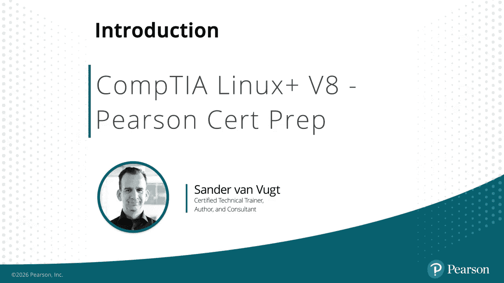
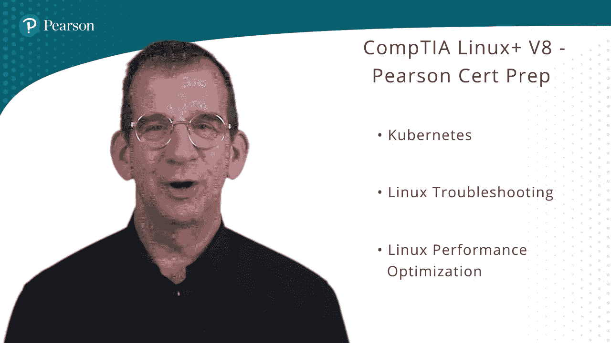

# CompTIA Linux+ V8 备考教程：01：课程概述与讲师简介 👋

在本节课中我们将要学习CompTIA Linux+ V8考试的全部考点，并了解这门课程的整体结构和讲师背景。



欢迎来到最新版本的CompTIA Linux+备考课程。我是Soov Avert，将担任本课程的讲师。这本课程涵盖考试中的每一个主题，专门帮助你备考并通过测试。课程内容会在你已有的Linux知识基础上逐步深入，让你从基础操作一步步掌握系统管理的核心技能。

接下来是讲师的个人介绍。讲师名字是Sora for Vert，他是一名讲师、作者和顾问，专精于Linux、Kubernetes和Ansible，居住在荷兰。他发布了60多门关于Linux相关话题的视频课程，其中包括红帽认证系统管理员、Linux内部原理、Linux+等畅销课程，也涵盖Kubernetes、Linux故障排除和Linux性能优化等更加进阶的话题。你可以把他当作一位在Linux领域有丰富实战经验的指导者。

讲师的专长领域可以用下面的代码来概括：

```text
Linux
Kubernetes
Ansible
```

相信你会喜欢这门课程，那么我们不再等待，立即开始学习。

本节课中我们一起学习了课程的整体目标以及讲师的专业背景。

# CompTIA Linux+ V8 备考教程：02：Module 1 用户、网络与 systemd 基础 👤

上一节我们介绍了课程概述与讲师背景，本节中我们来看看Module 1的具体内容。

Module 1完全围绕用户相关的管理任务展开，包含三个课时。这里的“用户”指的是在Linux系统中创建和维护账户，确保每个人只能使用自己该用的资源。

以下是Module 1包含的三个课程：

- Lesson 1：用户相关安全，学习如何保护用户账户和权限，防止未经授权的访问。
- Lesson 2：网络，学习Linux下的网络配置与管理，让计算机能够正常连接网络。
- Lesson 3：systemd高级部分，学习系统服务和守护进程的深度控制，理解系统后台是如何运行的。

在这些课程中，你会接触到一些常用的命令和工具：

```bash
useradd
usermod
ip addr
systemctl
journalctl
```

掌握了用户、网络和系统服务的基础知识后，我们接下来进入存储领域的学习。

本节课中我们一起学习了Module 1中关于用户安全、网络和systemd的基础内容。

# CompTIA Linux+ V8 备考教程：03：Module 2 存储与硬件管理 💾

上一节我们学习了用户、网络和systemd，本节中我们来看看Module 2关于存储的内容。

Module 2全面讲解存储及其相关设置。存储就是如何把数据保存在硬盘上，包括硬盘的识别、分区和文件系统的创建，这些都是Linux系统正常运行的基础。

以下是Module 2包含的三个课程：

- Lesson 4：硬件管理，学习识别和配置计算机硬件，确保系统能够正确使用磁盘和其他设备。
- Lesson 5：分区管理，学习如何把硬盘空间划分成不同的区域，方便数据分类存放。
- Lesson 6：文件系统，学习创建、挂载和维护文件系统，让操作系统能够读写数据。

在实际操作中，你会使用到以下命令：

```bash
lsblk
fdisk
mkfs.ext4
mount
/etc/fstab
```

存储基础打好之后，接下来我们将学习更多日常的系统管理任务。

本节课中我们一起学习了Module 2中关于硬件、分区和文件系统的管理。

# CompTIA Linux+ V8 备考教程：04：Module 3 日常系统管理任务 🛠️

上一节我们完成了存储模块的学习，本节中我们来看看Module 3的常见管理任务。

Module 3涵盖日常运维中最常见的几项工作，包括日志配置、性能监控、启动流程、备份恢复、用户界面以及故障排除。这些内容构成了Linux系统管理的日常工作核心。

以下是Module 3包含的主要课程：

- Lesson 7：在Linux环境中配置日志，学习查看系统日志文件，了解系统发生了什么。
- Lesson 8：监控系统性能，学习观察CPU、内存与系统负载，发现运行缓慢的原因。
- Lesson 9：管理启动流程，学习系统如何开机启动，掌控开机顺序。
- Lesson 10：管理文件压缩与备份，学习打包重要数据，防止意外丢失。
- Lesson 11：使用用户界面，学习图形界面与命令行的区别，选择适合的操作方式。
- Lesson 12：故障排除，学习解决在Linux工作中可能遇到的各种问题，提高解决问题的能力。

在学习过程中，你会反复使用下面这些工具：

```bash
/var/log
top
htop
systemctl enable
tar
dmesg
journalctl -xe
```

日常系统管理掌握之后，我们将进入服务器安全的学习阶段。

本节课中我们一起学习了Module 3中关于日志、性能、启动、备份、界面和故障排除的日常管理任务。

# CompTIA Linux+ V8 备考教程：05：Module 4 服务器安全管理 🔒

上一节我们学习了日常系统管理任务，本节中我们来看看Module 4关于服务器安全的内容。

Module 4专门讲解如何保护Linux服务器的安全。服务器通常直接面向网络，面临更多攻击风险，因此防火墙、访问控制和安全加固变得尤为重要。

以下是Module 4包含的主要课程：

- Lesson 13：Linux防火墙，学习控制进出服务器的网络流量，阻止非法连接。
- Lesson 14：一些通用的安全相关解决方案，学习基础安全加固，降低系统被攻击的概率。
- Lesson 15：管理垃圾邮件和tripleSD，学习过滤不需要的信息，保持系统环境清洁。
- Lesson 16：强制访问控制，学习限制程序对系统资源的访问权限，防止程序越权操作。

在服务器安全方面，你会接触到以下技术和工具：

```bash
firewalld
ufw
iptables
SELinux
AppArmor
```

安全体系建立之后，我们将进一步学习更高级的管理任务。

本节课中我们一起学习了Module 4中关于防火墙、安全加固和强制访问控制的服务器安全内容。

# CompTIA Linux+ V8 备考教程：06：Module 5 服务角色、容器与虚拟化 🐳

上一节我们完成了服务器安全模块，本节中我们来看看Module 5的高级管理任务。

Module 5聚焦一些更高级的系统管理工作，包括Linux服务的不同角色、容器技术以及虚拟化。这些知识能帮助你在现代基础设施中更灵活地部署和管理应用。

以下是Module 5包含的主要课程：

- Lesson 17：Linux服务的不同角色，学习服务在系统中的定位，理解前台和后台服务的区别。
- Lesson 18：管理容器的简要介绍，学习轻量级应用打包，让程序在不同环境中都能运行。
- Lesson 19：使用虚拟化Linux的简要介绍，学习在虚拟机中运行完整的操作系统。

在实际操作中，你可能会使用到以下工具：

```bash
docker
podman
kvm
virt-manager
systemctl
```

掌握了容器和虚拟化之后，最后一块内容是自动化运维。

本节课中我们一起学习了Module 5中关于服务角色、容器和虚拟化的高级管理内容。

# CompTIA Linux+ V8 备考教程：07：Module 6 自动化运维与 AI 入门 🤖

上一节我们学习了服务角色、容器和虚拟化，本节中我们来看看Module 6关于自动化的内容。

Module 6全面介绍自动化运维，帮助你用代码代替手工操作。自动化可以让你一次性配置多台服务器，减少重复劳动，提高工作效率。

以下是Module 6包含的主要课程：

- Lesson 20：使用Git进行版本控制，学习记录配置文件的变更，方便回溯和协作。
- Lesson 21：Bash脚本入门，学习编写简单的自动化脚本，让电脑帮你执行重复任务。
- Lesson 22：配置管理，学习批量管理多台服务器，保持所有机器状态一致。
- Lesson 23：Python基础，学习用Python处理运维任务，编写功能更强大的自动化工具。
- 最后一课：使用AI的简要介绍，学习人工智能工具如何辅助运维，提升故障排查速度。

自动化运维中常用的工具和语言包括：

```bash
git
bash
ansible
python
AI
```

至此，所有六个模块的内容已经介绍完毕，接下来我们将讲师背景和课程进行总结。

本节课中我们一起学习了Module 6中关于Git、Bash脚本、配置管理、Python和AI的自动化运维内容。

# CompTIA Linux+ V8 备考教程：08：讲师介绍与课程总结 📚

上一节我们学习了自动化运维与AI入门，本节中我们来了解讲师的详细背景并总结全篇。

讲师名叫Sora for Vert，他是一名讲师、作者和顾问，专精于Linux、Kubernetes和Ansible，居住在荷兰。他发布了60多门关于Linux相关话题的视频课程，其中包括红帽认证系统管理员、Linux内部原理、Linux+等畅销课程，也涵盖Kubernetes、Linux故障排除和Linux性能优化等更加进阶的话题。你可以把他当作一位在Linux领域有丰富实战经验的指导者。

讲师的专长领域可以用下面的代码来概括：



```text
Linux
Kubernetes
Ansible
60+ 视频课程
```

本节课中我们一起学习了讲师的专业背景，并回顾了从Module 1到Module 6的全部课程内容。
