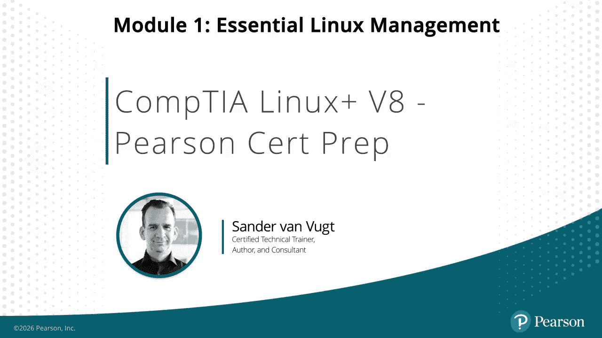

# Oreilly - CompTIA Linux+ V8：Module 1：模块简介 🐧

在本节课中，我们将要学习CompTIA Linux+ V8课程中的Module 1。这个模块的主要目的是让你了解Linux系统管理的基础知识，适合完全没有经验的初学者。我们会先整体看看这一节要讲什么，再逐步进入每个小课的具体内容，确保每个知识点都讲得清清楚楚。

## 模块概述

你好，欢迎来到Module 1。在这个模块里，你将学习一些基本的Linux管理内容。

Linux系统管理可以用下面这个简单的公式来理解：



```
Linux管理 = 用户管理 + 网络管理 + 系统服务管理
```

本模块一共有三节课，每节课都有独立的主题，内容之间也是循序渐进的。

## 第一课：高级用户安全

在上面的概述中，我们简要介绍了Module 1的整体结构。接下来，我们来看看第一节课具体讲些什么，主要是关于如何保护Linux系统中的用户账户安全。

以下是第一课的学习重点：

- 学习如何设置用户密码的复杂度要求
- 学习如何给普通用户提升管理员权限
- 学习如何限制不必要的用户访问系统资源

在Linux中，修改用户密码和管理用户组通常使用下面这些命令：

```bash
sudo passwd 用户名
sudo usermod -aG sudo 用户名
```

## 第二课：网络管理

上一节我们介绍了高级用户安全的基本概念。本节中，我们来看看第二课的内容，重点是学习如何在Linux系统上配置和管理网络连接。

以下是第二课的学习重点：

- 学习如何查看当前系统的网络接口信息
- 学习如何给网卡设置固定的IP地址
- 学习如何使用网络命令测试主机之间是否连通

网络管理中最常用的几个命令如下所示：

```bash
ip addr show
ping 目标地址
```

## 第三课：systemd

在第二节中，我们学习了网络管理的相关知识。本节中，我们来看看第三课，内容是关于Linux系统中的systemd服务管理器。

以下是第三课的学习重点：

- 学习什么是systemd，它在系统中起什么作用
- 学习如何启动、停止和重启系统服务
- 学习如何查询某个服务当前的运行状态

使用systemd管理服务的基本命令如下：


```bash
systemctl start 服务名
systemctl status 服务名
```

## 总结

本节课中，我们一起学习了Module 1的模块简介。我们了解了本模块包含三个课时：第一课是高级用户安全，第二课是网络管理，第三课是关于systemd的内容。希望这些介绍能帮助你对Linux系统管理有一个整体的认识。

