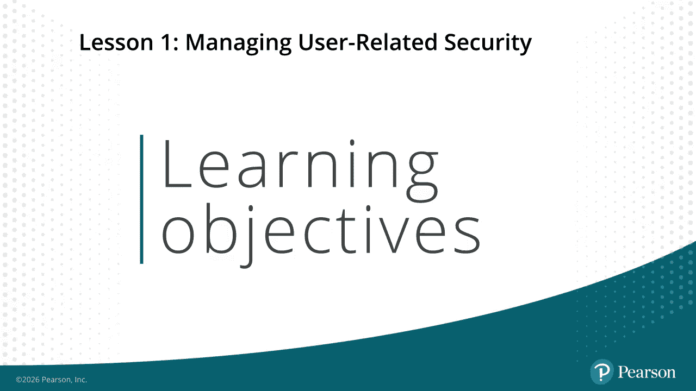

# Linux用户安全：第3部分：高级用户安全设置 🔒


在本节课中，我们将要学习关于高级用户安全相关设置的内容。欢迎来到用户安全相关的课程，本节课的主题是围绕用户安全展开的进阶配置。我们会把内容讲得尽可能直白，让没有经验的初学者也能听得懂。主要目标是让你了解如何管理用户安全方面的核心技术，包括访问控制列表、文件系统属性以及权限提升等内容。无论你是刚开始接触 Linux，还是已经有一点基础，这些知识点都能帮助你更好地理解系统安全的基本框架。


接下来我们先看看这节课的整体安排。课程内容分为几个主要部分，依次是访问控制列表的管理、文件系统属性的设置、使用 sudo 与 PolicyKit 进行权限提升，最后是实验环节及其参考答案。每一部分都会围绕实际操作来讲解，确保你既能理解理论，也能动手实践。下面是本节课将要重点介绍的几个核心知识点：

- 管理访问控制列表，以便对文件和目录进行更细粒度的权限控制
- 查看与修改文件系统属性，增强对系统资源的保护能力
- 使用 sudo 与 PolicyKit 实现权限提升，完成需要管理员权限的操作
- 完成实验任务，并对照实验解答检查自己的操作结果




刚才我们看过了课程安排，现在我们进入第一个具体话题。访问控制列表，也就是 ACL，是 Linux 文件系统中用来控制谁可以访问哪些文件的一种机制。普通的读写执行权限只能针对文件所有者、所属组和其他用户设置，而 ACL 允许你给特定的用户或组单独分配权限，灵活性更高。我们可以用一个简单的公式来描述 ACL 的作用：

```text
ACL = 基础权限 + 针对特定用户或组的额外权限
```

在 Linux 中，查看和设置 ACL 的常用命令如下：

```bash
getfacl 文件名
setfacl -m u:用户名:权限 文件名
```

这里的 `u` 表示用户，`g` 表示组，`m` 表示修改。你可以把 ACL 理解为在普通权限之外额外增加的一份“准入名单”，让系统管理员能够更精确地控制资源访问。


刚才我们学习了 ACL 的基本用法，接下来我们来看看文件系统属性。文件系统属性是指附加在文件或目录上的某些特殊标志，用于改变文件的行为或限制对文件的操作。例如，某些属性可以防止文件被意外删除，或者只允许追加内容而不允许修改已有数据。这种机制在保护关键系统文件时非常有用，能够为系统增加一层额外的安全防线。

常见的文件属性查看与设置命令如下：

```bash
lsattr 文件名
chattr +属性 文件名
```

给文件加上不可变属性后，即使是 root 用户在不解除该属性的情况下也无法修改或删除该文件。你可以把文件属性看作是贴在文件上的“特殊标签”，告诉系统这个文件可以怎么用，不可以怎么用。


在了解了文件属性之后，本节中我们来看看权限提升。权限提升是指普通用户以更高的权限（通常是 root 权限）执行命令的过程。在 Linux 中，最常用的两种方式是 sudo 和 PolicyKit（也叫 polkit）。两者的核心目的都是一样的：在保持系统安全的前提下，让合法用户完成需要提升权限的任务。

使用 sudo 执行命令的示例如下：

```bash
sudo 命令
```

执行后，系统会提示输入当前用户的密码，验证通过后才会以提升后的权限运行指定命令。PolicyKit 则更多用于图形桌面环境中的权限策略管理，适合桌面用户在日常操作中获取临时权限。


前面几节我们介绍了 ACL、文件属性和权限提升的理论知识，接下来我们来看看本节课的实验环节。实验部分会让你在实际的 Linux 系统中操作上述内容，例如创建 ACL 规则、设置文件属性、使用 sudo 执行管理命令等。动手实践是掌握这些技能的关键步骤，不要只看不练。


实验完成后，建议你对照实验解答逐步核对自己的操作步骤，找出可能遗漏的地方。实验解答通常会列出每一步的预期结果和对应的命令，帮助你确认是否掌握了本节课的重点内容。


本节课中，我们一起学习了高级用户安全相关设置。具体包括访问控制列表的管理方法、文件系统属性的查看与修改，以及使用 sudo 和 PolicyKit 进行权限提升的技巧。最后我们还完成了配套的实验，并参考了实验解答进行自我检查。希望这些内容能帮助你打下扎实的 Linux 用户安全基础。
