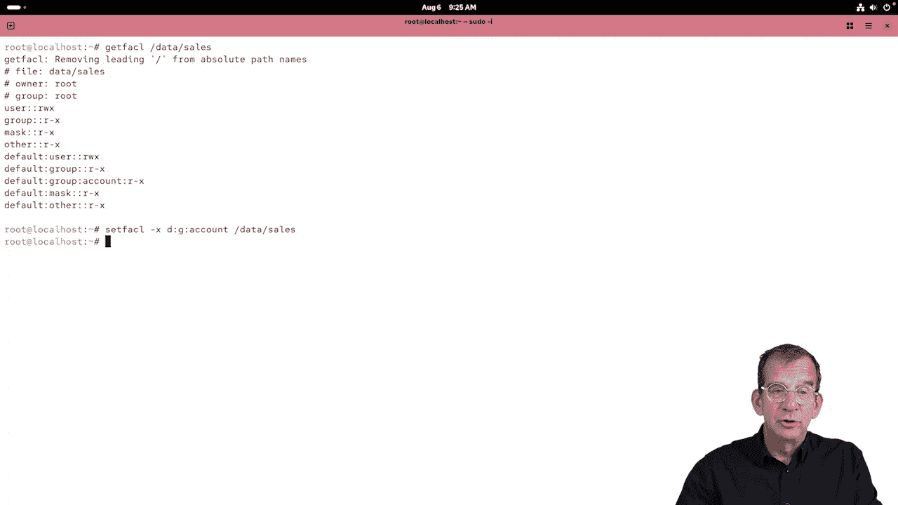

# CompTIA Linux+：11：管理访问控制列表 🛡️

在本节课中，我们将一起学习 Linux 系统中的访问控制列表，也就是 ACL 的相关知识。我们会先了解 ACL 是什么，它解决了基础权限无法处理的哪些问题，接着会看看在什么场景下应该使用 ACL。随后，我会介绍用于查看和修改 ACL 的两个核心命令，并解释常规 ACL 与默认 ACL 的区别。最后，我们会进行一次实际操作演示，创建用户组和目录，设置 ACL 权限，验证默认 ACL 对新建文件的影响，并学习如何删除不再需要的 ACL 规则。

## 什么是访问控制列表

在学习具体命令之前，我们需要先搞清楚 ACL 的本质。

访问控制列表，英文叫 Access Control List，简称为 ACL。简单来说，它是一种扩展的权限机制，允许系统管理员把文件或目录的读、写、执行权限，授予多个用户或多个用户组，而不仅仅是文件的所有者和所有者所在的组。在 Linux 中，普通的读写执行权限是最基础的权限控制方式，而 ACL 则是在这些基础权限之上的补充和扩展。几乎所有现代文件系统默认都支持 ACL，所以我们在绝大多数 Linux 发行版上都可以直接使用，不需要额外安装什么插件。

基础权限模型：所有者 | 所属组 | 其他用户  
ACL 权限模型：基础权限 + 额外用户或组的权限

## ACL 的使用场景

了解了 ACL 的定义后，我们来看看它在实际工作中通常用来解决什么问题。

以下是几种典型的 ACL 使用场景。

- 共享用户环境：某个用户或用户组需要对文件夹拥有完全访问权限，而其他用户或用户组只需要只读权限。基础权限只能指定一个所属组，无法同时满足这种多组不同权限的需求。
- 开发者环境：开发人员可能需要访问服务器上的某个文档目录，但我们仍希望该目录由合适的系统进程拥有所有权，此时可以通过 ACL 额外授予开发者访问权限，而不必修改目录的原始所有者。

## 管理 ACL 的命令

明确了 ACL 的作用场景后，接下来就是学习如何在系统中实际操作 ACL 了。

在 Linux 中，我们主要使用以下两个命令来查看和管理访问控制列表。

- `getfacl`：用于查看当前文件或目录上已经应用的 ACL 设置。
- `setfacl`：用于创建、修改或删除 ACL 规则。

## 常规 ACL 与默认 ACL

有了命令基础，我们需要区分两种不同类型的 ACL，它们的作用对象不一样。

ACL 可以分为下面两类。

- 常规 ACL：只作用于当前已经存在的文件和目录。
- 默认 ACL：只作用于目录，并且只影响在该目录下之后新建的文件和子目录。

在正式使用文件系统之前，应该先在目录上配置好 ACL，将其作为基础设施方案来实施，这样可以避免后续权限配置遗漏。

## 实际操作演示

理论部分讲完了，现在我们进入最关键的实操环节，看看如何一步步配置 ACL。

以下是演示的具体步骤和命令说明。

### 第一步：创建用户组和目录

首先，我们需要创建一个用户组，假设命名为 `account`。然后创建一个目录路径，例如 `/data/sales`，使用 `mkdir -p` 命令可以一次性创建整个目录树，即使中间层级的目录不存在也会自动创建。

```bash
groupadd account
mkdir -p /data/sales
```

### 第二步：为现有文件设置常规 ACL

接下来，我们要修改 `/data/sales` 的 ACL，添加用户组 `account` 的读取和执行权限。使用 `setfacl -R -m g:account:rx /data/sales` 命令，其中 `-R` 表示递归处理目录下的所有内容，`-m` 表示修改 ACL，`g:account:rx` 表示给组 `account` 授予读取和执行权限。这里使用大写 `X` 的逻辑是，只让目录可执行，不让普通文件可执行，这样更符合实际需求，避免给普通文件添加不必要的执行权限。

```bash
setfacl -R -m g:account:rx /data/sales
```

### 第三步：为新建文件设置默认 ACL

常规 ACL 只能处理已经存在的文件，如果我们希望今后在 `/data/sales` 下新建的文件也自动继承同样的权限，就需要设置默认 ACL。命令是 `setfacl -m d:g:account:rx /data/sales`，注意这里的 `d:` 表示默认 ACL，默认 ACL 只能应用于目录，所以不需要大写 `X`，直接指定读取和执行权限即可。

```bash
setfacl -m d:g:account:rx /data/sales
```

### 第四步：查看 ACL 设置

配置完成后，使用 `getfacl /data/sales` 检查 ACL 是否生效。输出会显示默认 ACL 中的用户、所属组以及组 `account` 的读取执行权限，确保配置没有错误。

### 第五步：验证默认 ACL 的继承效果

为了确认默认 ACL 是否真的起作用，我们在 `/data/sales` 下新建一个文件，比如 `file1`，然后运行 `getfacl file1`。你会发现，这个新建文件上也自动出现了组 `account` 的读取执行权限，这就是默认 ACL 的目的，让指定权限自动应用到该目录下的所有新建文件和目录。

## 删除 ACL 规则

学会添加 ACL 之后，我们也需要知道如何删除不再需要的 ACL 设置。

删除 ACL 的常用命令如下。

- 删除某个用户组的常规 ACL：`setfacl -x g:account /data/sales`
- 删除某个用户组的默认 ACL：`setfacl -x d:g:account /data/sales`



执行第一条命令后，`getfacl /data/sales` 会显示常规 ACL 已经移除，但默认 ACL 仍然保留。如果想把默认 ACL 也一并删除，就需要加上 `d:` 前缀，使用第二条命令，这样就能把该组在目录上的所有 ACL 规则彻底清除。


本节课中，我们一起学习了 Linux 访问控制列表 ACL 的基本概念、使用场景以及管理命令。我们了解了常规 ACL 和默认 ACL 的区别，掌握了使用 `getfacl` 查看权限、`setfacl` 修改权限的方法，并通过创建用户组和目录完成了完整的配置演示，验证了默认 ACL 对新建文件的自动继承作用，最后还学习了如何删除常规 ACL 和默认 ACL。希望这些内容能帮助你在实际工作中更灵活地控制文件和目录的访问权限。

