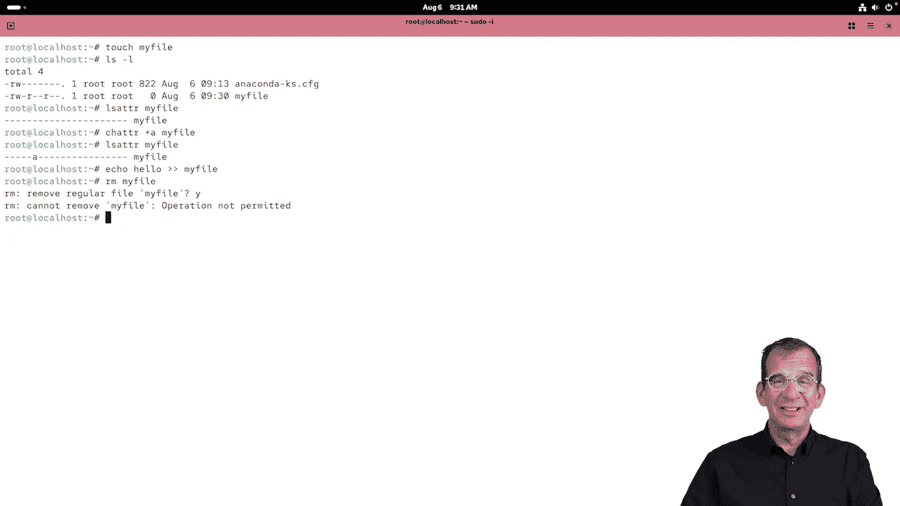

# CompTIA Linux+ V8：12：管理文件系统属性 🛡️

在本节课中，我们将一起学习 Linux 文件系统属性是什么，怎么用命令查看和修改这些属性，以及最常见的不可变属性和只追加属性是如何工作的。我们还会通过一个简单的实际例子，看看这些属性对 root 用户是否也有效，最后你会明白，当你明明有权限却无法操作文件时，应该去检查什么。

文件系统属性是 POSIX 标准定义的一种安全机制。POSIX 源自很久以前制定的 UNIX 标准，目的是确保不同的 UNIX 发行版之间能够使用一致的解决方案。POSIX 定义了一些属性，这些属性可以用来给文件增加额外的安全保护。你可以把文件系统属性理解为附加在文件元数据上的标记，与普通的读写执行权限是不同的概念。

以下是查看和设置文件系统属性的常用命令：

- `lsattr 文件名`：列出文件当前应用的所有属性，让你知道文件身上贴了什么标签。
- `chattr 操作 属性 文件名`：改变文件的属性，比如添加或移除某个标记。

在所有的文件系统属性当中，不可变属性和只追加属性是最常见的两个。不可变属性意味着一旦设置，文件就不能被修改、删除或重命名，即使是 root 用户也不行。只追加属性则允许你向文件末尾写入新内容，但是不允许修改已有内容，也不允许删除文件。

下面我们来看一个具体的操作过程，帮助你理解这些属性在实际中是怎么表现的。我会以 root 用户的身份在自己的家目录里演示，因为文件系统属性和具体的操作用户没关系，哪怕是系统管理员也受这些属性限制。

首先，使用 touch 命令创建一个空文件，然后用 ls -l 查看它的属性。你会看到这是一个普通的空文件，权限显示为读写、读、读。文件名后面还会出现一个小点，这个点很有意思，因为它表示文件上已经应用了一些特殊的属性。

接着，使用 lsattr 命令查看这个文件的属性列表。此时你会发现，目前没有任何属性应用在这个文件上。文件的元数据里只是预留了一块区域用来存储属性，但暂时是空的。

现在，让我们尝试给文件添加只追加属性。使用 `chattr +a 文件名` 命令，然后再用 `lsattr 文件名` 查看，你可以看到这个追加属性已经生效。这时候，如果你尝试用 echo 命令向文件里写入内容，操作是被允许的，因为追加属性允许在文件末尾增加新数据。

但是，当你尝试用 rm 命令删除这个文件时，系统会提示操作不被允许。即使你是 root 用户，也会收到“操作不被允许”的错误。这就是文件系统属性在起作用，它绕过了常规的用户权限检查。

所以，如果你是普通用户或者 root 用户，遇到明明有权限却无法修改或删除文件的奇怪情况，我建议你先检查一下是否有文件系统属性应用在该文件上。

本节课中，我们一起学习了 Linux 文件系统属性的基本概念、POSIX 标准背景、查看和修改属性的命令，以及不可变属性和只追加属性的实际效果。希望这些内容能帮助你在日常运维中更好地保护重要文件。

