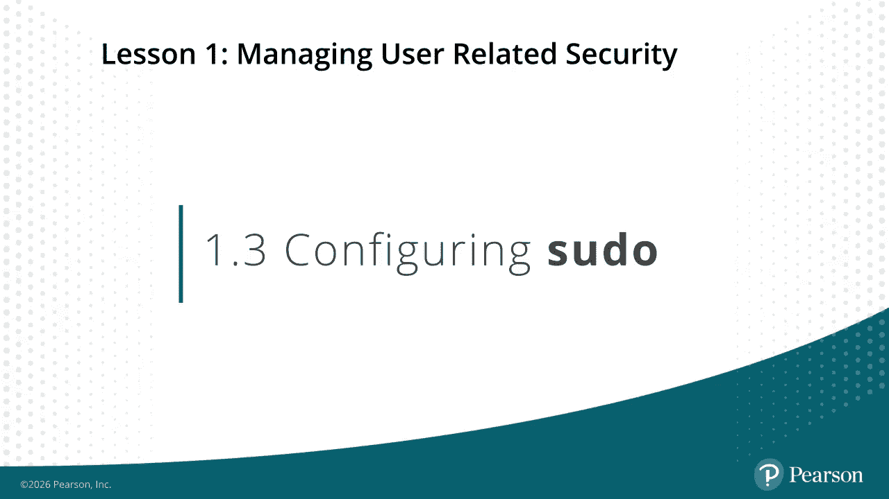
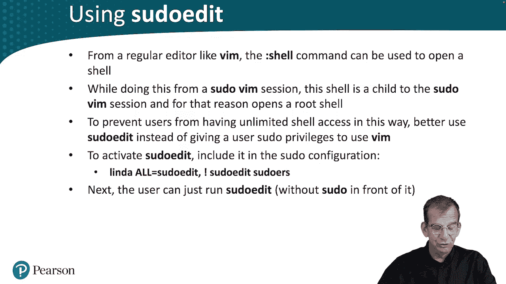
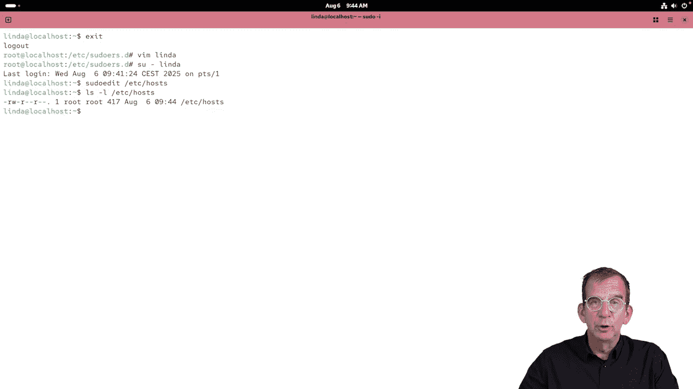

🐧 CompTIA Linux+ V8：13：Configuring sudo（配置 sudo）




在本节课中，我们将学习如何配置 sudo。sudo 是 Linux 系统中用于提升权限的重要工具，之前的课程中你可能已经接触过它。本节我们将重点了解 sudo 的配置细节，包括如何安全地编辑 sudoers 文件、认证令牌的工作原理、超时时间设置、分片配置文件的使用，以及 sudoedit 命令的作用。

上一节我们介绍了 sudo 的基本使用，本节中我们来看看如何为用户配置简便的 sudo 访问权限。

在 Red Hat 系列系统中，将用户添加到 wheel 组即可获得简便的 sudo 访问权限；在 Ubuntu 系列系统中，则是将用户添加到 sudo 组。

如果你需要访问更高级的选项，就必须编辑 sudo 的配置文件，这个文件的名称是 `/etc/sudoers`。但你不能直接编辑它，应该使用 `visudo` 命令来编辑。

`visudo` 命令的作用是以安全的方式将修改写入 `/etc/sudoers` 文件。

使用 sudo 时，有一个重要的概念叫做 sudo 认证令牌。

有些人会在启用 sudo 的行中使用 `NOPASSWD` 选项，这样可以让用户无需输入密码就能使用 sudo，但这非常不安全。

为什么有人这么做？因为使用 sudo 时会生成一个认证令牌。第一次使用 sudo 时，系统会根据用户输入的密码生成这个令牌。有了令牌后，同一用户可以运行更多 sudo 命令，而不需要每次都输入密码。

不过问题在于，默认情况下，这个令牌在几分钟后就会过期。之后用户就需要再次输入密码。如果你一整天都在使用 sudo，这种频繁输入密码的做法会让人感到烦躁，所以你可能希望避免这种情况。

为了避免这个问题，可以在配置中添加以下两个参数：

```text
Defaults timestamp_type=global
Defaults timestamp_timeout=60
```

`timestamp_type=global` 表示该设置对所有用户生效，无论他们以何种方式登录系统；`timestamp_timeout=60` 表示将认证令牌的过期时间设置为 60 分钟。

当然，60 分钟并不是固定值，你可以根据需要设置得更长或更短。相比于使用 `NOPASSWD` 选项，这种做法要安全得多。因为你只需要在会话开始时输入一次密码，然后可以整个上午都无需再次输入密码。即使你去吃午饭并退出登录，回来后只需再输入一次密码，一天只需要输入两次，而不是一直都要输入，这样要安全得多。

在 sudo 中，你还可以使用分片配置文件。与其直接向 `/etc/sudoers` 写入内容，不如将分片文件添加到 `/etc/sudoers.d/` 目录中。

这其实是 Linux 中处理配置文件的一种通用方法。过去，我们通常只有一个配置文件；但如今，Linux 系统经常被集中管理，我们需要区分默认配置文件中的托管内容和你自己创建的内容，后者通常保存在分片文件中。

策略是使用命名为 `/etc/sudoers.d/` 的分片文件，在其中创建你自己的配置。

在 sudo 的分片文件中，你可以为单个用户或组添加配置。以下是示例：

```text
linda ALL=(ALL) /usr/bin/passwd, !/usr/bin/passwd root
```

这条规则允许用户 linda 为其他用户设置密码，但不允许为 root 用户设置密码。如果你想让 lisa 也能执行所有命令，可以编写类似 `lisa ALL=(ALL) NOPASSWD: ALL` 的规则。

接下来我们通过实际操作来验证这些配置。

首先，我将使用 `visudo` 来添加管理认证令牌生存周期的默认参数。默认参数在 sudoers 文件中可以出现多次，我倾向于将它们放在一起，方便查找。

具体配置如下：

```text
Defaults timestamp_type=global
Defaults timestamp_timeout=240
```

`timestamp_type=global` 确保该设置无论用户以何种方式登录都生效，包括 SSH 会话；`timestamp_timeout=240` 表示令牌有效期为 240 分钟。你可以根据自己的需求自行修改这个数值。我喜欢 240 分钟，因为这样一天只需要输入两次密码。

应用更改后，进入 `/etc/sudoers.d/` 目录，创建名为 `linda` 的文件，并在其中添加：

```text
linda ALL=(ALL) /usr/bin/passwd, !/usr/bin/passwd root
```

现在我们来测试一下。首先创建用户 linda，这是一个类 CentOS 的系统，使用 `useradd linda` 会默认创建 Bash shell 和家目录，这正是我想要的。同样使用 `useradd lisa` 创建用户 lisa。

然后使用 `su linda` 以用户 linda 身份打开 shell。我有点懒，没有为 linda 设置密码，但我是以 root 身份操作的，所以不需要输入密码。现在切换到 linda 之后，我应该能够使用 `sudo passwd lisa`，不过系统会提示输入 linda 的密码。我的懒惰在这里没有得到奖励，我确实需要为 linda 输入密码。这是因为 sudo 默认会进行密码检查。请记住，使用 sudo 的用户需要输入他们自己的密码。

现在我在 `/etc/sudoers.d/` 目录下，可以为用户创建配置文件。我创建名为 `linda` 的文件，其中写入：

```text
linda ALL=(ALL) /usr/bin/passwd, !/usr/bin/passwd root
```

接下来继续测试。使用 `getent passwd linda` 检查用户 linda 是否存在，输出显示我们确实有这个用户。`getent` 是一个很好的命令，因为它会打印从认证数据库中找到的用户所有属性，在这里就是 `/etc/passwd`。确保该用户已经设置了密码，然后以该用户身份打开 shell。我正在以 `su - linda` 的方式操作。

由于我是以 root 身份执行的，完全不需要输入密码。但现在我应该能够使用 `sudo passwd lisa`，输入 linda 的密码，系统会提示输入两次新密码。

如果我们尝试对 root 用户做同样的操作，会得到错误信息：用户 linda 不被允许，这是因为我们排除了这个功能。

回到幻灯片，我需要告诉你关于 `sudoedit` 命令的内容。这是一个非常有用的命令。

为什么它有用？因为从普通编辑器中，通常有选项可以打开 shell。例如，在 Vim 中，可以使用 `:shell` 打开 shell。这意味着如果你从 sudo 的 Vim 会话中这样做，打开的 shell 就是 sudo Vim 会话的 shell，如此一来，你就可以打开一个 root shell。这通常不是你希望看到的结果。

因此，如果你想防止用户通过这种方式获得无限制的 shell 访问权限，最好使用 `sudoedit`，而不是给用户使用 Vim 的 sudo 权限。

要启用 `sudoedit`，需要将其包含在 sudo 配置中。具体做法如下：



```text
linda ALL=(ALL) sudoedit, !sudoedit /etc/sudoers
```

结果是，用户可以直接使用 `sudoedit` 命令，而不需要在前面加 `sudo`。

现在我回到 linda 的配置文件，添加 `sudoedit` 命令。应该使用 `sudoedit`，而不是 `sudo sudoedit`。然后可以像往常一样使用 `su - linda` 打开 shell，在那里使用 `sudoedit /etc/hosts`。这是 `/etc/hosts` 文件，linda 可以在其中添加内容，例如 `192.168.29.111 demi.example.com`。可以看到这确实生效了，执行 `ls -l /etc/hosts` 显示你确实需要提升权限才能操作。同时要注意，`sudoedit` 使用的是认证令牌，linda 不需要再次输入密码。



本节课中，我们一起学习了如何配置 sudo。我们了解了如何通过 wheel 组或 sudo 组配置简便访问，如何使用 `visudo` 安全地编辑 `/etc/sudoers`，以及 sudo 认证令牌和超时时间的设置方法。我们还学习了使用 `/etc/sudoers.d/` 分片文件来分离托管内容和自定义内容的策略，并通过为用户 linda 配置规则进行了实际测试。最后，我们介绍了 `sudoedit` 命令，以及如何通过它避免用户通过普通编辑器获得 root shell 的安全风险。
