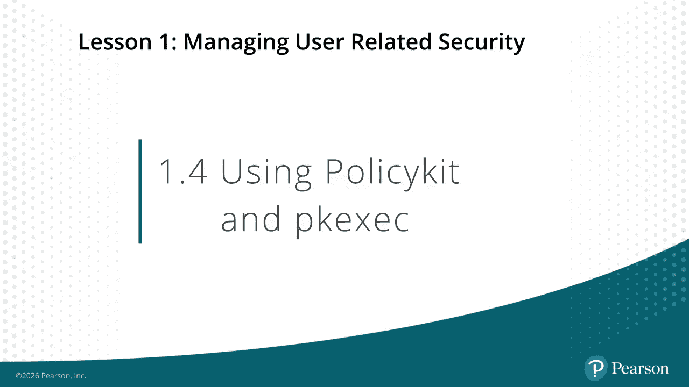
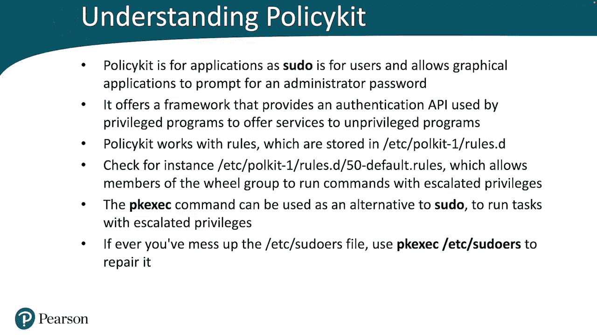

# Oreilly - CompTIA Linux+ V8：14：使用 PolicyKit 和 pkexec 🔐

在本节课中我们将要学习 PolicyKit 和 pkexec 这两个工具。PolicyKit 是一个在后台默默运行的系统服务，它的主要工作是决定哪些普通用户可以执行需要管理员权限的操作。pkexec 是一个命令行工具，它让你可以在不完整切换到 root 用户的情况下，以提升后的权限运行任务。这两个东西结合在一起，让 Linux 系统在图形界面下也能安全地处理权限请求。如果你是初学者，不需要担心这些概念听起来很复杂，我们会用大白话把它们拆开来讲。


什么是 PolicyKit 📦

在开始之前，我们先搞清楚 PolicyKit 到底是个什么东西。PolicyKit（也常被称为 Polkit）是 Linux 系统中的一个权限管理框架。简单来说，它就是一套规则，告诉系统：当某个程序需要做需要管理员权限的事情时，是否应该弹出密码对话框让用户确认。对于普通用户来说，这非常方便，因为你不需要事先切换到超级用户，系统会在需要的时候帮你申请权限。

PolicyKit 的核心功能可以用下面这个简单的公式来描述：

```
普通用户请求 + PolicyKit 规则 = 图形界面弹出管理员密码框
```

以下是 PolicyKit 的主要特点：

- 它为图形应用程序提供了一种申请管理员密码的机制。
- 它允许普通用户在图形环境中启动需要提权的程序。
- 它不直接执行命令，而是负责判断是否允许执行。


PolicyKit 如何工作 🔧

了解了 PolicyKit 的基本定义之后，我们来看看它具体是如何运行的。PolicyKit 提供一个认证 API，特权程序可以通过这个 API 向普通程序提供服务。它的运行依赖于一系列存储在系统中的规则文件，这些规则决定了谁有权限做什么。

规则文件通常位于以下路径：

```
/etc/polkit-1/rules.d
```

在这个目录下，你会看到类似 50-default.rules 这样的默认规则文件。比如，默认规则可能允许 wheel 组的成员使用提升的权限执行命令。这意味着如果你把自己加入 wheel 组，PolicyKit 就会在合适的时候允许你提权，而不需要每次都切换到 root。

以下是常见的规则存储位置和作用：

- /etc/polkit-1/rules.d：存放 PolicyKit 的规则文件。
- 50-default.rules：系统自带的默认规则，常见的比如允许 wheel 组成员提权。
- 自定义规则文件：管理员可以在此目录添加自己的规则，控制具体的程序访问权限。


使用 pkexec 提权 🚀

学习完 PolicyKit 的规则之后，接下来我们介绍一个更直接的提权命令。pkexec 命令可以看作是 su 或 sudo 的替代品。它的作用是让你以提升后的权限运行某个任务，而不需要完整地切换到另一个用户。这在日常维护中非常实用，尤其是当你只需要执行一两个管理命令时，不必频繁输入 root 密码或切换身份。

pkexec 的基本使用方式如下：

```
pkexec <需要提权的命令>
```

比如，如果你想以管理员身份编辑某个系统配置文件，就可以在命令前面加上 pkexec。系统会在需要时弹出密码提示，确认你的身份后执行命令。



pkexec 有一个非常实用的应用场景。如果你不小心把 /etc/sudoers 文件改错了，导致 sudo 命令无法使用，这时候你可能陷入无法通过 sudo 获取 root 权限的困境。幸运的是，你依然可以使用 pkexec 来修复这个文件，因为 pkexec 不依赖 sudoers 配置。

以下是使用 pkexec 时需要注意的几点：

- pkexec 不会对你的命令进行一致性检查，所以输入时要小心。
- 输入命令时不要出现拼写错误，否则可能导致操作失败。
- 它适合偶尔提权的场景，不适合频繁执行大量管理任务。


总结与回顾 📝


掌握了 pkexec 的用法后，我们来总结一下本节内容。本节课中我们一起学习了 PolicyKit 和 pkexec 的基本概念和使用方法。PolicyKit 是一个在后台运行的权限框架，主要负责在图形应用需要管理员权限时弹出密码对话框；pkexec 是一个命令行工具，可以作为 su 或 sudo 的替代方案，让你以提升的权限运行任务。掌握这两个工具，可以让你在 Linux 系统中更灵活、更安全地处理权限问题。

