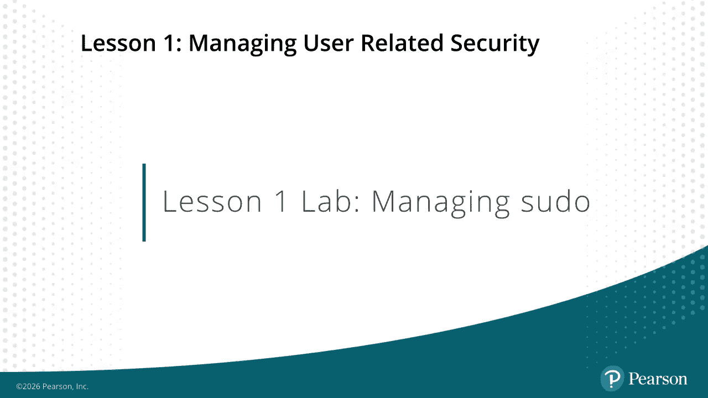
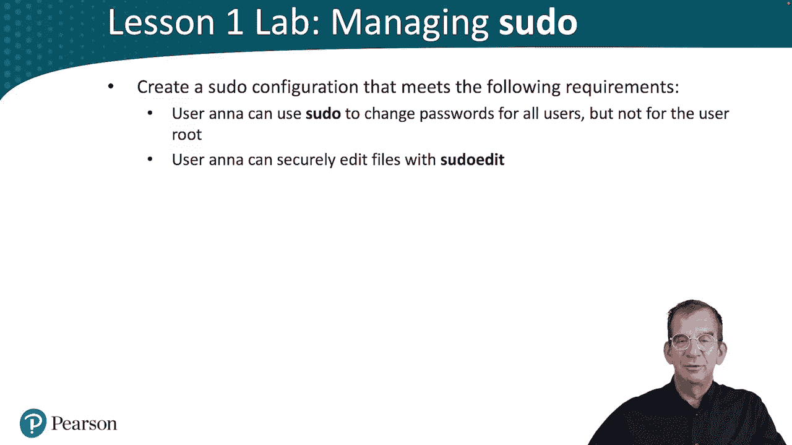

# 🖥️ CompTIA Linux+ V8：01：管理sudo实验

在本节课中我们将要学习如何配置sudo权限，这是Linux系统管理中非常基础且重要的一部分。sudo机制允许普通用户在不切换到root账户的情况下，以提升的权限执行特定命令。通过本实验，你将掌握如何为指定用户分配受限的管理权限，在满足运维需求的同时保持系统安全。我们将先介绍实验目标，再说明核心概念，最后给出具体操作步骤。

## 实验目标


在本实验中，你需要创建一个满足若干要求的sudo配置。以下是需要完成的任务：

- 编辑sudo配置文件，使其符合设定的权限策略。
- 允许用户En为所有用户修改密码，但不允许修改root用户的密码。
- 允许用户En使用sudo edit命令安全地编辑文件。



## 核心概念

了解了实验目标之后，我们来看看实现这些目标所需的核心概念。sudo的工作原理是通过/etc/sudoers文件来控制哪些用户可以在哪些主机上以什么身份运行什么命令。如果配置写错，可能会导致普通用户获得过高权限，或者管理员无法正常执行任务。

核心配置逻辑可以用下面的公式描述：

`用户 主机 = (运行身份) 命令列表`

如果需要用伪代码表示，可以参考如下示例：

```
En ALL = (ALL) /usr/bin/passwd, !/usr/bin/passwd root
En ALL = (ALL) /usr/bin/sudoedit
```

这意味着用户En可以在任何主机上，以任何身份运行passwd命令，但明确禁止对root用户使用passwd；同时允许使用sudoedit来编辑文件。

## 具体操作步骤

接下来我们来看看如何实际配置这些权限。以下是操作步骤：

1. 使用visudo命令打开/etc/sudoers文件，这是编辑sudo配置最安全的方式。
2. 在文件中添加规则，授予用户En修改其他用户密码的权限，同时排除root用户。
3. 继续添加规则，允许用户En使用sudo edit安全编辑文件。
4. 保存文件并退出编辑器，然后测试配置是否生效。



## 总结

本节课中我们一起学习了如何创建sudo配置，明确了用户En的权限范围，掌握了允许修改他人密码但不包括root、以及使用sudo edit安全编辑文件的方法。希望通过本实验，你能更好地理解Linux权限管理的基本思想。
