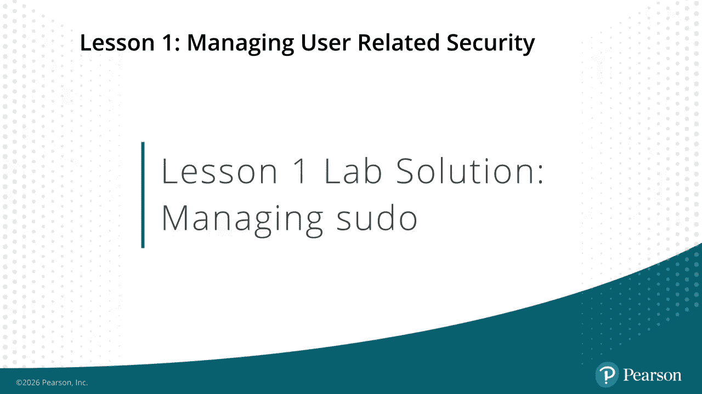
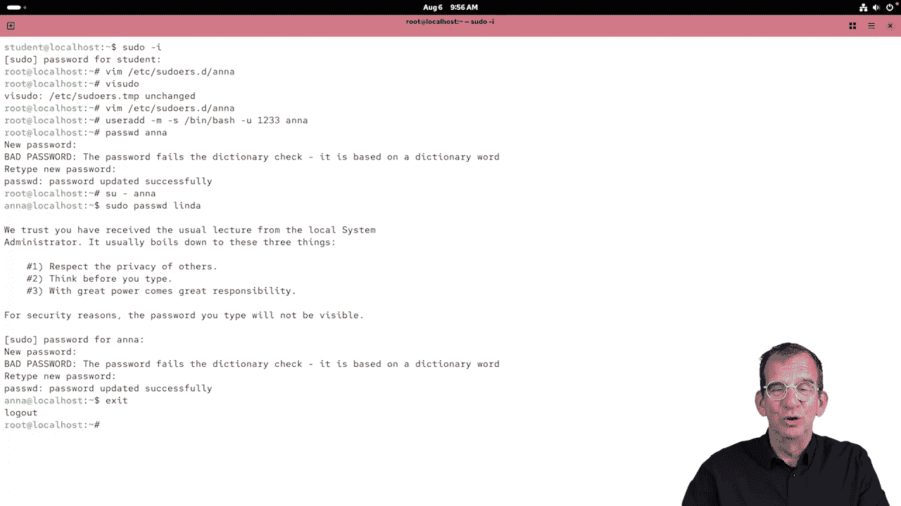

# CompTIA Linux+ V8：1：管理 sudo 权限 🔐

在本节课中我们将要学习如何在 Linux 系统中管理 sudo 权限。我们将会一起完成一个实验，学习如何为特定用户配置 sudo 访问规则，如何编辑 sudoers 文件，以及如何验证配置是否生效。通过本节课的学习，你将掌握 sudo 权限管理的基本操作方法，这对日常系统维护非常有用。




## 开始实验

好了，我们开始实验讲解。我将从 root shell 开始，在这个 root shell 中操作。这是我们做所有配置工作的起点，所以请确保你已经获得了管理员权限，然后再继续往下进行。


## 创建 sudoers 配置文件

上一节我们介绍了实验的起点，本节中我们来看看如何创建 sudoers 配置文件。

以下是本节我们要创建的文件路径：

```text
/etc/sudoers.d/anna
```

我要在这个文件中写入什么内容。这是你需要记住自己想要做什么的部分，说实话，如果你不记得具体语法，可以先给它一个通用的写法。我建议你查找 wheel 这一行，wheel 是一个很好的占位符，我喜欢把它复制过来然后进行编辑，这样在创建要用的文件时就不会出现语法错误。占位符可以帮助我们避免手动输入时的拼写错误，让配置过程更加稳妥。


## 编写 sudo 规则

在创建好配置文件之后，本节中我们来看看如何编写具体的 sudo 规则。

在这个占位符中，我将添加用户 anna。她能做什么。她可以使用 /usr/bin/passwd，但不能使用 /usr/bin/passwd root。顺便说一句，请注意顺序。

以下是核心规则的示例：

```text
anna ALL=(ALL) /usr/bin/passwd
anna ALL=(ALL) !/usr/bin/passwd root
```

通常你是从特定到通用，或者说从通用到特定，这里有一个通用定义，即用户可以使用 /usr/bin/passwd，但不能使用 /usr/bin/passwd root。如果你颠倒这些行的顺序，就不会起作用了。这是因为 sudoers 文件中的规则是按顺序匹配的，顺序错误会导致权限控制失效，所以请务必保持正确的行序。


## 使用 visudo 编辑

写完规则之后，本节中我们来看看如何正确地编辑 sudoers 文件。

然后你应该使用 visudo 来编辑 /etc/sudoers，而不是随意使用普通文本编辑器修改。visudo 会在保存前检查语法，防止因为语法错误导致无法使用 sudo。这样就完成了配置文件的编写工作，接下来我们可以进行测试了。


## 测试配置

编辑完成之后，本节中我们来看看如何测试配置是否生效。

当然，你需要进行测试。我不确定是否已经有用户 anna 了，所以我们先确认一下。

以下是创建测试用户的命令：

```bash
useradd anna
```

顺便说一句，如果你在 Ubuntu 上，可以使用 useradd -m 来创建家目录，使用 -s /bin/bash 指定 shell，还可以使用 -u 为用户指定用户 ID。在 useradd 中，你只需要注意像这样的命令行选项，展示如何使用这些选项绝对没有坏处，这对初学者来说很有帮助，建议多加练习。


## 设置用户密码

创建用户之后，本节中我们来看看如何为该用户设置密码。

接下来，我将设置密码。为用户 anna 运行 passwd，输入两次密码：

```bash
passwd anna
```

设置密码是为了确保用户可以正常通过身份验证，之后才能使用 sudo 权限执行命令，这一步不能省略。


## 验证 sudo 权限

设置好密码之后，本节中我们来看看如何验证 sudo 权限是否正确生效。

现在我可以以用户 anna 的身份打开超级用户 shell，并使用 sudo passwd。anna 正在输入密码，系统提示设置新密码，一切运行正常。这说明 sudo 权限配置已经生效，用户 anna 可以按照我们定义的规则执行命令了，实验目标已经达成。

这就是本次实验需要完成的全部内容，就这样，我们继续学习第二课。


## 总结



本节课中我们一起学习了如何创建 /etc/sudoers.d/anna 配置文件，如何编写允许用户运行特定命令但禁止运行特定参数的 sudo 规则，如何使用 visudo 安全地编辑 sudoers 文件，以及如何创建测试用户、设置密码和验证 sudo 权限。希望这些内容能帮助你掌握 Linux 中 sudo 权限管理的基础知识。
