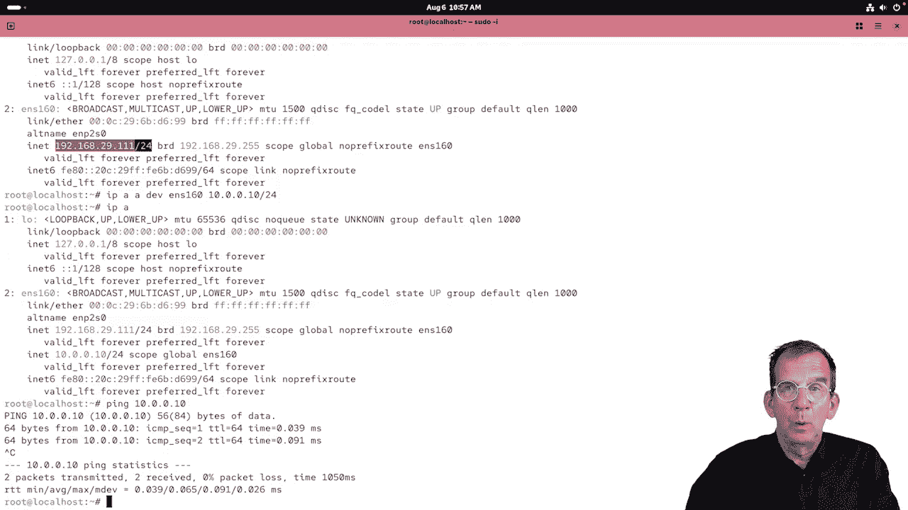

# Oreilly - CompTIA Linux+ V8：第21节：监控网络接口 🖥️

在本节课中，我们将一起学习如何在 Linux 系统里监控网络接口。网络接口是计算机与外部网络通信的通道，掌握如何查看和管理这些接口，是使用 Linux 系统时必须具备的基础技能之一。无论你是刚接触 Linux 的新手，还是希望进一步补强网络知识的学习者，这节课都会用最直白的方式把相关命令讲清楚，帮助你快速上手网络接口的监控工作。

在开始具体操作之前，我们需要先搞清楚系统当前到底有哪些网络接口可用。获取接口列表是所有网络配置工作的第一步，如果没有这个清单，后续的设置和故障排查就无从谈起。以下是查看可用网络接口的方法：

- 使用 `ip link show` 命令列出系统中所有的网络链路和接口信息。
- 命令输出会显示每个接口的名称、当前状态以及相关属性。

如果你想了解网络接口更深层的硬件属性，单靠 `ip link show` 可能还不够。这时候可以借助专门的硬件信息工具，而不再使用那些已经过时的网络配置命令。以下是获取深度信息的方式：

- 使用 `lshw -class network` 命令查看网络硬件的详细参数。
- 不要再使用 `ifconfig`，因为它已经是旧命令，基本不再受到维护和支持。

在运行时临时修改网络接口配置也是日常运维中非常常见的需求。这类修改不会写入磁盘，重启网络接口或系统后就会失效，非常适合用来快速测试或临时调整网络地址。以下是临时配置的具体步骤：

- 使用 `ip address add` 为指定网络接口添加 IP 地址。
- 使用 `ip address show` 查看当前接口已经配置的 IP 地址信息。

过去曾经有一些工具被用来修改网卡的底层参数，比如自动协商、端口速度等高级设置，不过现在这些工具已经很少有人使用了。以下是相关工具的说明：

- 旧版 `ethtool` 实用程序曾用于更改设备设置，例如自动协商和端口速度。
- 这个工具现在基本已经被淘汰，实际工作中几乎看不到它的身影。

接下来我们实际查看一下与网络链路相关的实用工具。`ip link show` 是最常用的起点，它能显示系统中所有网络链路的概览信息。以下是输出内容的含义：

- `lo` 是回环接口，主要用于应用程序之间通过 socket 进行进程间通信，属于内部网络区域，对日常外部网络配置不太重要。
- 在示例环境中，`ens160` 是我们关注的主要接口，它保存了当前的配置信息。

接口名称本身往往包含物理位置的线索，理解这些命名规则有助于你快速定位硬件设备。以下是 `ens160` 的名称拆解说明：

- `ens160` 采用所谓的可预测网络接口命名，能够反映接口的物理位置。
- 它的别名可能是 `ep2s0`，其中 `p2s0` 代表 PCI 插槽 0，即实际的物理位置。

除了名称，接口的其他属性也很重要，比如 MAC 地址和最大传输单元，这些参数直接影响数据传输的行为和效率。以下是常见属性说明：

- 可以通过相关命令查看接口的 MAC 地址。
- 以太网的最大传输单元通常设置为 1500 字节。

如果基本信息不足以满足你的需求，还可以使用硬件检测工具获取更全面的数据。`lshw` 是一个功能强大的实用程序，能够列出系统中检测到的所有硬件设备。以下是使用建议：

- 直接运行 `lshw` 会输出大量硬件信息，内容非常多，通常不需要全部关注。
- 使用 `lshw -class network` 可以过滤出仅与网络相关的信息，避免无关数据干扰。
- 驱动程序检测到的能力、容量、时钟速度等详细数据都会显示在这里。

最后，我们来看看如何在运行时临时更改网络接口配置，并且这些更改不会持久化保存。假设当前接口已经使用某个 IP 地址，你可以临时添加第二个地址来验证连通性。以下是操作示例：

- 使用 `ip address show` 确认当前接口正在使用的 IP 地址，例如 `192.168.2.91.11`。
- 使用 `ip address add` 临时添加一个新 IP 地址，命令需要指定设备名称，比如 `ens160`，然后跟上你想添加的 IP 地址。
- 添加成功后，可以使用 `ping` 命令验证新地址是否可达，例如 `ping 100.0.10`。

不过要注意，运行时添加的配置在网络接口重启后就会消失，不会永久保留。如果你希望配置生效持久化，需要继续学习后续关于持久化网络配置的内容。

在本节课中，我们一起学习了如何监控 Linux 网络接口。具体包括使用 `ip link show` 查看接口列表，使用 `lshw -class network` 获取网络硬件详情，不再使用过时的 `ifconfig`，使用 `ip address add` 和 `ip address show` 进行运行时的非持久化 IP 配置，了解回环接口 `lo` 和物理接口 `ens160` 的命名含义，以及查看 MAC 地址和最大传输单元等属性。希望这些内容能帮助你建立起对 Linux 网络接口管理的基础认识。

