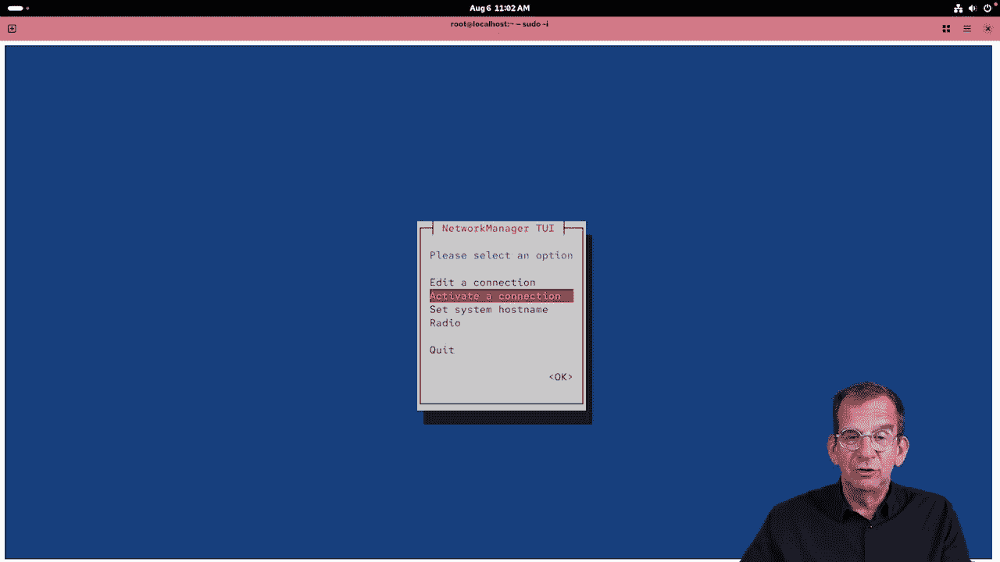
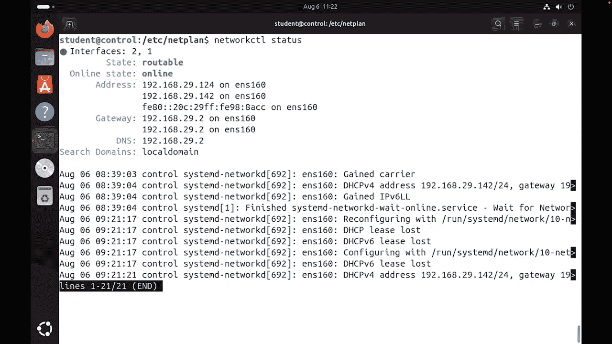
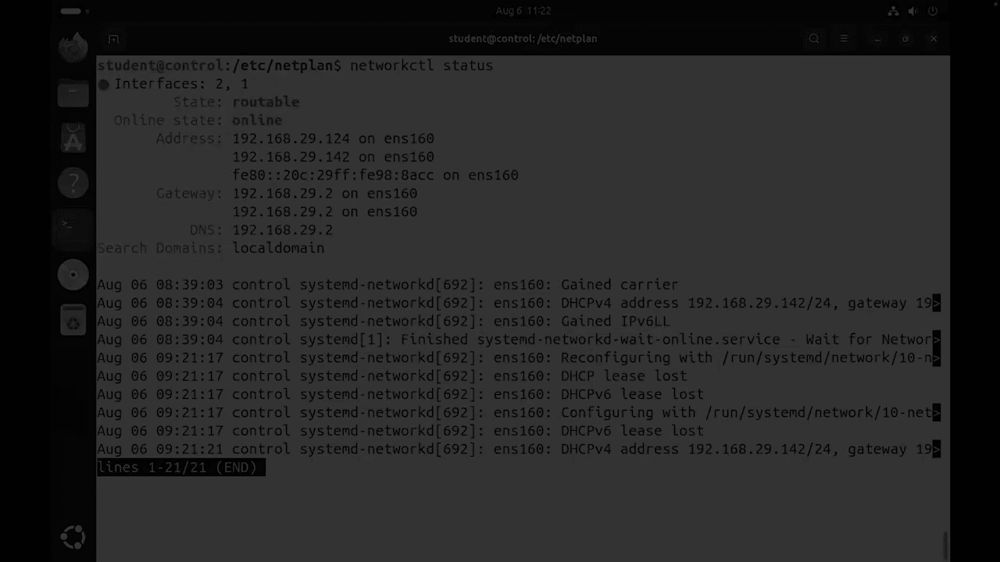

# CompTIA Linux+ V8：22：管理持久网络配置 🌐

在本节课中我们将要学习持久网络配置的核心知识。持久网络配置是指在系统重启之后，网络设置仍然保持不变的配置方式。不同的Linux发行版对持久网络配置的实现方式并不相同，因此我们需要分别掌握它们的方法。

本节课主要包含两个部分。首先我们会学习Red Hat家族Linux系统中使用NetworkManager来管理网络接口的方法，包括图形化文本界面和命令行工具。随后我们会转到Ubuntu及其相关系统，学习如何使用netplan工具配置持久网络。通过对比这两种发行族的配置思路，你将能够在实际工作中快速找到对应的配置文件和命令。

## 1. 持久网络配置的基本概念

在开始具体操作之前，我们需要先理解什么是持久网络配置，以及不同发行版之间存在的差异。

持久网络配置的核心目标是让网络设置在重启后依然有效。如果你只是临时修改IP地址，重启系统后设置就会丢失，这显然不符合生产环境的需求。因此我们需要将配置写入系统的配置文件中，使其在下次开机时自动加载。

不同的Linux发行版采用不同的工具来实现这个目标。Red Hat家族倾向于使用NetworkManager，而Ubuntu服务器版本则倾向于使用netplan配合systemd-networkd。了解这些差异可以帮助你避免在错误的地方修改配置文件，也能让你在面对不同系统时更加从容。

以下是不同发行族的常用工具对比：

| 发行族 | 主要工具 | 配置目录 |
|--------|---------|---------|
| Red Hat 家族 | NetworkManager | /etc/NetworkManager |
| Ubuntu | netplan / systemd-networkd | /etc/netplan |

## 2. Red Hat 家族中的 NetworkManager

上一节我们介绍了持久网络配置的基本概念，本节中我们来看看Red Hat家族Linux系统是如何实现持久网络配置的。

在Red Hat家族Linux中，NetworkManager是用于持久接口配置的标准工具。它为管理员提供了两种主要的操作界面，分别适合不同的使用场景。

第一种是文本用户界面，即NMTUI。这种界面基于菜单操作，适合希望通过简单菜单输入网络信息的用户。你不需要记忆复杂的命令，只需要在选项中选择并填写相应内容即可。

第二种是命令行界面，即NMCLI。这是一个非常强大的命令行实用工具，你可以通过一条命令精确定义想要执行的网络操作。对于需要自动化配置或在远程服务器上操作的场景，NMCLI更加高效。

无论使用哪种工具，生成的配置最终都会写入/etc/NetworkManager目录。你也可以直接修改该目录下的配置文件，但建议优先使用官方工具来避免语法错误。

以下是NetworkManager的两个主要前端工具：

- NMTUI：文本用户界面，菜单驱动，适合初学者
- NMCLI：命令行界面，功能强大，适合自动化运维

## 3. 使用 NMTUI 配置网络

在了解了NetworkManager的基本工具之后，我们来看看如何具体使用NMTUI进行网络配置。

使用NMTUI时，首先需要编辑网络连接。在界面中选择合适的连接，在这个示例中我们只有一个连接，因此选择起来比较简单。

进入编辑界面后，你需要输入想要设置的各种信息。首先要确认IP配置模式，如果当前设置为自动，需要将其改为手动模式，然后输入手动配置信息。

最小配置要求包括IP地址、网关和DNS服务器。完成这些填写后，还需要确保自动连接选项被打开。在某些虚拟环境中，这个选项默认可能是关闭状态，如果不打开，系统重启后网络可能不会自动启用。

配置完成后，选择确定保存设置。

## 4. 激活与验证网络配置

编写配置文件之后，仅仅保存还不够，还需要让系统加载这些设置，本节我们来看看如何激活并验证配置。

在Linux中，写入配置文件通常不足以立即生效，你还需要激活连接。NMTUI提供了简便的方式来完成这一步骤。你可以使用激活连接功能，在列表中找到自己的连接并按回车键进行激活。

如果连接之前处于停用状态，按下回车键即可启用它。激活完成后，可以使用退出命令离开界面，然后通过IP地址检查命令验证配置是否成功应用。

你也可以前往/etc/NetworkManager目录，在其中找到system-connections子目录。这个目录下保存着刚才添加的配置文件，文件内容与你在界面中输入的信息完全一致。

以下是激活连接的常用操作流程：

1. 在NMTUI中选择激活连接
2. 找到目标连接并按回车键启用
3. 使用ip命令检查IP地址是否生效
4. 查看/etc/NetworkManager/system-connections中的配置文件

## 5. Ubuntu 中的 netplan 与 systemd-networkd

我们已经详细学习了Red Hat家族的配置方法，本节中我们来看看Ubuntu及其相关系统是如何处理持久网络配置的。

在Ubuntu中，用于持久接口配置的标准工具是netplan。netplan使用systemd-networkd作为后端，而systemd-networkd是systemd管理一切的组件之一。这点在Ubuntu服务器和桌面版本中略有不同。

在Ubuntu服务器版本中，systemd-networkd被用作网络管理后端，因为Ubuntu认为这是服务器场景下更好的解决方案。而在Ubuntu桌面版本中，NetworkManager仍然作为后端使用，这是因为NetworkManager在处理WiFi连接方面更加出色，便于在不同的无线网络之间切换。

因此，systemd-networkd是Ubuntu服务器上管理网络的标准方式。它读取由netplan提供的YAML格式配置文件，这些文件位于/etc/netplan目录中。

在netplan配置中，render networkd用于连接systemd-networkd。持久网络配置需要手动创建netplan配置文件。不幸的是，Ubuntu Server并没有提供专门的图形工具来简化这一过程，所有配置都需要通过编辑文件来完成。

为了查询网络状态，systemd提供了一组以ctl结尾的工具，例如loginctl、systemctl和networkctl等。其中networkctl是专门用于查询网络状态的前端工具。你可以使用networkctl status和networkctl up/down命令，指示systemd-networkd加载配置。

## 6. 创建和应用 netplan 配置文件

在理解了netplan的基本原理之后，我们来看看如何创建配置文件并使其生效。

首先在/etc/netplan目录中创建一个配置文件，文件内容通常使用YAML格式编写。配置完成后，可以使用sudo netplan apply命令来应用网络配置，或者使用networkctl status命令来验证配置是否正确加载。

netplan提供了一个非常实用的命令，即sudo netplan try。这个命令允许你进行干运行，也就是在不使配置永久生效的情况下先行测试。在干运行过程中，如果配置文件存在语法错误，系统会发出警告，你可以在问题修复后再正式应用配置。

以下是netplan常用命令的说明：

- sudo netplan apply：应用当前的netplan配置
- sudo netplan try：干运行测试配置，发现语法错误后可修复
- networkctl status：查询systemd-networkd当前的网络状态

## 7. 修复 netplan 配置文件中的常见问题

编写netplan配置文件时经常会遇到缩进和语法问题，本节我们来看看如何排查和修复这些常见错误。

在实际操作中，使用vim等编辑器修改配置文件是常见的做法。编辑完成后，运行sudo netplan try进行测试，系统可能会提示权限过开放，或者指出配置定义中存在错误。

一个常见问题是缩进不正确。在netplan的YAML文件中，ethernets部分需要与version和render处于同一层级，而不同的网络接口则作为ethernets的子元素。如果缩进错误，系统将无法正确解析配置。

此外，旧版本的写法如gateway4已经被弃用，建议改用routes部分来配置默认路由。例如，可以将默认路由通过192.168.29.2转发，而不是使用gateway4字段。

名称服务器的配置也需要注意格式。与其使用逗号分隔的地址字符串，不如将其写成列表形式，因为名称服务器本质上是一个列表参数。

另一个常见错误是IP地址缺少前缀长度。虽然在配置中可能已经指定了斜杠24，但系统可能仍然报错，这时需要将其改为旧式前缀写法，或者检查缩进是否正确。

权限问题也是常见原因之一。如果配置文件权限过于开放，netplan会拒绝应用。可以使用sudo chmod 600对配置文件进行权限限制，然后再次尝试应用。

修复过程中可能会遇到这样的错误提示：地址缺少前缀长度。但实际上问题可能出在更低的位置，比如名称服务器部分的缩进。名称服务器不是以太网接口本身，而是以太网接口的一个属性，因此需要将其正确嵌套在ethernets下面。

经过上述修改后，再次运行sudo netplan try，系统会询问是否保留这些设置。确认后，配置就会被接受并应用，此时ip命令可以显示新的网络设置已经生效。

以下是在编辑netplan配置文件时需要注意的要点：

- 确保ethernets与version、render处于同一缩进层级
- 使用routes替代已弃用的gateway4
- 将名称服务器写成列表形式
- IP地址必须包含前缀长度
- 配置文件权限建议设置为600

## 8. 验证配置并查询网络状态

配置应用之后，我们需要确认网络是否正常工作，本节介绍如何使用网络查询工具验证最终结果。

networkctl是一个非常有用的命令，它属于systemd-networkd组件，用于管理netplan配置背后的网络状态。通过networkctl status，你可以从systemd-networkd的视角查看当前正在发生什么，查询网络接口的详细情况。

这种查询方式可以帮助你确认配置是否真的被网络管理守护进程接受，以及接口当前的运行状态是否符合预期。如果networkctl显示接口处于路由或配置完成状态，说明持久网络配置已经成功。

## 总结

本节课中我们一起学习了管理持久网络配置的核心内容。

首先我们了解到，不同的Linux发行族在持久网络配置上采用不同的工具。Red Hat家族主要使用NetworkManager，提供NMTUI文本界面和NMCLI命令行界面，配置写入/etc/NetworkManager目录，并需要通过激活连接来使设置生效。

接着我们学习了Ubuntu系统中使用netplan配合systemd-networkd的方法。配置文件存放在/etc/netplan目录中，使用YAML格式编写，可以通过sudo netplan apply应用配置，使用sudo netplan try进行干运行测试，并使用networkctl status查询网络状态。

在实际操作中，我们还掌握了如何修复netplan配置文件中的缩进问题、如何替代已弃用的gateway4字段、如何正确设置名称服务器列表，以及如何调整配置文件权限。

通过对比Red Hat家族和Ubuntu的配置思路，你现在应该能够在各类Linux系统中找到正确的配置文件和命令，完成持久网络配置的设置与验证。
