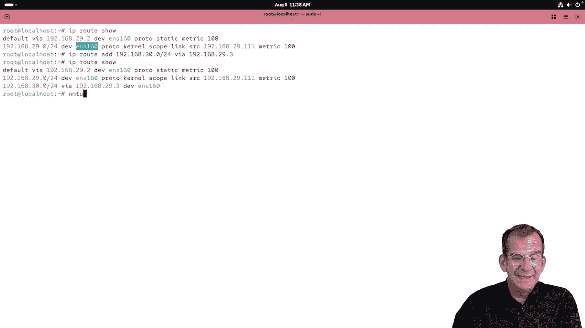
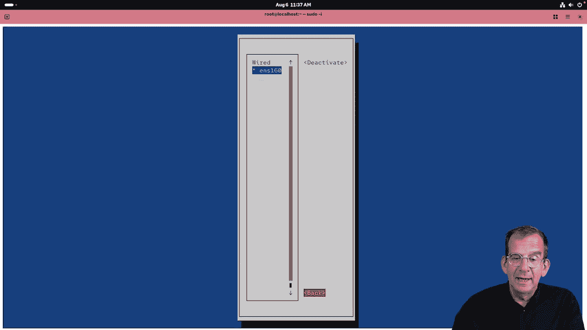
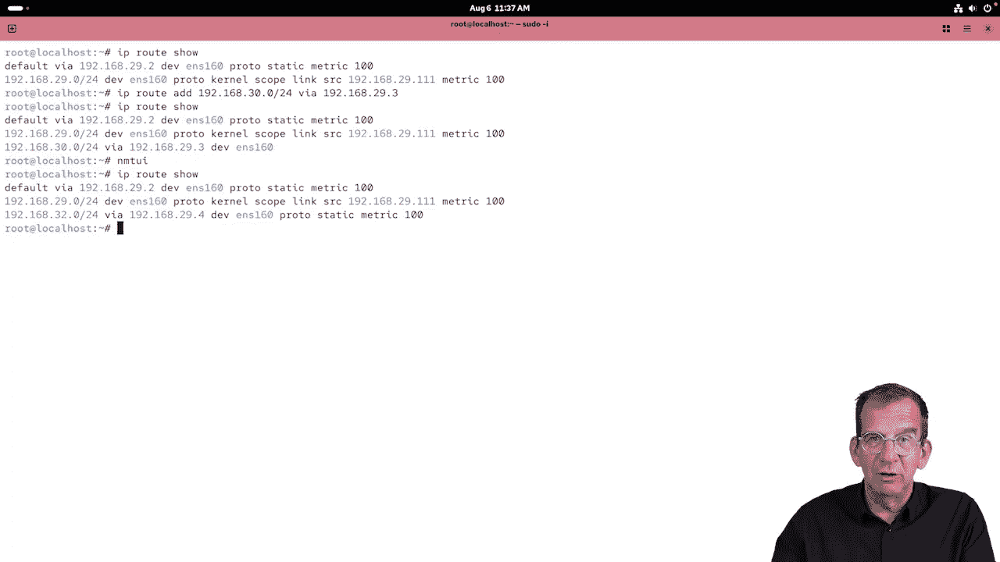

# CompTIA Linux+ V8：23：创建静态路由 🛣️

在本节课中，我们将一起学习 Linux 网络路由的基础知识，重点了解默认网关的作用，以及在什么情况下需要手动添加静态路由。我们会先看看系统如何通过默认网关访问外部网络，再学习如何使用 ip 命令临时添加路由，最后了解如何在 Red Hat 和 Ubuntu 系统中配置永久生效的静态路由。课程最后会通过实际演示，带你完成一次完整的路由添加过程，并解释为什么某些配置在重启后会失效。

## 默认网关基础 🌐

在开始讲静态路由之前，我们先回顾一下网络节点最基本的配置，也就是默认网关。每一台联网的电脑都需要知道如何把数据包发给不在自己局域网里的目标。如果一台设备没有配置默认网关，它就只能和本地网段里的设备通信，完全不知道怎么走出去访问互联网或者其他远程网络。简单来说，默认网关就是一台路由器节点，当你的电脑不知道目标地址在哪里时，就会把数据包交给它，由它负责转发。你可以把它想象成小区大门口的保安，你要去外面的世界，必须先经过他。在 Linux 系统中，查看当前默认网关的方法非常直接，只需要使用 ip route show 命令即可。

```bash
ip route show
```

通过运行上述命令，你会在输出中看到类似下面的关键信息。

- 默认路由：通过 default via 指出，表示所有不匹配其他路由的流量都交给这个网关处理。
- 直连网络：表示直接连接的本地网段，数据包无需经过网关即可直达。

搞清楚了默认网关之后，接下来我们要讨论的是一种更灵活的路由方式，也就是静态路由。

## 什么是静态路由 🛤️

默认网关虽然能解决大多数上网问题，但在复杂的企业网络环境里，它并不总是足够。有时候你需要访问一个不在默认网关后面的网络，这时候就需要手动定义一条静态路由，告诉系统：要去某个特定网段，请走指定的路由器。这类情况通常出现在多个路由器互连、多个网段共存的复杂拓扑中，单纯依赖默认网关无法覆盖所有通信需求。

```
目标网络  via  下一跳地址
```

了解完静态路由的概念后，我们来看看如何在系统运行期间临时添加一条路由。

## 运行时添加静态路由 ⚡

如果你只想让路由在当前会话生效，重启网络后就会消失，可以使用 ip route add 命令。这是一种快速测试或临时调整路由的方法，适合不需要长期保留的场景。执行这条命令时，你需要指定要到达的目标网络，以及负责转发的下一跳地址，而这个下一跳必须是你本地网络里当前可以访问到的地址，否则路由添加后也无法通信。

```bash
ip route add 192.168.2.0/24 via 10.0.0.10
```

上面这条命令的作用可以拆解为以下几个要点。

- 192.168.2.0/24：你想要访问的目标网络地址。
- via 10.0.0.10：数据包将发送给的下一跳路由器，必须在本地网段内可达。

临时路由适合测试，但生产环境通常需要路由在重启后依然有效，下面我们看看如何配置持久静态路由。

## 配置持久静态路由 💾

在 Red Hat 系统中，比较常用的工具是 NMTUI，它提供了一个文本界面来编辑网络连接；而在 Ubuntu 系统中，则通常使用 netplan 来管理网络配置。无论使用哪个工具，核心思路都是一样的：把静态路由作为网卡的一个属性来保存，这样系统启动或网络重启时，路由会自动加载，不需要手动再次添加。

```yaml
routes:
  - to: 192.168.2.0/24
    via: 10.0.0.10
```

在 netplan 的配置文件中，你通常会用到下面这两个字段来定义路由。

- to：指定目标网络的 IP 地址和掩码。
- via：指定到达该网络需要经过的本地节点 IP 地址。

理论介绍完了，接下来我们进入实际演示环节，先看如何用命令行添加路由。



## 命令行演示添加路由 🖥️

现在我们直接在终端里操作。首先使用 ip route show 查看系统当前的所有路由表项。你会看到一条标有 default via 的路由，这就是用来访问互联网的默认路由；同时还会看到直连的本地网络，比如绑定在 ENS 160 网卡上的网段，这类直连网络不需要经过网关，数据包可以直接送达。接着我们尝试添加一条不存在的假想网络，比如使用 ip route add 命令指定目标网段和下一跳地址。执行完之后再用 ip route show 检查，你会发现新路由已经出现在列表里。不过要注意，如果目标网络本身并不存在，这条路由虽然能添加成功，但实际上无法进行有效的通信测试。

```bash
ip route add 192.168.3.0/24 via 192.168.29.3
```

除了命令行，我们也可以用图形化的文本界面工具来完成同样的操作，下面看看 NMTUI 是怎么做的。

## 使用 NMTUI 添加静态路由 🔧

在 Red Hat 系统中，打开 NMTUI 并选择编辑连接，进入路由设置界面后，你需要先选择 edit，然后选择 add。在弹出的窗口里，输入要添加的目标网络，例如 192.168.29.0/24，接着填写下一跳地址，也就是本地网络中负责转发的那台计算机 IP，填写完成后点击确定。之后按照之前见过的常规步骤激活连接，退出 NMTUI 界面，回到终端再次执行 ip route show，你就能看到新添加的路由已经生效了。

演示到这里快结束了，最后有一点非常重要，关于路由配置的持久性问题。

## 路由配置的持久性说明 ⏳

在演示的最后，我们需要回顾一个关键知识点。通过 ip route add 命令添加的路由，默认是非持久的。这意味着如果你重启网络接口、重新初始化网卡，或者重启系统，刚才添加的配置就会丢失。刚才的演示也印证了这一点，命令行添加的路由在网络重启后不会保留。因此，如果你希望路由长期有效，必须使用 NMTUI 或 netplan 等工具将其写入配置文件，而不是只依赖临时的 ip 命令。

总结一下非持久配置的特点，主要包括以下内容。





- 仅在当前会话生效。
- 网络接口重启后配置消失。
- 适合临时测试，不适合生产环境长期使用。


本节课中，我们一起学习了默认网关的基本作用，了解了什么是静态路由以及在什么场景下需要使用它。我们还掌握了如何使用 ip route add 命令临时添加路由，并学习了在 Red Hat 和 Ubuntu 系统中配置持久静态路由的方法。最后通过实际演示，确认了路由添加后的效果，并明白了一条重要结论：ip 命令添加的路由是非持久的，长期生效需要写入系统配置。希望这些内容能帮助你更好地理解 Linux 网络路由的工作原理。

