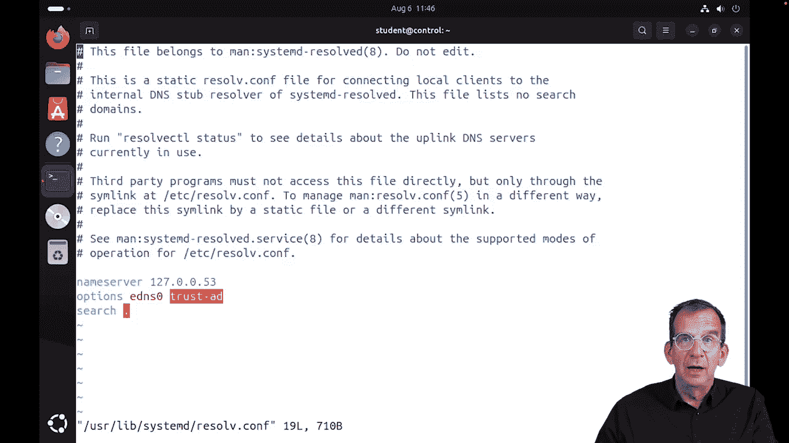

CompTIA Linux+ V8：24：管理 DNS 客户端 🌐

在本节课中，我们将学习 Linux 系统上的 DNS 客户端配置。DNS 客户端的作用是把域名转换成 IP 地址，让你可以通过名字访问网络上的主机。我们会先聊聊 DNS 的基础原理，然后介绍传统的 resolv.conf 文件和本地 hosts 文件，接着说明名称解析的优先级规则。之后会重点讲解 systemd-resolved 服务，并演示怎么查看 DNS 状态、修改 DNS 配置。最后会提醒你配置文件优先级的一些常见陷阱。内容比较基础，适合初学者慢慢理解。

### DNS 基础概念 📡

DNS 的全称是域名系统，它的核心作用是让网络上的每台主机都有一个独一无二的名字，并且可以通过这个名字找到它。你可以把 DNS 想象成互联网的电话本，里面记录了域名和 IP 地址的对应关系。

当你想访问一个域名时，系统需要知道这个域名对应的 IP 地址。这时，计算机会去联系互联网上的 DNS 服务器，查询这个名字背后隐藏的 IP 地址。有了 IP 地址，网络通信才能正常进行。

在 Linux 系统里，传统上由一个特殊的配置文件负责处理 DNS 名字解析，我们把这个机制称为 DNS 解析器。

以下是 DNS 工作的核心逻辑：
- 输入域名
- 发送 DNS 查询
- 获取 IP 地址
- 建立网络连接

这个过程看起来简单，但实际上涉及好几个步骤，缺一不可。

### 传统 DNS 解析文件 📄

在 Linux 上，有一个经典的配置文件专门管 DNS 解析，那就是 `/etc/resolv.conf`。这个文件是 DNS 解析器的核心，记录了系统应该去哪些 DNS 服务器求助。

如果你在本地网络里想通过名字访问某台主机，又不想用 DNS 服务器，可以用 `/etc/hosts` 文件。这个文件可以在本地直接把主机名和 IP 地址绑定起来，不需要联网查询。

具体做法就是把主机名和 IP 地址写进 `/etc/hosts` 里面。比如你想让系统认识一台叫 `myserver` 的本地主机，就把它的名字和 IP 地址记录在 `/etc/hosts` 中。

以下是 `/etc/hosts` 文件的常见格式：
```
192.168.1.100   myserver
```

### 系统解析器优先级 ⚖️

当一个主机名同时出现在 `/etc/hosts` 和 DNS 服务器里时，系统会优先使用 `/etc/hosts` 里的定义。也就是说，本地文件的优先级比 DNS 服务器高。

这个优先级顺序是由另一个配置文件管理的，也就是 `/etc/nsswitch.conf`。这个文件决定了系统先查哪个来源，再查哪个来源。

以下是名称解析的优先级示例：
```
/etc/hosts 优先级高于 DNS 服务器
```

了解这一点很重要，因为有时候你改了 DNS 配置却没生效，很可能是因为本地 hosts 文件在作怪。

### systemd-resolved 介绍 🔄

在大多数情况下，如果你要设置 DNS 客户端，传统的 `resolv.conf` 是旧标准。在使用 NetworkManager 的系统上，这个文件可以直接编辑，也可以由 NetworkManager 来管理。

不过在基于 systemd 的系统上，比如 Ubuntu，情况就不一样了。这些系统引入了一个新组件，叫作 `systemd-resolved`。

`systemd-resolved` 是 systemd 的一个组件，专门负责管理 DNS 名字解析。它以系统服务的方式运行，和网络栈通信，确保可以使用多个 DNS 来源，并且会把 DNS 记录缓存起来，提高查询速度。

以下是 systemd-resolved 的主要职责：
- 管理 DNS 名字解析
- 作为系统服务运行
- 支持多个 DNS 来源
- 缓存 DNS 记录

### 查看 DNS 状态 🔍

想知道当前 DNS 配置的状态，可以使用 `systemctl` 命令检查 `systemd-resolved` 服务是否正在运行。

具体命令如下：
```
systemctl status systemd-resolved
```

如果服务显示为 active running，就说明 systemd-resolved 正在管理你的 DNS 配置。

另外，还可以用 `resolvectl` 命令查看当前的 DNS 配置详情。

命令如下：
```
resolvectl status
```

这个命令会告诉你系统当前正在使用哪些 DNS 服务器，配置是否正确。

### 修改 DNS 配置 ✏️

如果你想覆盖现有的 DNS 配置，可以编辑 `/etc/systemd/resolved.conf` 文件。编辑完成后，需要重启 `systemd-resolved` 服务，让修改生效，并把正确信息写入 `/etc/resolv.conf`。

下面是一个演示过程。先用编辑器打开配置文件：

```
sudo vim /etc/systemd/resolved.conf
```

在文件里加上一行，指定 DNS 服务器，比如 Google 的公共 DNS：

```
nameserver 8.8.8.8
```

保存退出后，重启服务：

```
sudo systemctl restart systemd-resolved
```

这时候再检查配置文件，你会发现刚才加入的 `8.8.8.8` 可能不见了。这是因为系统有自己的配置覆盖机制，不是直接改这个文件就能一劳永逸的。

### 配置文件优先级与陷阱 ⚠️

事实上，如果你想改 DNS 配置，真正需要关注的输入文件是 `/run/systemd/resolve.conf`，这是实际被使用的配置文件。`/usr/lib/systemd/resolved.conf` 这类文件通常是由软件包提供的，不建议直接修改。

正确的做法是，把文件复制到 `/etc/systemd/resolved.conf` 之后再编辑，这样你的修改才会真正生效并写入 `resolved.conf` 配置中。

这个过程可能有点绕，但你最好了解清楚，否则改来改去配置永远不会生效。



以下是修改 DNS 配置的推荐步骤：
1. 不要直接编辑 `/usr/lib/systemd/resolved.conf`
2. 复制文件到 `/etc/systemd/resolved.conf`
3. 编辑 `/etc/systemd/resolved.conf`
4. 重启 `systemd-resolved` 服务


在本节课中，我们一起学习了 DNS 客户端的基础概念、传统的 `/etc/resolv.conf` 和 `/etc/hosts` 文件、名称解析的优先级规则，以及 systemd-resolved 服务的使用方法。我们还演示了如何修改 DNS 配置，并提醒了配置文件优先级的常见陷阱。希望这些内容能帮助你更好地理解 Linux 上的 DNS 客户端管理。
