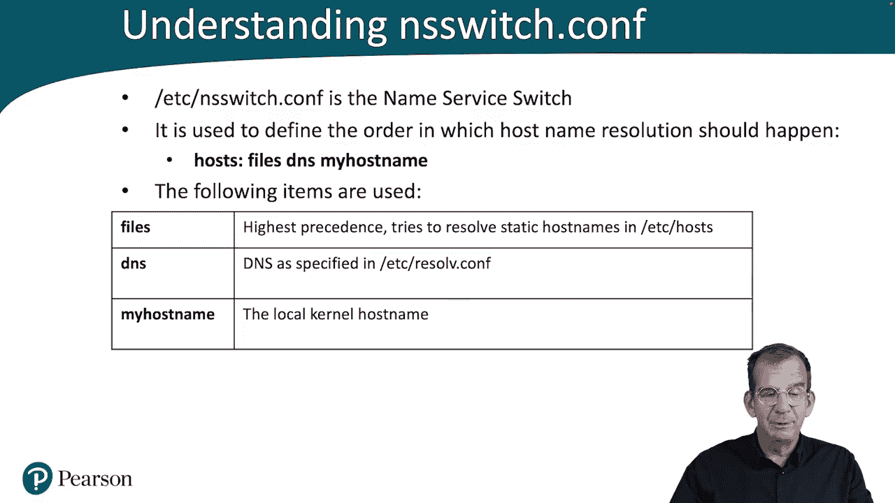

# CompTIA Linux+ V8：25：理解名称服务切换 🌐


在本节课中，我们将学习名称服务切换（Name Service Switch）的相关知识。名称服务切换是 Linux 系统中用来决定主机名解析顺序的重要机制。通过本节内容，你将了解这个机制的配置文件、工作原理以及实际应用场景。无论你是刚开始接触 Linux 的新手，还是希望巩固网络基础的学习者，都能从中获得实用的帮助。


## 什么是名称服务切换

上一节我们介绍了主机名解析的基础概念，本节中我们来看看系统究竟按照什么顺序来查找主机名对应的 IP 地址。

名称服务切换定义在配置文件 /etc/nsswitch.conf 中。这个文件的作用是指定系统在解析主机名时，应该优先查询哪种数据源，以及后续的备选顺序。简单来说，它决定了当你输入一个域名时，系统是先查本地 hosts 文件，还是先向 DNS 服务器发起请求。

以下是配置文件的核心语法形式：

```text
hosts files dns myhostname
```

在这一行中，`hosts` 表示我们要配置的是主机名解析服务。后面跟着的 `files`、`dns`、`myhostname` 就是查询顺序。系统会严格按照从左到右的顺序依次尝试，直到找到匹配结果为止。


## 配置文件中的查询源

刚才我们看到了配置文件的示例内容，本节中我们来看看每个查询源分别代表什么含义。

在这个配置项中，可以使用多个不同的项目，常见的包括以下几种：

- files：代表查询本地文件，具体就是 /etc/hosts 文件。这个来源的优先级最高，系统会先检查本地静态主机名记录。
- dns：代表使用域名系统，系统会读取 /etc/resolv.conf 中指定的 DNS 服务器地址，并向其发起解析请求。
- myhostname：代表使用本地主机名，即系统自身的主机名配置。

当系统按照顺序查询时，如果在第一个来源就找到了匹配结果，就会立即停止后续查询，不会再去检查后面的来源。这种机制确保了最优先的配置始终生效。




## 实际操作演示

了解了配置原理之后，本节中我们来看看如何通过修改本地文件来改变解析结果。

首先查看 /etc/nsswitch.conf 文件，找到 hosts 这一行，确认内容是 `hosts files dns myhostname`。这意味着系统会优先查看 /etc/hosts 文件。

接下来，我们可以尝试在 /etc/hosts 文件中添加一条记录，将 google.com 指向 IP 地址 192.168.29.111。添加完成后，使用 ping 命令测试 google.com，你会发现系统返回的 IP 地址正是 192.168.29.111，而不是通过 DNS 解析得到的真实 Google 服务器 IP。

以下是操作示例：

```bash
echo "192.168.29.111 google.com" >> /etc/hosts
ping google.com
```

这种做法看起来可能有点奇怪，甚至让人感到困惑。但实际上，有些管理员会刻意利用这种机制，确保某些基于互联网的主机无法被直接访问，从而起到简单的访问控制作用。


## 本节总结


在本节课中，我们一起学习了名称服务切换的概念、配置文件 /etc/nsswitch.conf 的工作方式，以及主机名解析的优先级顺序。我们还通过实际示例演示了如何在 /etc/hosts 中添加记录来覆盖 DNS 解析结果。希望这些内容能帮助你更好地理解 Linux 系统是如何处理主机名查询的。
