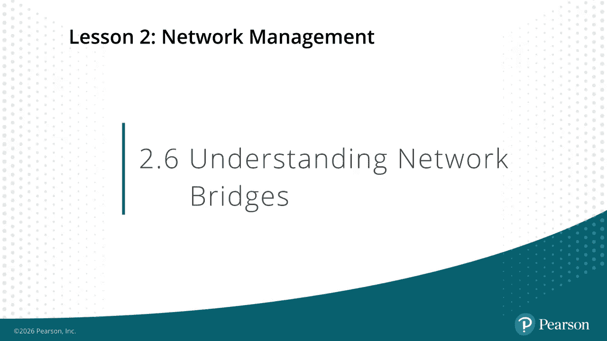
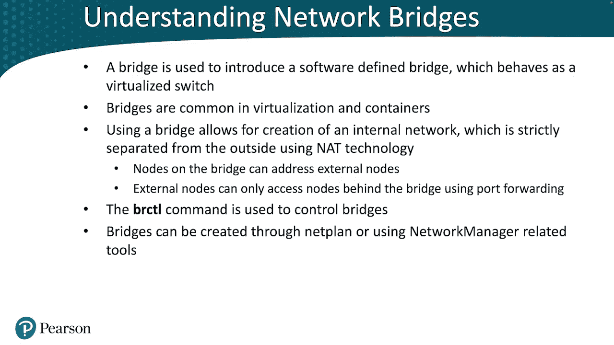
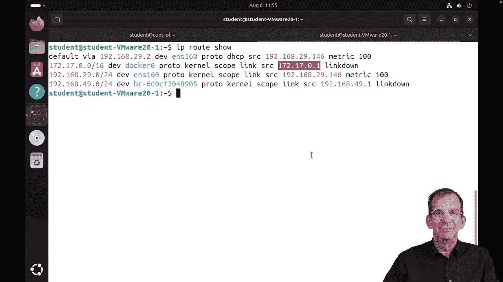

# CompTIA Linux+：255.26：理解网络网桥 🌉



## 课程概述

在这节课中，我们将一起学习网络网桥是什么，以及它在虚拟化和容器环境中是如何工作的。网桥是一个比较基础但又非常重要的概念，特别是当你开始接触虚拟机或者Docker容器的时候，你一定会遇到它。我们会用大白话把网桥的作用讲清楚，也会演示怎么在Linux系统里查看网桥。

## 什么是网络网桥

网络网桥，简单来说就是一种软件定义的桥接设备，它的行为表现就像一台虚拟化的交换机。在计算机网络里，网桥的主要任务就是把不同的网络段连接起来，让数据包能够在它们之间正确地转发。

网桥在虚拟化技术和容器技术当中，使用得非常普遍。

以下是网桥的主要作用：
- 它允许你定义一个内部网络，让虚拟机或者Docker容器连接进去。
- 使用网桥可以借助网络地址转换技术，也就是NAT，来创建一个和外部网络严格隔离的内部网络。这样一来，所有连接到这个网桥上的设备，都无法直接从外部访问到。
- 不过，如果有需要的话，连接在网桥上的节点也是可以访问外部节点的。

## 网桥的网络隔离与访问控制

当你使用网桥的时候，外部网络和内部网络之间是有隔离的，这是网桥的一个重要特性。

外部节点想要访问网桥后面的设备，只能使用端口转发的方式。这也是为什么在后面学习Docker容器时，我们访问容器必须配置端口转发。如果没有端口转发，外部根本无法直接连接到容器里面的服务。

## 常用命令与创建工具

管理网桥在Linux系统里有一些常用的工具和命令。

以下是常见的操作方式：
- `brctl`命令是一个常用命令，可以用来管理和控制网桥。
- 除了命令行，网桥也可以通过网络配置工具或者相关的网络管理工具来创建。

不过在实际工作中，你绝大多数时候遇到网桥，都是在容器化环境里。



## 实例演示：查看Docker0网桥

下面我来给大家演示一下，怎么在Ubuntu虚拟机里查看Docker的网桥。

现在我登录到了一台Ubuntu虚拟机上面。接下来我要执行`ip link show`命令，让我们看看输出结果。这里面有一个叫Docker0的网络接口。这个Docker0就是Docker的网桥，专门供Docker容器使用。

这个网桥对应的内部网络地址段是172.17.0.1，所有的Docker容器都在这个网络后面。

网桥在数据转发上的作用可以用下面这个简单的方式来理解：

```
虚拟机/容器 <--> 网桥 <--> 外部网络
```

那我们再来看看`ip route show`命令的输出。执行`ip route show`命令可以查看这个内部网络的路由表。这意味着，如果主机接收到任何发往172.17.0.0网段的传入请求，系统就会把这些请求转发到172.17.0.1。如果当前有Docker容器在运行，那么这个网桥就是用来让我们访问这些容器的关键通道。

关于网桥的更多内容，我们会在第21课中详细学习。

## 课程总结



本节课中我们一起学习了网络网桥的基本概念，了解了它在虚拟化和容器环境中的应用，也掌握了怎么用`ip link show`和`ip route show`命令来查看Docker0网桥。希望这节课对你有所帮助。
