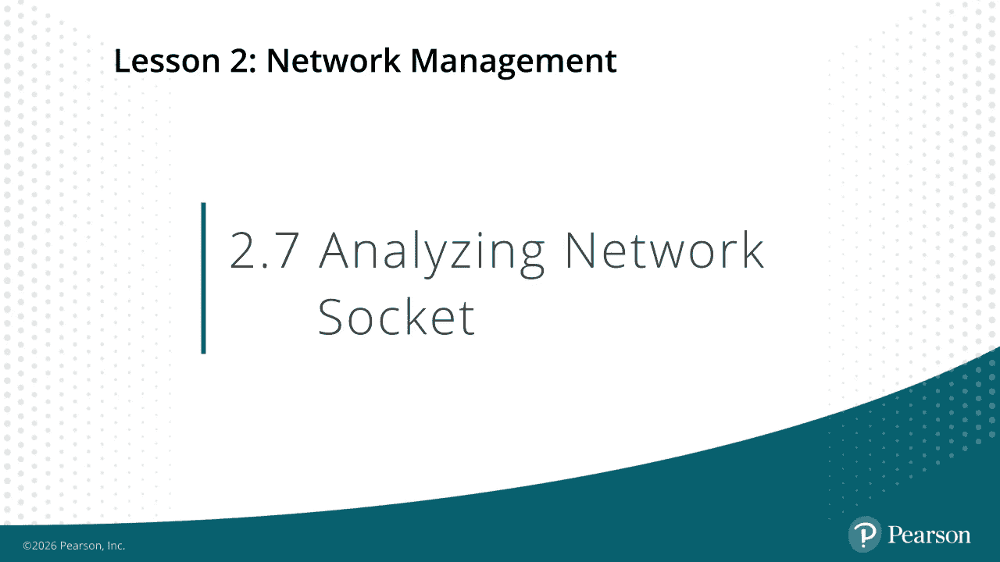
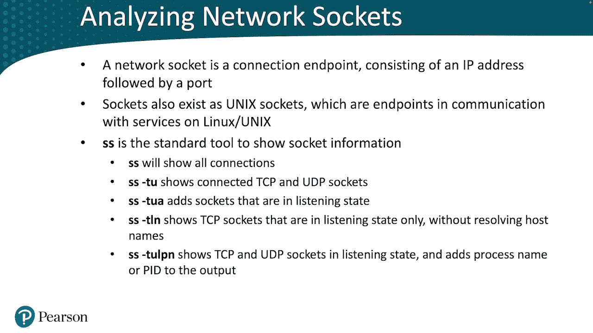
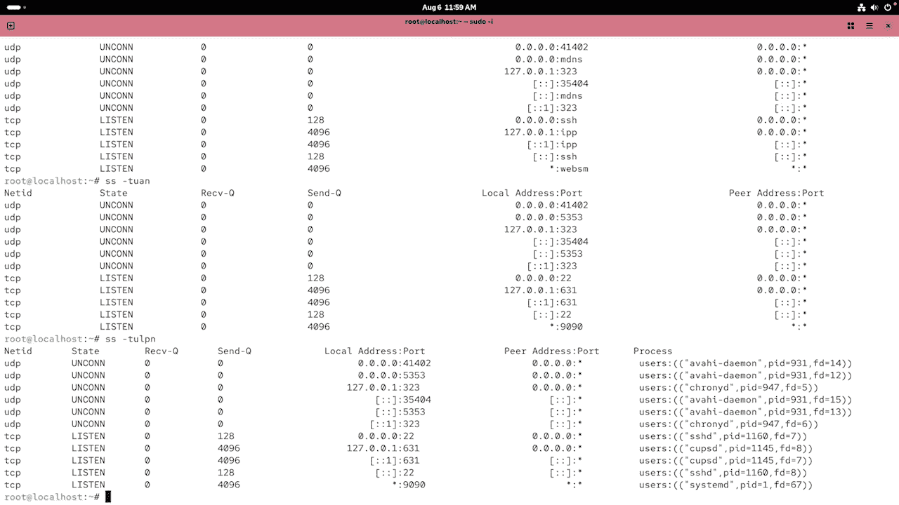

🌐 CompTIA Linux+ V8：256：27 分析网络套接字




在本节课中我们将要学习如何分析网络套接字。网络套接字是 Linux 系统中非常基础的网络通信概念，掌握它之后你就能明白程序是怎么通过网络和外界交换数据的。本节课会先解释套接字的基本构成，然后介绍一个常用的查看工具，最后演示如何结合参数找出具体的监听进程。内容会尽量用大白话讲解，即使你之前没有相关经验也能跟上。


我们先来看看套接字到底是什么。

网络套接字简单来说就是网络通信的一个端点。你可以把它想象成电话线两端的插座，数据需要通过这个插座才能进出。一个完整的网络套接字由两部分组成，公式如下：

```text
网络套接字 = IP 地址 + 端口号
```

比如 `127.0.0.1:80` 就是一个典型的网络套接字。这里的 `127.0.0.1` 表示本地主机，也就是你自己正在使用的这台机器，而 `80` 表示端口号。这个套接字的意思是，本机上的 80 号端口正在监听连接。

除了基于 IP 地址和端口的套接字，Linux 里还有一种叫作 Unix 套接字的东西。Unix 套接字也是通信端点，不过它主要用于同一台 Linux 或 Unix 系统上的服务之间进行内部通信，不一定需要经过网络协议栈。理解这一点有助于你以后排查本地服务的连接问题。


了解完套接字是什么之后，接下来我们需要知道怎么在系统里把这些套接字查出来。

在 Linux 系统中，查看网络套接字最常用的工具之一是 ss 命令。

ss 是一个标准工具，专门用来显示套接字信息。它的作用是取代老旧的 netstat 工具，功能更全面，输出也更详细。执行 ss 不带任何参数时，它会显示当前系统中所有的网络连接，包括已经建立的连接和正在监听的端口。



以下是 ss 命令常用的几个参数及其含义：

- `ss -tu`：显示已建立连接的 TCP 和 UDP 套接字。
- `ss -ta`：在已建立连接的基础上，额外显示处于监听状态的套接字。
- `ss -tln`：只显示处于监听状态的 TCP 套接字，并且不解析主机名，直接显示 IP 地址。
- `ss -topen`：显示处于监听状态的 TCP 和 UDP 套接字，并在输出中加入进程名称或进程 ID。

这些参数可以单独使用，也可以组合使用，具体取决于你想看到什么样的信息。


光知道参数还不够，我们需要在实际命令行里看看这些参数产生什么效果。

在终端里直接输入 `ss`，你会看到大量信息刷屏出来，很多条目看起来像文件，也有很多看起来像网络连接。如果输出内容太多，看不清楚，可以把结果通过管道传给 less 命令，比如 `ss | less`，这样就可以一页一页地查看了。

这里有一个初学者容易混淆的地方，套接字里的本地地址不一定总是 IP 地址，有时候它其实是一个文件路径。端口号也可以和某个文件关联。这就是套接字的核心思想，套接字不仅仅局限于 IP 地址和端口号，它更广泛地指代各种通信端点。

如果你只想看 TCP 和 UDP 的已连接套接字，可以用 `ss -tu`。如果想再加上处于监听状态的套接字，就在参数后面加上 `a`，变成 `ss -tua`。如果希望输出里直接显示端口数字而不是服务名称，可以再加上 `n`，比如 `ss -tun`。

在日常运维中，我最喜欢的一个组合是 `ss -tlpn`。这个命令不仅能告诉你哪些套接字在监听，还会把监听这些套接字的进程信息一起显示出来。这在排查系统安全问题时非常有用，比如当你发现系统上有一个不应该存在的监听套接字时，你可能想要把它关掉。这时候输出中的进程名称和 PID 就能帮你定位到具体的进程，之后就可以使用 `kill` 命令把这个进程终止掉，从而清理掉非法套接字。




本节课中我们一起学习了网络套接字的基本概念，了解了它由 IP 地址和端口号组成，也知道了 Unix 套接字用于本地服务通信。我们重点介绍了 ss 工具，学习了如何用它取代 netstat，以及如何用 `-tu`、`-ta`、`-tln`、`-topen` 等参数筛选套接字信息。最后还演示了 `ss -tlpn` 怎么帮助你找到监听进程的 PID，并配合 `kill` 命令处理异常套接字。希望这些内容能帮助你更好地理解 Linux 网络通信。
