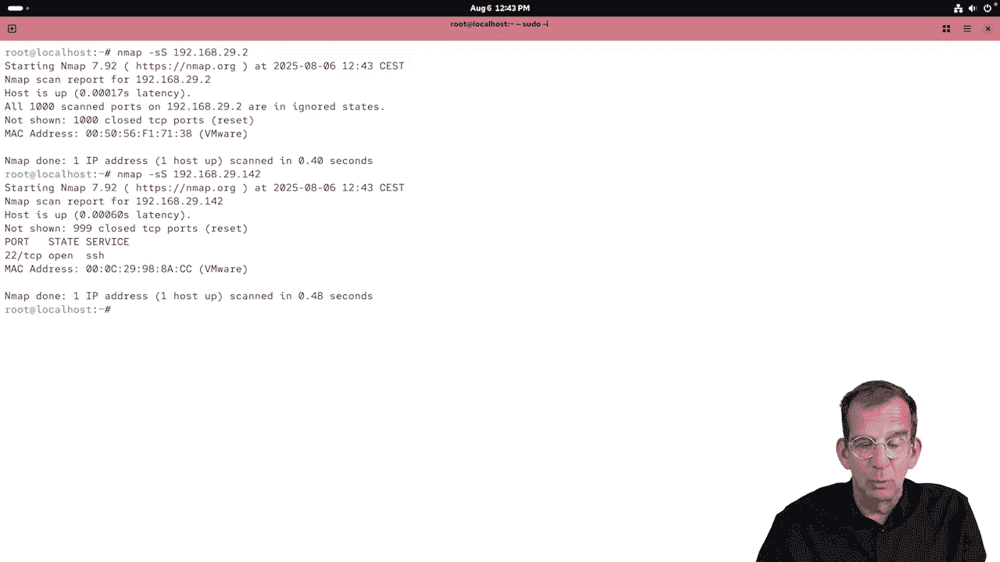

📡 CompTIA Linux+ V8：28：分析网络流量与 tcpdump 和 Nmap

在本节课中，我们将要学习如何在 Linux 系统中分析网络流量。网络分析是运维和安全工作中非常基础的一项技能，通过它你可以了解数据在网络中是如何流动的，也可以发现哪些端口是开放的。本节课会重点介绍两个实用工具，一个是 tcpdump，另一个是 Nmap。我们还会简单看看 Wireshark 这个图形化工具。无论你是初学者还是有一点经验，内容都会尽量用大白话讲解，希望能让你看懂并上手。

首先我们来看看 Linux 自带哪些常用的网络分析工具。

Linux 系统中内置了很多不同的实用工具，它们允许你分析网络情况。其中最常用且最强大的两个工具是 tcpdump 和 Nmap。tcpdump 可以用来抓取和查看网络流量，Nmap 则可以用来分析开放端口和网络主机。这两个工具合起来，能够覆盖大部分日常的网络排查需求。

以下是本节课将涉及的核心工具列表：

- tcpdump：用于捕获和分析网络数据包
- Nmap：用于扫描主机、端口和服务版本
- Wireshark：用于图形化查看抓包文件

接下来我们详细看看 tcpdump 是如何工作的。

tcpdump 的作用就是把网络上的数据包“截获”下来并显示出来。如果你直接运行 tcpdump，它会监听所有的网络接口。这意味着你会看到非常多的输出，因为机器上可能同时有多个网卡在收发数据。屏幕上会显示进来的数据和检测到的流量类型，画面可能会比较繁忙。

例如，在抓包过程中你可能会看到 DNS 请求，也可能会看到局域网里打印机或扫描仪的通信信息。有时候还能直接看到设备的型号名称，比如这里出现了一台佳能扫描仪。同时你也能看到 DNS 流量，系统正在请求指针记录，但返回结果是没有那个域名，这种信息对排查网络问题很有用。

如果你想让 tcpdump 工作得更高效，通常建议指定要监听的网卡名称。命令如下：

```
tcpdump -i ENS160
```

这条命令只会抓取网卡 ENS160 上的流量，如果你的机器有多个网络接口，这样做会非常方便。

为了让输出更易读，你还可以加上 -a 选项，把数据包以 ASCII 格式显示。前提是数据包本身是可以读取的格式。

如果你想把抓取到的数据保存下来，稍后再分析，可以使用 -w 选项生成抓包文件。命令示例如下：

```
tcpdump -w /tmp/dump.pcap
```

这里生成的 dump.pcap 是一个标准的抓包文件。保存文件的好处是，你可以先产生一些网络流量，比如 ping 一个外部域名，然后稍后用其他工具仔细分析文件里的内容。

有时候你只关心某个特定端口上的流量，这时可以加上端口过滤条件。比如只抓取 SSH 流量，命令如下：

```
tcpdump port 22
```

运行后，如果你用 SSH 连接到 192.168.29.142，你就会看到 SSH 的数据包被实时抓取出来。

另外，如果输出内容太多让你眼花缭乱，还可以加上源地址过滤，只显示来自特定 IP 的数据包。这是因为 tcpdump 的输出往往非常庞大，加过滤条件能帮你聚焦到真正关心的部分。

抓包文件保存下来之后，我们需要一个工具来把它打开看个究竟。


这时候 Wireshark 就派上用场了。你可以先用包管理器搜索一下是否已经安装：

```
dnf search wireshark
```

如果系统里已经有，就可以直接安装：

```
dnf install wireshark
```

Wireshark 是一个图形化实用工具，它的优点在于能够非常直观地展示网络中发生了什么。你可以把 tcpdump 生成的 /tmp/dump.pcap 文件交给 Wireshark 打开。pcap 是抓包文件的标准格式，专门用来存储网络数据包。

打开文件后，你可以看到里面包含 DNS 请求等信息。从 DNS 请求开始，逐个查看数据包的详细信息，就能知道网络里到底传输了什么内容。Wireshark 还支持实时抓包捕获，你可以先设置好过滤条件，然后开始捕获，找到你想要的数据。

以下是使用 Wireshark 的基本步骤：

1. 使用 tcpdump 生成 pcap 文件
2. 用 Wireshark 打开该文件
3. 在图形界面中查看数据包详情
4. 如有需要，也可以进行实时抓包

除了 tcpdump 和 Wireshark，另一个必不可少的工具是 Nmap。

Nmap 是一个非常强大的实用工具，有些人把它当作黑客工具。因此有一条非常重要的原则：在没有目标主机所有者授权的情况下，绝对不要使用 Nmap。如果你擅自扫描他人网络，可能会被网络管理员封禁，甚至引发不必要的麻烦。

Nmap 的核心用途是分析网络和端口，它能够显示远程主机上哪些端口是开放的。而且它有多种扫描方式，可以帮助你绕过防火墙。如果目标机器运行了防火墙，普通的端口嗅探可能行不通，而 Nmap 可以提供帮助。

安装 Nmap 的命令如下：

```
dnf install nmap
```

使用 Nmap 时要非常小心，尤其是在公网上，最好完全不要扫描。我们只在自己的局域网里进行演示，目标地址是 192.168.29.142，这是我知道在自己系统中开放的一个 IP 地址。

直接扫描这个地址，结果显示只开放了 SSH 端口，并且识别出了 VMware 网卡。如果你想进一步探测操作系统，可以使用 -O 选项：

```
nmap -O 192.168.29.142
```

扫描结果可能会告诉你系统内核大概是 4.x 或 5.x 范围，这是根据协议头部的具体细节推断出来的，通常比较精确。

如果你想了解本地网络里有哪些 IP 地址是活跃的，可以使用网络扫描选项。命令示例如下：

```
nmap -sn 192.168.29.0/24
```

这样可以快速发现你此前不知道的可用 IP 地址。扫描结果会从 IP 地址开始列出，后面跟着更多信息。比如你可能会看到 146 或 124 这样的地址，如果不清楚是什么设备，可以进一步针对性扫描。

有时候你想检查目标机器是否启用了防火墙，可以使用专门的扫描选项来探测防火墙状态。如果觉得结果不理想，也可以换一台主机再试。

想知道某个服务的具体版本时，可以使用 -sV 选项：

```
nmap -sV 192.168.29.142
```

这样做很有意义，因为某些服务版本可能存在已知漏洞，通过版本探测你可以发现潜在的安全问题。

如果你只想扫描几个特定端口，而不是全部端口，可以使用 -p 选项指定端口列表：

```
nmap -p 80,443,22 192.168.29.142
```

这里我特意加上了 22 号端口，因为我知道它正在监听。扫描只针对这些特定端口进行。即使端口号写错了，也不影响整体理解，重点在于你可以指定端口范围。

当你遇到一台机器，怀疑上面运行了非常严格的防火墙，这时可以考虑使用隐蔽扫描。隐蔽扫描会尝试低调地探测服务器，看看到底发生了什么。在 192.168.29.2 这台路由器上，即使是隐蔽扫描也能很快完成，结果表明路由器上没有其他活跃端口。

不过要做好心理准备，在某些情况下，使用隐蔽扫描可能需要等待很长时间。

以下是 Nmap 常用扫描选项总结：

| 选项 | 含义 |
|------|------|
| -O | 操作系统探测 |
| -sn | 网络存活扫描 |
| -sV | 服务版本探测 |
| -p | 指定端口扫描 |



本节课中我们一起学习了在 Linux 中分析网络流量的基本方法。首先介绍了 tcpdump 的使用，包括全网卡监听、指定网卡、ASCII 显示、保存 pcap 文件、端口过滤和源地址过滤。接着介绍了 Wireshark 如何打开和可视化 pcap 抓包文件，让数据包分析更直观。最后详细讲解了 Nmap 的安装和各种扫描方式，包括操作系统探测、网络扫描、服务版本探测、指定端口扫描和隐蔽扫描。希望这些内容能帮助你入门网络流量分析，并在实际工作中安全合规地使用这些工具。

