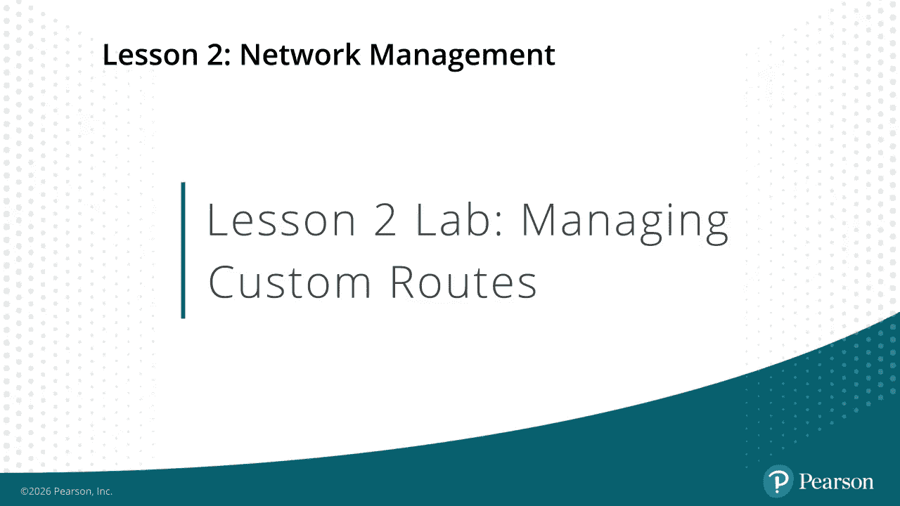
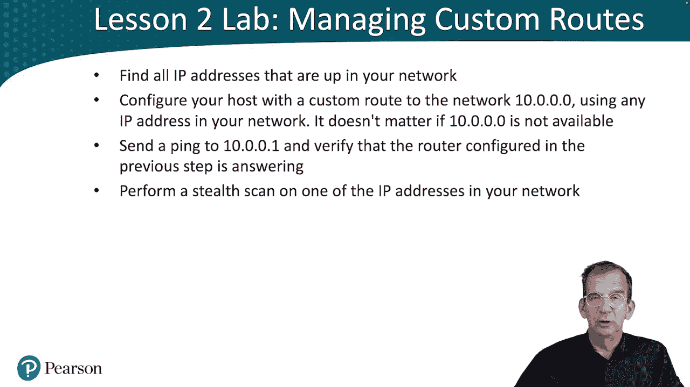

# 🖧 Linux+ 教程：第 2 课：管理自定义路由实验


在本节课中，我们将学习如何在 Linux 系统中管理自定义路由。本节课的内容是一个实验课，你需要完成几个具体的操作任务。通过这些任务，你可以理解网络流量是如何被引导的，以及如何检查路由是否生效。本节课适合刚开始学习 Linux 网络配置的初学者，讲解会尽量使用大白话，避免复杂的术语。


这节课的实验包含多个任务，你需要按照顺序完成每一个步骤。下面我们先来看看第一个任务是什么。


## 第一步：查找网络中所有活跃的 IP 地址


在开始配置路由之前，你需要知道网络里哪些 IP 地址是当前在线的。这可以帮助你确认目标主机是否可达，也能为后续的扫描任务提供目标选择。



以下是查找活跃 IP 地址的方法：

- 在终端中运行网络邻居表查询命令，查看本机已知的活跃设备
- 使用 `ip neigh show` 命令列出当前可达的 IP 地址
- 如果需要，可以通过发送 ICMP 请求来探测网段内其他主机的状态


完成这一步之后，你应该掌握网络中哪些 IP 地址处于活跃状态，这样我们才能继续下一步的路由配置工作。


## 第二步：为主机添加指向网络 10000 的自定义路由

接下来，你需要在自己的主机上配置一条自定义路由。这里的目标网络是 10000，这个网络实际中可能并不存在，但这不影响我们验证路由配置是否正确。

自定义路由的核心命令如下：

```bash
ip route add 10000 via <网关IP地址>
```

这条命令的意思是，把发往网络 10000 的流量交给指定的网关处理。配置完成后，你可以使用路由表查看命令确认这条路由已经生效。


## 第三步：发送测试报文并验证自定义路由是否生效

添加路由之后，我们需要验证这条路由是否真的起作用了。你可以向网络 10000 发送一个 ping 测试报文，然后观察是否收到来自路由器的响应。

验证步骤如下：

- 使用 `ping` 命令向 10000 网络发送测试数据包
- 观察输出结果，确认是否收到路由器返回的应答
- 如果收到应答，就证明自定义路由已经正常工作

验证公式：`自定义路由生效 = 向 10000 发送 ping 且收到路由器应答`


## 第四步：对网络中一个 IP 地址进行隐蔽扫描

最后一个任务是对网络里某个活跃 IP 地址进行隐蔽扫描。隐蔽扫描的目的是在不被轻易发现的情况下探测目标主机的开放端口。

推荐使用的工具和命令：

- 使用 `nmap` 工具执行隐蔽扫描
- 命令示例：`nmap -sS <目标IP地址>`
- 选项 `-sS` 表示 TCP SYN 隐蔽扫描，属于较为隐蔽的扫描方式




完成这一步之后，本节实验的所有任务就全部结束了。


在本节课中，我们一起学习了如何查找网络中活跃的 IP 地址，如何在 Linux 主机上添加指向不存在网络的自定义路由，如何通过 ping 测试验证路由是否生效，以及如何对网络中的某个 IP 地址执行隐蔽扫描。希望这些内容能帮助你更好地理解 Linux 网络路由的基本原理。

