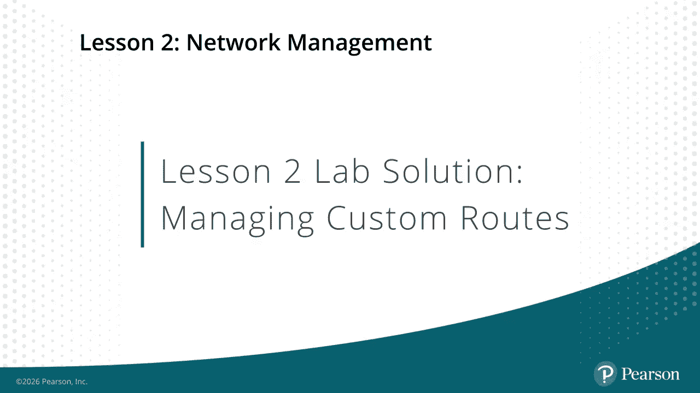
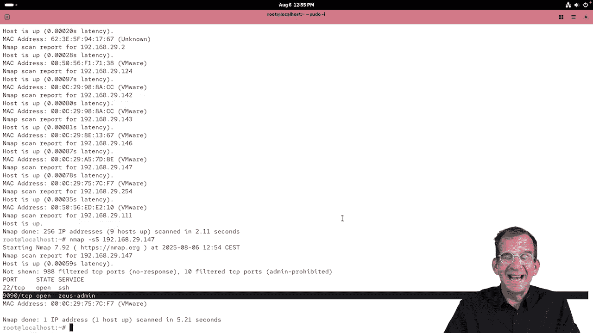

# CompTIA Linux+ 网络管理：02：管理自定义路由 🌐

## 概述 📚


在本节课中我们将要学习如何在 Linux 系统中管理自定义路由。路由决定了数据包从一台计算机发送到另一台计算机时应该走哪条路径。有时候默认路由不够用，我们需要手动添加一条规则来告诉系统，某些 IP 地址应该通过哪个网关发送。本节课会一步步带你完成添加路由、测试连通性以及使用网络扫描工具的全过程。我们还会讨论网络扫描的一些安全注意事项，确保你在合法授权的前提下操作。



## 查看当前路由表 🔍

上一节我们简单介绍了网络配置的基础概念，本节中我们来看看如何查看系统当前的路由表。在 Linux 中，查看路由信息最常用的方法就是使用 ip route show 命令。这个命令会列出系统中所有已知的路由条目，包括默认网关和直连网络。通过它，你可以确认当前系统已经知道哪些网络，以及数据包默认会发往哪里。

以下是查看当前路由表的命令：

```bash
ip route show
```

执行后，系统会输出一系列路由记录。每一行代表一条路由规则，告诉内核当数据包目的地匹配某个网段时，应该通过哪个网卡或网关转发。如果你看到默认路由，那通常就是你上网的主要出口。

## 添加自定义路由 🛣️

接下来我们要添加一条自定义路由。有时候系统不知道如何到达某个远程网段，这时就需要手动指定。本例中，我们想让系统知道 10.0.0.0/8 这个网段应该通过 192.168.29.142 这个地址进行转发。即使这个地址本身不一定提供完整的路由功能，添加这条记录仍然可以帮助系统尝试发送数据。

以下是添加自定义路由的命令：

```bash
ip route add 10.0.0.0/8 via 192.168.29.142
```

核心公式：`目标网络/掩码 via 网关地址`

命令执行完成后，你可以再次运行 ip route show 来确认新增的路由已经出现在列表中。这意味着系统现在知道，凡是要发往 10 开头的 IP 地址，都应该先交给 192.168.29.142 处理。

## 测试网络连通性 📶

添加路由之后，我们需要验证它是否真的生效。最简单的方法就是使用 ping 命令发送测试数据包。在这里我们尝试 ping 通 10.0.0.3，看看数据包能否成功到达目标并返回。

以下是测试命令：

```bash
ping 10.0.0.3
```

然而，实际运行后你可能会收到一个“重定向”消息。这里的重定向意味着路由器告诉你的计算机：“我不是这个网段的路由器，你应该去问 192.168.29.2”。虽然路由器做出了回应，但最终 ping 并没有成功，你收不到任何回复数据包。这种情况是正常的，它说明网络中存在某些设备，但目标地址本身可能并不可达，或者中间设备拒绝转发。

## 扫描局域网主机 🖥️

为了进一步了解这个网络里有哪些设备，我们需要进行网络扫描。网络扫描可以帮助我们发现同一网段中所有存活的主机，从而掌握网络拓扑。这里使用的是 nmap 工具，它是网络安全和系统管理中非常常用的一款扫描软件。

以下是扫描整个 192.168.29.0/24 网段的命令：

```bash
nmap -sn 192.168.29.0/24
```

-sn 参数表示只进行主机存活探测，不扫描端口。等待几秒钟后，nmap 会列出所有响应的 IP 地址。这样你就能清楚地知道当前网络里哪些地址被占用，哪些设备在线。

## 执行隐秘端口扫描 🕵️

找到存活主机之后，下一步往往是检查这些主机开放了哪些端口。端口就像是房间的门，开放的端口意味着该服务正在接受外部连接。这里我们对 192.168.29.147 进行隐秘端口扫描，看看它上面运行了什么服务。

以下是执行隐秘扫描的命令：

```bash
nmap -sS 192.168.29.147
```

-sS 参数表示 TCP SYN 扫描，又称半开放扫描。这种扫描方式不会完成完整的 TCP 握手，因此速度更快，而且不容易被目标系统的日志记录下来。扫描完成后，结果显示该主机开放了 22 号端口和 9090 号端口。22 号端口通常是 SSH 服务，用于远程登录；9090 号端口则可能是某个网页管理界面或其他应用服务。

## 安全使用提示 ⚠️

使用 nmap 这种工具时，有一点非常重要，必须引起足够重视。nmap 被广泛认为是一款黑客工具，在未经许可的网络上随意扫描可能违反法律或公司规定。因此，请务必确保你拥有对目标网络的明确授权，只有在自己管理的网络或获得允许的环境中才使用扫描命令。

以下是安全使用原则：

- 只在获得许可的网络上执行扫描
- 不要扫描公共网络或他人所有的设备
- 将扫描结果用于合法的系统管理和排障目的

## 总结 📝



本节课中我们一起学习了如何在 Linux 中添加自定义路由，并使用 ip route show 验证配置是否生效。我们还通过 ping 测试了连通性，并解释了遇到的 ICMP 重定向现象。接着，我们使用 nmap -sn 扫描了局域网中的存活主机，又用 nmap -sS 对特定主机进行了隐秘端口扫描，发现了开放的 22 和 9090 端口。最后，我们重点强调了使用网络扫描工具必须遵守法律与授权的要求。希望这些内容能帮助你更好地理解 Linux 网络管理的基础操作。
