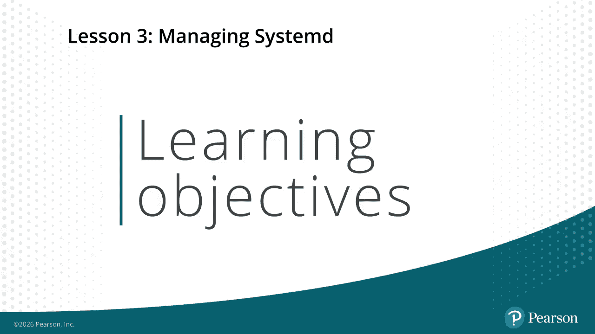

systemd：261：学习目标 📚


在本节课中，我们将一起学习关于 systemd 的高级单元知识。systemd 是现代 Linux 系统里非常核心的系统和服务管理器，几乎所有主流发行版都默认使用它。不管你之前是否接触过 systemd，这一节都会从比较基础的概念开始，逐步带你进入更深入的内容。我们会先了解 systemd 单元是什么，然后学习怎么管理这些单元的运行状态，接着看看怎么自己编写服务配置文件，再深入聊聊 target 和服务之间的依赖关系，最后还会接触到定时器、套接字和挂载单元。课程的最后会安排一个实验，帮助你把所学的知识全部串联起来，真正动手操作一次。


## 课程内容快速概述 🔍


我们先从一个快速概述开始，这样你能对整节课的内容有一个整体的印象。systemd 把系统里的各种资源都抽象成了"单元"，不管是服务、定时器还是挂载点，在 systemd 眼里都是单元。理解单元的概念，是后面所有操作的基础，没有这个基础，后面的命令很容易记混。


以下是我们将要学习的主要内容：



- systemd 单元的基本概念和常见分类
- 使用 systemctl 命令管理单元的启动、停止和重启
- 查看单元当前运行状态的方法


掌握这些内容之后，你就能比较自信地在命令行里操作 systemd，不再觉得它是一个黑盒。


### 管理 systemd 单元状态 🛠️


上一节我们简单介绍了 systemd 单元是什么，本节中我们来看看怎么具体管理单元的状态。单元的状态包括正在运行、已停止、已失败等等，了解状态有助于你排查系统问题。最常用的命令就是 systemctl，它是 systemd 的主要管理工具，几乎所有跟单元相关的操作都要通过它来完成。


你可以使用下面的命令来操作单元：

```bash
systemctl start nginx.service      # 启动 nginx 服务
systemctl stop nginx.service       # 停止 nginx 服务
systemctl restart nginx.service    # 重启 nginx 服务
systemctl status nginx.service     # 查看 nginx 服务的当前状态
systemctl enable nginx.service     # 设置开机自动启动
systemctl disable nginx.service    # 取消开机自动启动
```


这些命令看起来很多，但实际上逻辑很简单。start 就是启动，stop 就是停止，restart 就是重启，status 就是查看状态。enable 和 disable 是控制服务是否随系统一起启动。你只需要记住，所有的操作都围绕着 systemctl 这个命令展开，参数不同，功能就不同。


### 创建自定义 systemd 服务配置和管理 targets 📝


在学会了怎么管理已有单元之后，本节中我们来看看怎么创建属于自己的 systemd 服务配置，以及怎么管理 targets。target 可以理解为系统的运行目标或运行级别，比如多用户模式、图形界面模式等等。不同的 target 包含不同的服务集合，切换 target 其实就是切换系统应该运行哪一组服务。


自定义服务配置文件通常放在 `/etc/systemd/system/` 目录下，以 `.service` 为后缀。一个简单的服务配置文件长这样：

```ini
[Unit]
Description=我的自定义服务
After=network.target

[Service]
ExecStart=/usr/local/bin/my-script.sh
Restart=always

[Install]
WantedBy=multi-user.target
```


这里的 `[Unit]` 部分写服务的描述和依赖关系，`[Service]` 部分写具体要运行什么命令以及怎么重启，`[Install]` 部分写这个服务应该被哪个 target 加载。配置好之后，需要重新加载 systemd 配置才能生效：

```bash
systemctl daemon-reload
systemctl start my-service.service
systemctl enable my-service.service
```


对于 target 的管理，你可以使用以下命令：

```bash
systemctl get-default                      # 查看当前默认 target
systemctl set-default multi-user.target    # 设置默认 target 为多用户模式
systemctl isolate graphical.target         # 切换到图形界面 target
```


target 的概念对初学者可能有点抽象，你可以把它想象成一组服务的打包集合。切换 target，其实就是告诉 systemd："请启动这组里的服务，停止那组里的服务。"

### 服务依赖关系详细讨论 🔗


一旦你理解了 target 是什么，本节中我们就来讨论服务依赖关系的更多细节。在实际的系统中，服务之间很少是孤立存在的，数据库服务可能需要网络服务先启动，Web 服务可能需要数据库服务先就绪。systemd 提供了几种方式来表达这些依赖关系，合理设置依赖能避免很多启动顺序错误导致的问题。


常见的依赖设置包括下面这些选项：

- `Wants=`：表示希望启动这个单元，但如果启动失败也不影响当前服务
- `Requires=`：表示强制依赖，如果这个单元启动失败，当前服务也会失败
- `After=`：表示当前服务应该在指定单元之后启动，但不强制依赖
- `Before=`：表示当前服务应该在指定单元之前启动


举个例子，如果你的 Web 服务依赖于网络就绪，配置文件里可能会这样写：

```ini
[Unit]
Description=Web 服务器
After=network-online.target
Wants=network-online.target
```


这意味着 Web 服务器会在网络就绪之后启动，并且希望网络服务也能启动。理解依赖关系能帮你避免很多启动顺序错误导致的服务无法正常运行。


### systemd 定时器、套接字和挂载单元 ⏱️


除了服务和 target，systemd 还支持定时器、套接字和挂载等其他类型的单元。本节中我们来探索这些进阶的单元类型，它们能让你的系统管理更加灵活，不再局限于传统的方式。


定时器用来代替传统的 cron 任务，可以按照时间或间隔触发某个服务，配置起来更统一。查看系统中所有定时器的命令是：

```bash
systemctl list-timers
```


套接字用于按需启动服务，只有当有客户端连接时，相关的服务才会被启动，这样可以节省系统资源。查看套接字的命令是：

```bash
systemctl list-sockets
```


挂载单元用来管理文件系统的挂载，可以替代传统的 `/etc/fstab` 方式，拥有更好的依赖管理能力。查看挂载单元的命令是：

```bash
systemctl list-mounts
```


这三种单元类型各有侧重，定时器侧重时间触发，套接字侧重按需启动，挂载单元侧重文件系统管理。你可以根据实际需求选择合适的单元类型，让系统运行得更高效。


### 实验与实验解答 🧪


在本节课的最后，你会找到一个实验以及对应的实验解答。实验是巩固知识最重要的环节，光看不练是很难真正掌握 systemd 的。建议你先独立完成实验，遇到困难的时候再参考解答，不要直接跳过去看答案，否则很难形成肌肉记忆。


实验通常会让你创建一个自定义服务，设置它的依赖关系，或者配置一个定时器任务。完成实验之后，你可以尝试修改一些配置，观察系统的反应，这样能加深理解，也能让你更快发现配置错误的表现。


## 总结 📋


本节课中，我们一起学习了 systemd 的高级单元知识。首先介绍了 systemd 单元的基本概念，然后学习了使用 systemctl 管理单元状态的方法，接着讲解了如何创建自定义服务配置和管理 targets，详细讨论了服务之间的依赖关系，最后探索了定时器、套接字和挂载单元的使用。希望通过这一节的学习，你能对 systemd 有更全面的认识，并在实际工作中熟练使用这些工具。

