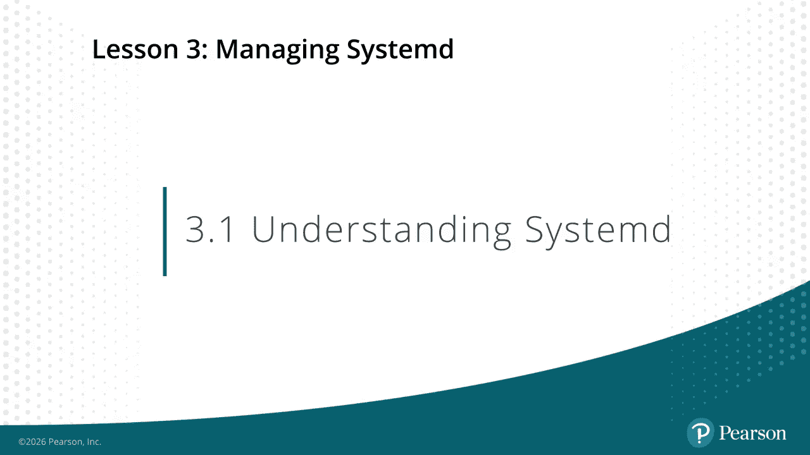
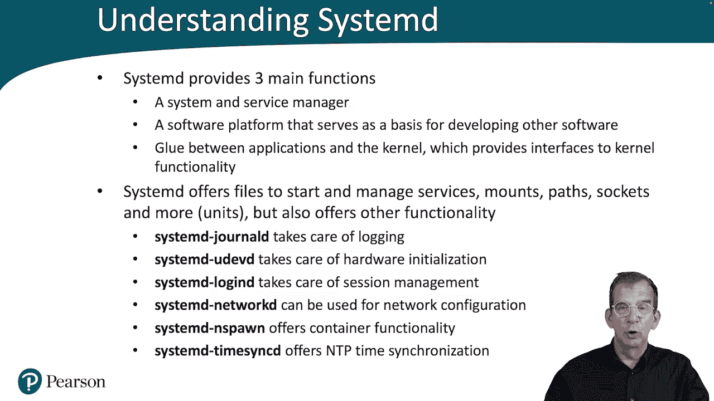

# CompTIA Linux+ V8：262.31：理解 Systemd 🐧



在本节课中，我们将一起学习 Linux 系统中的 systemd。systemd 是 Linux 操作系统中非常核心的一部分，它负责管理系统启动、服务运行、日志记录、硬件初始化、网络配置、容器以及时间同步等多项工作。如果你刚开始接触 Linux，那么理解 systemd 是掌握系统运行机制的关键第一步。我们会用大白话把它的作用拆解开来，让你一眼看清它到底在管什么。


## systemd 是什么？

systemd 可以看作是 Linux 系统里的“总管家”，或者说是“万事之管”。它的主要职责是确保系统运行所需的各项服务都能正常启动，并且在系统运行过程中协调各个部分之间的协作。简单来说，如果没有 systemd，很多服务可能无法自动启动，系统也难以正常工作。


## systemd 的三大核心功能

在 Linux 操作系统中，systemd 主要承担以下三方面的作用，以下是具体说明：

- 系统和服务管理器：systemd 负责启动和管理系统上所有必须运行的服务，确保开机后各项功能可用。
- 软件开发平台：它为开发其他软件提供基础环境，开发者可以基于 systemd 构建更多应用。
- 插件功能平台：systemd 通过不同的插件提供额外功能，让系统具备更强的扩展能力。

用一个简单的公式来描述：

systemd = 系统与服务管理器 + 软件开发平台 + 插件功能平台


## systemd 连接应用与内核

除了上述功能，systemd 还充当应用程序与 Linux 内核之间的“粘合剂”。它提供访问内核功能的接口，让上层应用可以方便地调用底层系统能力。这样一来，应用程序不需要直接去操作复杂的内核细节，而是通过 systemd 提供的统一接口来完成工作，这大大简化了系统开发和维护。


## 单元（Unit）文件

systemd 提供用于启动受管服务以及挂载点、设备、套接字等的文件，我们称这些文件为单元。每个单元文件都定义了 systemd 如何启动、停止或管理某一个具体资源。以下是常见的单元类型：

- 服务单元：用于管理后台运行的服务进程。
- 挂载单元：用于管理文件系统挂载点。
- 设备单元：用于管理内核识别的硬件设备。
- 套接字单元：用于管理进程间通信所需的套接字。

单元文件的常见结构可以用代码表示如下：

```
[Unit]
[Service]
[Socket]
[Mount]
```

除了这些单元文件，systemd 还通过其他程序提供更多功能，下面我们来看看这些组件具体负责什么。


## systemd 的生态组件

systemd 的功能不仅限于单元管理，还由多个独立程序共同完成，以下是常见组件及其职责：

- systemd-journald：负责系统日志记录，替代传统的 syslog。
- systemd-udevd：负责硬件设备的初始化和管理。
- systemd-logind：负责用户会话管理，处理登录和退出。
- systemd-networkd：用于网络配置，管理网络接口和连接。
- systemd-nspawn：提供容器功能，用于轻量级虚拟化。
- systemd-timedyncd：基于 NTP 进行时间同步，保证系统时钟准确。

这些组件共同构成了 systemd 的丰富生态，让它能够管理内核之上发生的几乎所有事情。




systemd 是一个用于管理内核之上所有运行事务的丰富环境。在接下来的几节课中，你将全面学习 systemd 的各项功能和使用方法。本节课中我们一起学习了 systemd 是什么、它的三大核心功能、单元文件的概念，以及 journald、udevd、logind、networkd、nspawn 和 timedyncd 等主要组件的作用。

