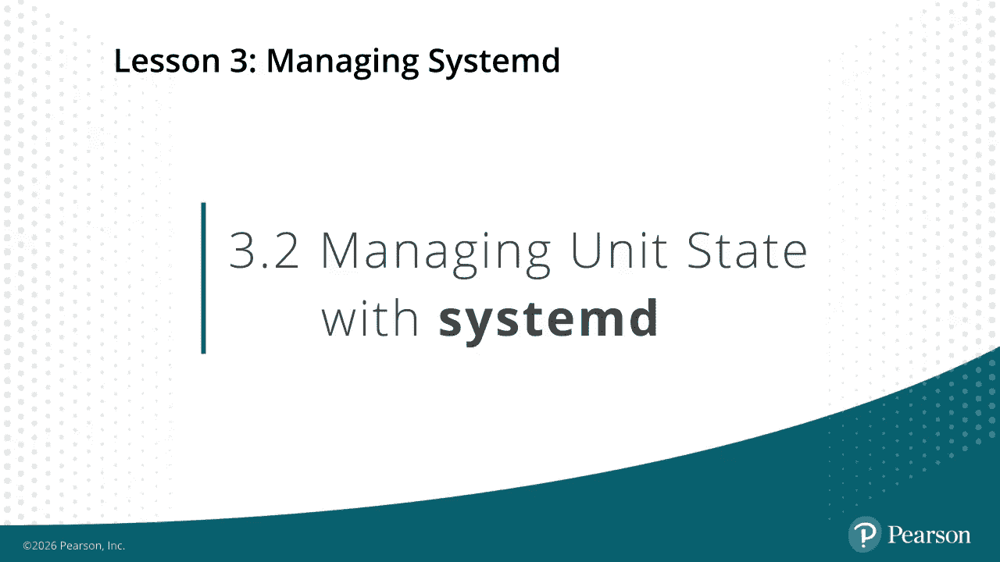
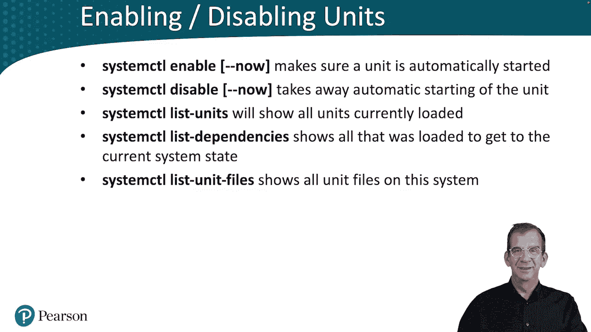
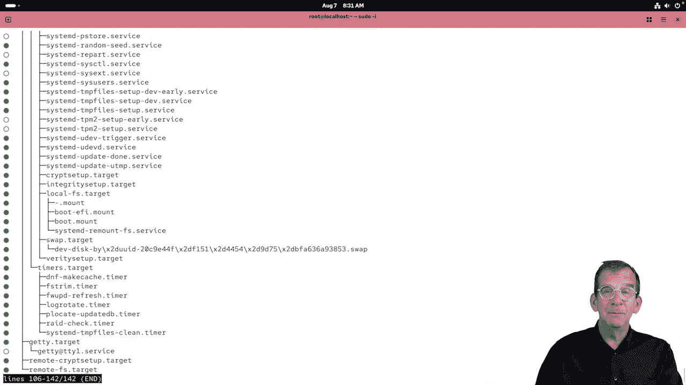

# CompTIA Linux+ V8：263：使用systemd管理单元状态 🐧




在本节课中，我们将学习如何使用systemd来管理Linux系统中各个单元的运行状态。systemd是当前大多数主流Linux发行版所使用的系统和服务管理器，它的核心工作就是负责启动、停止和监控系统中的各种单元。无论你是想运行一个网页服务器，还是想查看某个后台进程是否正常，都离不开systemd的管理。我们会用最直白的语言把每一个命令都讲清楚，确保即使是初学者也能快速上手。


在开始具体操作之前，我们需要先理解systemd的基础概念。systemd的基础工作就是管理systemd单元的状态。所谓单元，你可以把它理解为系统中某一个被systemd管理的资源，比如一个服务、一个挂载点、一个定时器，或者是一个套接字。不管你想对系统中的哪个组件进行操作，都要使用systemctl这个命令，它是systemd的主要控制工具，几乎所有的单元管理操作都通过它来完成。

如果你想启动一个单元，就需要使用systemctl start命令；如果你想查看单元当前的运行状况，就使用systemctl status命令；如果你想停止一个正在运行的单元，就使用systemctl stop命令。这三个命令是日常运维中最常见的操作，掌握它们之后，你就能够对大部分服务进行基本的启停控制。

除了启停操作之外，你可能还想了解某个单元的详细配置属性，这时候可以使用systemctl show命令。这个命令会列出该单元的所有配置信息，方便你确认它当前的各种参数设置，比如它的描述、依赖关系、资源限制等等。



以下是这些常用命令的简单对照，你可以根据需要选择使用：
- `systemctl start <单元名>`：启动指定的单元
- `systemctl status <单元名>`：查看单元当前的运行状态
- `systemctl stop <单元名>`：停止指定的单元
- `systemctl show <单元名>`：显示单元的详细属性信息


在了解了如何手动控制单元之后，我们来看看如何让单元在系统启动时自动运行。在实际使用中，我们经常希望某些重要服务在系统开机时就自动启动，而不需要每次都手动输入命令。在systemd中，这个操作被称作启用单元，英文是enable。反过来，如果你不想让某个单元随系统自动启动，那就叫做禁用单元，英文是disable。

如果你希望某个单元既能够立即启动，又能在以后的开机过程中自动启动，可以使用带有--now参数的enable命令。这样即使该单元之前没有运行，也会被马上启动，并且被标记为下次开机自启。如果你想取消一个单元的自动启动设置，可以使用disable命令，同样可以加上--now参数，这样它会立即停止，并且不再随系统自动启动。

当你执行enable操作时，systemd会在后台创建一个符号链接，通常位于/etc/systemd/system/multi-user.target.wants目录下。这个符号链接的作用是：当系统进入多用户目标状态时，会跟随这个链接自动启动对应的单元，从而实现开机自启的效果。

以下是启用与禁用单元的典型命令，你可以直接在终端中运行：
- `systemctl enable --now <单元名>`：立即启动并设置开机自启
- `systemctl disable --now <单元名>`：立即停止并取消开机自启


掌握了启用和禁用之后，我们来看看如何查看系统中当前运行的单元，以及它们之间的依赖关系。有时候你需要知道系统里到底加载了哪些单元，或者想看看某个服务依赖了哪些其他服务才能正常工作。systemd提供了几个列表类的命令来帮助你理清这些情况，让你对系统当前的运行状况有一个清晰的认识。

systemctl list-units命令会显示当前已经加载到内存中的所有单元，你可以一眼看出哪些正在运行，哪些没有运行。如果你只想查看当前活跃的单元，这个命令就足够了。但如果你也想看到那些目前没在运行，只是安装在系统中的单元文件，那么systemctl list-unit-files命令会更合适。它会按单元类型把名称整齐地分组，并且显示当前状态和预设状态，让你知道哪些是启用状态，哪些是禁用状态。

如果你想从整体上了解当前系统的运行状况，以及各个单元之间的依赖关系，可以使用systemctl list-dependencies命令。它会展示从当前目标状态出发，系统加载了哪些单元，哪些正在运行，哪些没有运行，甚至哪些出了问题。在图形化系统中，默认目标通常是graphical.target，而它又包含multi-user.target，层层嵌套，形成了一张依赖网络，通过这个命令你可以很容易地看出各个单元之间的关联。

以下命令可以帮助你快速查看系统中的单元情况，建议在实际操作中多尝试几次：
- `systemctl list-units`：显示当前已加载的所有单元
- `systemctl list-unit-files`：显示系统上所有单元文件及其状态
- `systemctl list-dependencies`：显示当前目标的依赖关系链


在了解了单元的基本管理和列表查看之后，我们来看看单元内部的具体配置指令，以及如何通过日志来排查问题。每个单元都有自己的一组配置指令，systemd中称之为directives。这些directives决定了单元的行为方式，比如重启策略、资源限制、网络设置等等。如果你想知道某个单元都有哪些directives，可以使用systemctl show命令后跟单元名称，这样就会列出该单元相关的所有指令，让你知道这个服务是如何被配置的。

有时候你看到一个directive，不太明白它的具体作用，这时候可以查阅系统手册。使用man systemd.directives可以找到所有directives的列表。如果你想深入了解某个具体指令，比如IP accounting，可以在手册中搜索，或者直接查看man systemd.resource-control，因为某些directive会被归类到资源控制相关的文档中，这样你就能找到详细的说明文档。

当服务运行出现问题时，systemctl status显示的输出中通常包含该单元的日志。这些日志非常方便，因为你不需要到处去找日志文件，直接在这里就能看到最近的运行记录，从而快速定位问题所在，提高故障排查的效率。

以下命令用于查看单元指令与日志信息，你可以根据实际需要进行查询：
- `systemctl show <单元名>`：查看单元的所有配置directives
- `man systemd.directives`：查询systemd单元指令的说明文档
- `man systemd.resource-control`：查询资源控制类指令的说明文档


理论部分讲完了，我们现在通过一个具体的例子来实战演示一下上面的命令。为了不影响系统的核心功能，我们选择一个非关键服务来做演示，这里使用Apache HTTP服务器，也就是httpd。之所以选择httpd，是因为它不是系统运行所必需的服务，就算在演示过程中出了问题，也不会破坏系统的基本功能，比较适合初学者练手。

首先需要通过dnf包管理器安装httpd，命令是dnf install -y httpd。安装完成之后，我们先用systemctl status httpd来看看它的当前状态。你会发现systemd知道httpd.service这个单元文件的存在，但是当前状态显示为inactive，也就是未运行，而且它的启用状态是disabled，预设状态也是disabled，这意味着系统目前不会在开机时自动启动它。

接下来我们使用systemctl enable --now httpd来启用这个单元。这个命令不仅会把httpd标记为开机自启，还会立即把它启动起来。在背后，systemd会在/etc/systemd/system/multi-user.target.wants目录中创建一个指向httpd.service的符号链接。这样当系统进入多用户目标状态时，就会跟随这个符号链接自动启动httpd服务，实现开机自启的效果。

再次查看状态时，你会发现httpd现在的状态变成了enabled，preset disabled，并且运行状态变成了active and running。输出信息中还会显示该单元的主进程ID、任务数量、内存占用量等内容，这些信息对进程管理非常有帮助。另外，状态输出里还包含该单元的日志，如果服务运行不正常，你可以直接在这里进行故障排查，而不需要额外去查找日志文件。

以下是演示中使用的完整命令序列，你可以照着在自己的系统上尝试一下：
```
dnf install -y httpd
systemctl status httpd
systemctl enable --now httpd
systemctl status httpd
```




在本节课中，我们一起学习了如何使用systemd来管理系统单元的状态。我们介绍了systemctl命令的基本用法，包括启动、停止和查看单元状态；讲解了如何使用enable和disable来控制开机自启，特别是--now参数的作用；说明了如何通过list-units、list-unit-files和list-dependencies来查看单元及其依赖关系；最后通过httpd的实战演示，把这些知识点串联起来，展示了从安装到启用再到状态查看的完整流程。希望这节课能帮助你建立起对systemd的直观理解，在实际工作中能够熟练管理Linux系统中的各种服务。
