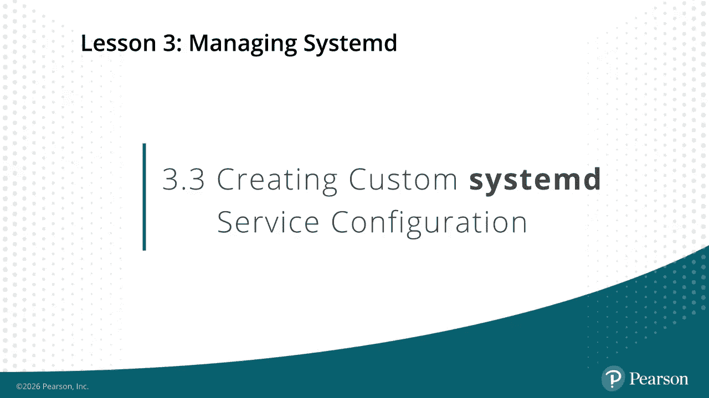
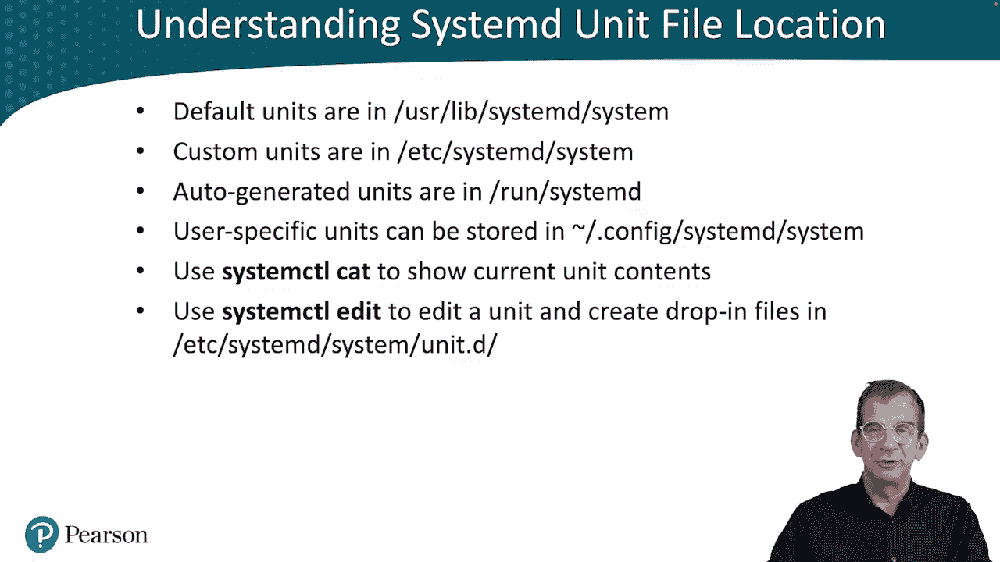
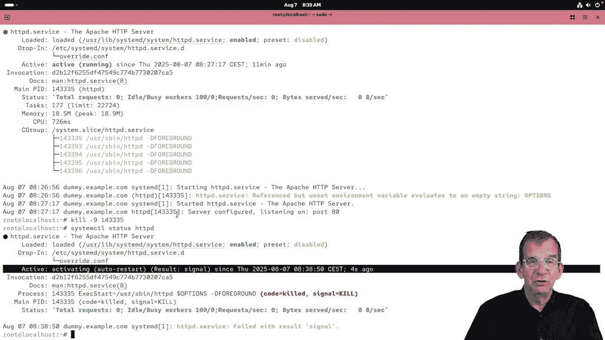

# Oreilly - CompTIA Linux+ V8 - Pearson Cert Prep (Video)：part3 p64 264. 33：Creating Custom systemd Service Configuration ⚙️




在本节课中，我们将学习如何为 systemd 创建自定义服务配置。这是 Linux 系统管理中非常实用的一项技能，尤其是当你需要修改系统服务的行为，又不希望直接去改动软件包安装的原始文件时。通过这节课，你会了解 systemd 单元文件的存放位置、优先级顺序，以及如何安全地编辑和覆盖服务配置，还会看到一个实际的编辑演示和验证过程。

## 1. systemd 单元文件的位置与优先级

在讲具体操作之前，我们先得搞清楚 systemd 单元文件都放在哪里，以及系统是怎么决定使用哪个文件的。这是后面所有操作的基础，如果不清楚优先级，很容易修改了错误的文件，却发现配置完全没有生效。

以下是 systemd 单元文件的主要存放位置：

- `/usr/lib/systemd/system`：由软件包提供的默认单元文件，不同的发行版可能会略有差异。
- `/run/systemd/system`：系统自动生成的单元文件，这类文件的数量比较有限。
- `/etc/systemd/system`：管理员或用户自定义的单元文件应当放置在这个目录。
- `~/.config/systemd/system`：用户特定的单元文件，只对当前用户生效。

关于优先级，systemd 查找单元的顺序如下：

```text
/run/systemd/system  >  /etc/systemd/system  >  /usr/lib/systemd/system
```

也就是说，运行时目录下的单元优先级最高，其次是系统配置目录，最后才是默认安装目录。如果同名单元在多个位置都出现了，优先级高的那个会生效，其他的会被忽略。

## 2. 推荐的编辑方法：使用 systemctl edit

上一节我们介绍了单元文件的位置与优先级，本节中我们来看看如何正确地修改这些配置。systemd 提供了专门的命令来处理单元编辑，不建议直接去手动修改原始安装文件。

当你想要编辑某个单元时，建议按照以下步骤操作：

1. 先使用 `systemctl cat <服务名>` 查看当前单元的完整内容。
2. 接着使用 `systemctl edit <服务名>` 来编辑单元，systemd 会自动在 `/etc/systemd/system/<服务名>.service.d/` 目录下创建 drop-in 文件。



这里还有一种旧方法也可以用来修改单元配置，那就是把默认单元文件从 `/usr/lib/systemd/system` 复制到 `/etc/systemd/system`，然后在那里进行修改。因为 `/etc/systemd/system` 的优先级更高，所以你的修改会覆盖默认设置，并且在软件包更新时也不会丢失自定义内容。不过这种方式不是 systemd 推荐的做法，现在的标准建议是直接使用 `systemctl edit` 命令。

## 3. 实际演示：查看 sshd 服务单元文件

前面我们讲了编辑命令，本节中我们来看一个具体的例子，看看单元文件内部长什么样。

以 sshd.service 为例，先用 `systemctl cat sshd.service` 把它的配置打印出来。你会看到单元文件里包含几个主要部分，其中 `[Unit]` 部分用来定义依赖关系。比如这里有一个 `After` 指令，表示该服务应当在网络启动之后再运行，还有一些 `Wants` 指令，用来列出启动该服务时一起启动的其他单元。

最重要的部分是 `[Service]`，这里面包含了服务的所有属性。例如 `Restart=on-failure` 和 `RestartSec=42`，意思是如果服务出现故障，会在 42 秒后自动重启。

此外还有一个 `[Install]` 部分，这是使用 `systemctl enable` 时需要的信息。启用服务时，systemd 需要在系统的目标目录中创建符号链接，而 `[Install]` 部分里的 `WantedBy=` 就指明了链接的目标目录。

## 4. 使用 systemctl edit 编辑 httpd 服务

刚才我们看了 sshd 的配置结构，本节中我们来尝试用 `systemctl edit` 给 httpd.service 加一些自定义设置。

执行 `systemctl edit httpd.service` 时，默认可能会打开 nano 编辑器。如果你不喜欢 nano，可以先设置环境变量，把默认编辑器改成 vim：

```bash
export SYSTEMD_EDITOR=vim
```

为了让这个设置长期生效，可以把它写进 `~/.bashrc` 文件里。

接下来再次运行 `systemctl edit httpd.service`，这次会进入 vim 编辑器。屏幕下方会提示正在创建 `/etc/systemd/system/httpd.service.d/` 目录，这就是 drop-in 文件的工作方式。生成的文件通常命名为 `override.conf`，你在光标所在位置写入的内容都会被包含到服务配置中。

不过需要注意，systemd 需要知道你写的内容属于哪个部分。比如你想让设置出现在 `[Service]` 部分，就要在文件里先写 `[Service]`，然后再加上你的配置，例如：

```ini
[Service]
Restart=on-failure
RestartSec=21
```

保存修改后，你的自定义配置就生效了。

## 5. 验证配置是否生效

编辑完成后，我们需要确认 systemd 是否真的采用了新配置，以及是否需要重启服务。

执行 `systemctl cat httpd.service` 可以查看合并后的完整配置，输出内容可能比较长，不一定能在一屏显示完，可以按大写字母 G 跳到文件末尾，就能看到刚才创建的 drop-in 文件路径，例如 `/etc/systemd/system/httpd.service.d/override.conf`。

再运行 `systemctl status httpd`，状态信息也会显示 systemd 已经考虑到了这个 drop-in 文件。这意味着 httpd 服务目前正在使用你设置的自动重启选项。

为了进一步验证，可以用 `kill -9 进程号` 强制杀掉 httpd 进程，模拟一次服务崩溃。然后再次运行 `systemctl status httpd`，你会看到服务状态变为 activating，说明 systemd 正在根据你的配置自动重启服务。这就是给单元添加自定义配置的完整流程，同时也是利用自动重启功能的一个实际案例。

## 总结



本节课中我们一起学习了 systemd 自定义服务配置的核心知识。首先梳理了单元文件的存放位置和优先级顺序，即 `/run/systemd/system` 优先级最高，其次是 `/etc/systemd/system`，最后是 `/usr/lib/systemd/system`；接着介绍了推荐的编辑方式 `systemctl edit`，并说明了它会在 drop-in 目录下生成 `override.conf` 文件；最后通过 sshd 和 httpd 的实际演示，展示了如何查看单元结构、添加 `[Service]` 重启配置、设置默认编辑器，以及用 `systemctl cat` 和 `systemctl status` 验证配置是否生效。希望这些内容能帮助你更好地管理 Linux 上的系统服务。

