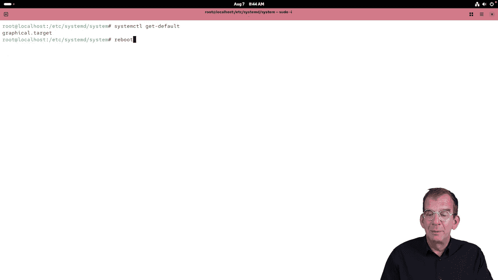
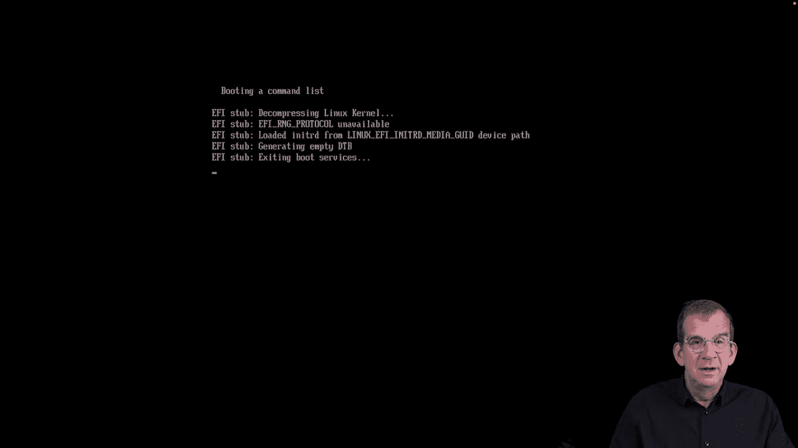
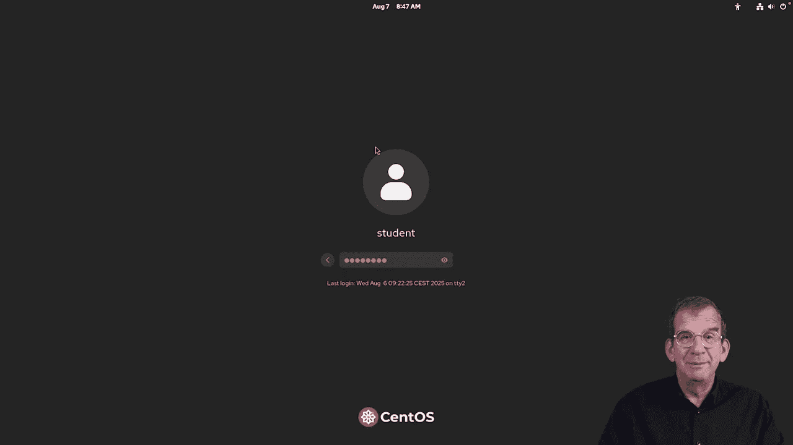
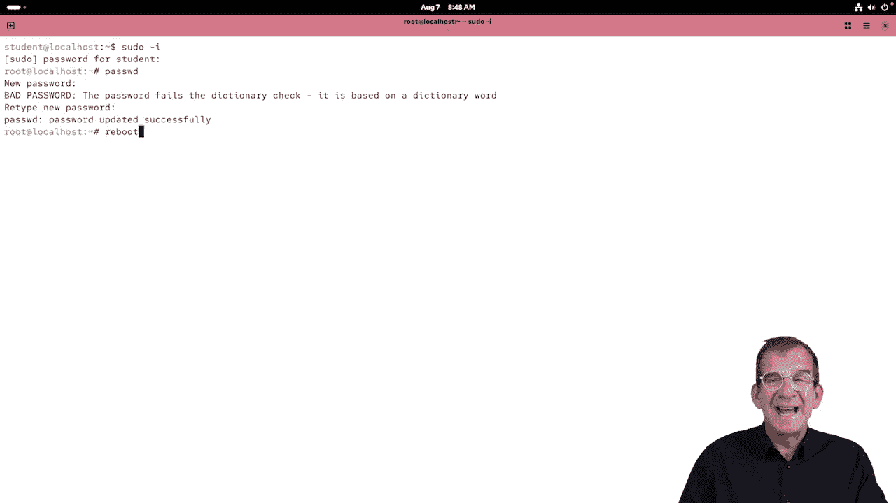
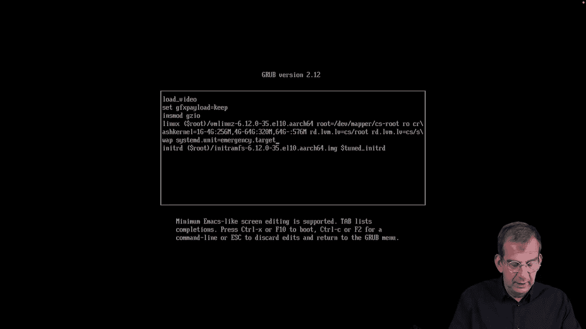

# Linux系统管理：第3部分：管理目标单元 🎯

在本节课中，我们将学习 Linux 系统中的目标单元。目标单元是 systemd 管理服务的一种方式，它把多个单元组合在一起，方便统一控制。我们会先解释什么是目标单元，然后介绍系统中常见的几个目标，接着演示如何查看默认目标并修改它，最后展示如何进入紧急目标进行故障排除。即使你是初学者，也能跟着步骤逐步理解。

## 什么是目标单元

首先我们来看看目标单元到底是什么。在 systemd 中，目标单元本身不是一个具体的服务或程序，它更像是一个容器或者分组。你可以把它理解为一组单元的集合，这组集合可以作为一个整体来启动、停止或者查看状态。

核心概念可以用下面这个公式来描述：

**目标单元 = 一组可以作为一个整体进行管理的 systemd 单元**

当你对一个目标单元执行启动命令时，系统会自动启动该目标包含的所有单元；同样，停止目标单元也会停止包含在内的所有单元。有些目标单元还可以用来定义系统启动时应该进入的状态，这类目标单元被称为可启动目标。

以下是管理目标单元的常用命令：

- systemctl start 目标名称：启动指定目标包含的所有单元
- systemctl stop 目标名称：停止指定目标包含的所有单元
- systemctl status 目标名称：查看目标当前的运行状态

## 常见的系统目标

接下来我们来看看系统中常见的几个目标单元。不同的目标对应不同的运行环境，从最简单的命令行修复环境，到完整的图形桌面环境，都有对应的目标。

以下是系统中常见的目标单元及其用途：

- emergency.target：最小化的故障排除目标，只包含最基本的系统功能，适合系统出现严重问题时使用
- rescue.target：比 emergency.target 稍微完整一点的故障排除目标，提供更多的基本工具
- multi-user.target：服务器的常规运行状态，不启动图形用户界面，适合大多数服务器场景
- graphical.target：启动完整的图形桌面界面，适合桌面电脑或需要图形环境的工作站

你可以使用下面的命令查看当前系统的默认启动目标：

systemctl get-default

如果你想修改默认启动目标，可以使用下面的命令：

systemctl set-default 目标名称

例如，如果你希望系统启动后不进入图形界面，可以将默认目标设置为 multi-user.target。

## 查看目标内部包含的单元

了解了常见目标之后，我们来看看如何查看目标内部到底包含哪些单元。这对理解系统启动流程非常有帮助。

以下是查看目标相关信息的方法：

- systemctl list-units -t target：列出系统中所有类型为 target 的单元文件
- systemctl status 音频.target：查看具体目标单元的当前状态，例如 sound.target
- ls /etc/systemd/system：进入 systemd 配置目录，查看具体的目标配置文件和符号链接

这里需要注意一个细节。有些目标单元虽然被系统加载，但当前可能处于非活动状态，比如 printer.target。这时候你可以进入它对应的目录，查看里面的符号链接，这些链接指向了应该在这个目标中启动的单元。

更有意思的是那些可以用于定义启动状态的目标，比如 graphical.target。你可以使用下面的命令查看它的详细配置：

systemctl cat graphical.target

在输出中你会看到 After 字段，它说明 graphical.target 应该在 multi-user.target 和显示管理器服务之后加载，因为图形界面依赖这些服务可用。你也可以查看该目标下实际会启动哪些单元：

ls graphical.target.wants

通过这种方式，你可以清楚地知道进入图形目标后，系统会启动哪些服务。

## 修改默认启动目标

现在我们知道了如何查看目标，接下来看看如何修改系统的默认启动目标。当你使用 systemctl enable 命令启用某个单元时，systemd 会在相应的目标目录中创建一个符号链接，这样在处理该目标时，就会自动启动这些单元。

你可以使用下面的命令确认当前默认目标：

systemctl get-default

如果要修改默认目标，可以使用下面的命令：

systemctl set-default 其他目标名称

在实际操作中，有时候你需要在重启时临时指定启动目标。这时可以在 GRUB 引导界面进行编辑。你需要在引导界面按下 Esc 键进入编辑模式，找到以 Linux 开头的那一行，去掉 rhgb 和 quiet 参数，然后添加下面这个参数：

systemd.unit=emergency.target

或者使用下面的参数进入救援目标：

systemd.unit=rescue.target

修改完成后按下 Control X 启动，系统就会进入指定的目标。

## 进入紧急目标进行故障排除

接下来我们演示如何实际进入紧急目标进行故障排除。紧急目标提供了一个最小化的系统环境，适合在系统无法正常启动时进行修复。

首先，如果你尝试进入 emergency.target，可能会遇到根账户被锁定的情况，系统会提示无法打开控制台访问权限，并且根账户被锁定。这时候你无法直接进入紧急目标。

解决方法是在可以正常进入的系统中，使用 su 切换到根用户，然后为根账户设置密码：

su -
passwd root

设置完成后，重启系统，再次进入 GRUB 引导界面，按下 Esc 键编辑内核启动行，添加下面这个参数：

systemd.unit=emergency.target

然后按下 Control X 启动。这一次系统会要求你输入根用户密码，因为紧急目标受到 su 登录程序的保护，只有输入正确的根密码才能获得根 shell，用于后续的故障排除。

进入紧急目标后，你可以使用下面的命令查看当前加载了哪些单元：

systemctl list-units

你会发现此时只有大约 60 个单元在运行，说明系统处于非常精简的状态。检查完成后，使用 reboot 命令重启系统，即可恢复正常的运行状态。

## 总结

本节课中我们一起学习了 Linux 系统中目标单元的基本概念和常见用法。我们了解了目标单元是一组可以作为一个整体进行管理的 systemd 单元，认识了 emergency.target、rescue.target、multi-user.target 和 graphical.target 等常见目标，学习了如何使用 systemctl get-default 和 systemctl set-default 查看和修改默认启动目标，还掌握了如何在 GRUB 引导界面通过 systemd.unit 参数进入紧急目标或救援目标进行故障排除。希望这些内容能帮助你更好地理解和管理 Linux 系统的启动状态。

