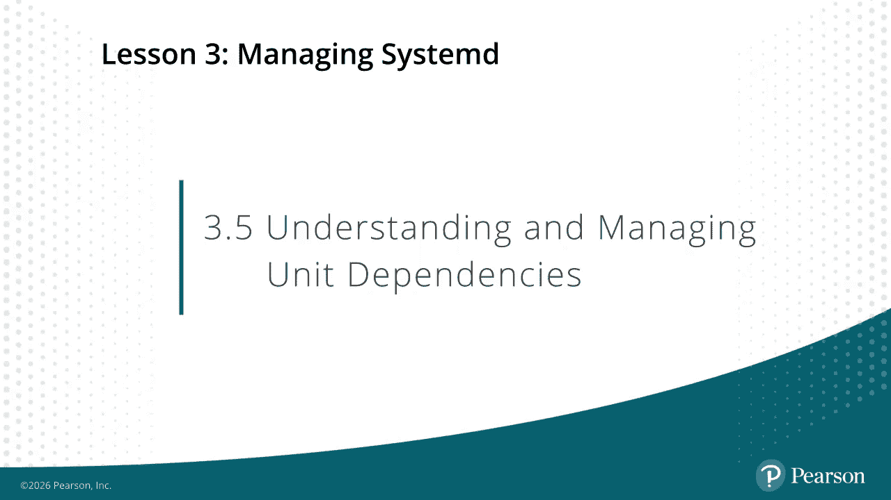
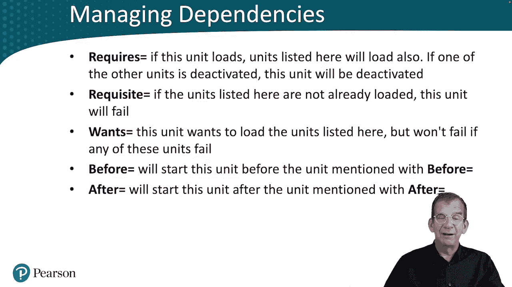
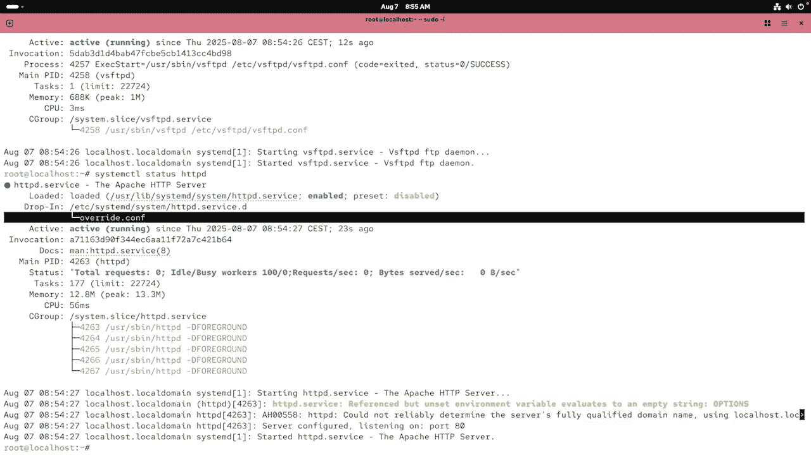

CompTIA Linux+：266：理解和管理单元依赖 🔗

在本节课中我们将要学习 systemd 中的单元依赖是怎么一回事。systemd 是 Linux 系统里负责启动和管理服务的核心组件，而单元就是 systemd 管理的一个个任务单位，比如服务、挂载点、目标等等。很多时候，一个单元不能单独干活，它需要其他单元先跑起来，或者说它们之间有先后顺序。这就是依赖关系要解决的问题。我们会先看看怎么查看系统里现有的依赖，再讲讲单元文件里哪些选项能用来定义依赖，最后通过一个动手实验，亲自给一个服务添加依赖，看看它是怎么生效的。

## 什么是单元依赖 🔗

上一节我们介绍了 systemd 的基本概念，本节中我们来看看单元之间的依赖关系。在 systemd 里，依赖通常是在单元文件的 Unit 区段里定义的，用来告诉系统：这个单元运行时，需要哪些别的单元一起存在，或者按照什么顺序启动。

以下是常见的几种依赖选项及其含义：

- `Requires=` : 如果本单元加载，列在这里的单元也会跟着加载；如果那些单元全都被停掉，本单元也会被停掉。
- `Requisite=` : 必须保证列出的单元已经可用，否则本单元无法启动。
- `Wants=` : 软依赖，意味着本单元希望启动列出的单元，但即使那些单元启动失败，本单元也不会失败。
- `Before=` : 让本单元在提到的单元之前启动。
- `After=` : 让本单元在提到的单元之后启动。

## 查看当前依赖 🔗

了解了依赖的基本概念之后，我们需要知道怎么在系统里把这些依赖看出来。systemctl 提供了一个非常方便的命令，可以不带参数直接查看所有把系统带到当前状态的依赖，也可以带上具体单元名，只看某个单元需要什么。

以下是查看依赖的常用方式：

- 不带参数查看全部依赖：`systemctl list-dependencies`
- 查看特定单元的依赖：`systemctl list-dependencies boot.mount`
- 查看另一个服务的依赖：`systemctl list-dependencies sshd.service`

执行这些命令后，屏幕上会列出一堆条目，其中绿色的点表示那些真正应该存在、正在运行的依赖项。通过这种方式，你可以一眼看出哪些服务是支撑当前系统运行的基础。

## 在单元文件中管理依赖 🔗

知道怎么查看依赖以后，接下来就是怎么自己定义依赖了。systemd 允许你直接在单元文件里写入依赖选项，这样系统在启动或处理该单元时，就会按照你设定的规则去加载相关的其他单元。

以下是配置依赖时要注意的几点：

- 通常使用 `Requires` 选项来建立硬依赖关系。
- 如果希望编辑的内容不被系统更新覆盖，建议使用覆盖文件而不是直接修改原始单元文件。
- 可以用 `systemctl edit` 命令来创建或修改覆盖文件，这样更安全也更规范。

在写依赖关系时，要清楚每个选项的严格程度。`Requires` 是硬要求，`Requisite` 更强调前置可用，`Wants` 则是软要求，失败不影响本单元。`Before` 和 `After` 只管顺序，不管是否必须存在。

## 实操演示：给服务添加依赖 🔗

光看理论总是不过瘾，我们来动手做一次实验。这次演示的目标是给 HTTP 服务添加一个对 FTP 服务的依赖，看看启动 HTTP 时 FTP 是否会被自动带起来。

以下是演示的具体步骤：

1. 安装 vsftpd 服务，确保系统里有这个 FTP 服务可用。
2. 使用 `systemctl edit httpd.service` 打开 HTTP 服务的覆盖文件进行编辑。
3. 在覆盖文件的 `[Unit]` 区段里写入 `Requires=vsftpd.service`，保存退出。
4. 使用 `ps aux | grep ftp` 确认当前系统里还没有 vsftpd 在运行。
5. 启动 `httpd.service`，再次用 `ps aux` 查看进程。
6. 你会发现 vsftpd 也跟着启动了。
7. 使用 `systemctl status vsftpd` 查看状态，确认它已经处于运行状态。
8. 使用 `systemctl list-dependencies` 查看依赖关系，因为直接看状态可能看不出两者之间的依赖连接。

在这个演示里，虽然 `systemctl status vsftpd` 能告诉你服务已启动，但它并不会明确说明是因为 httpd 的依赖才启动的。要真正看清这种依赖关系，还是得依赖 `systemctl list-dependencies` 这个命令，它能把隐藏的连接展示出来。

## 本节总结 🔗

本节课中我们一起学习了 systemd 单元依赖的基本概念，包括 `Requires`、`Requisite`、`Wants`、`Before`、`After` 这几个常用选项的区别和作用。我们还学会了怎么用 `systemctl list-dependencies` 查看系统里现有的依赖关系，以及怎么通过 `systemctl edit` 给单元文件添加覆盖配置，从而自定义服务之间的依赖。最后通过给 httpd 添加 vsftpd 依赖的实验，验证了依赖设置生效后，主服务启动时关联服务会自动跟随启动。希望这些内容能帮你更好地理解和管理 Linux 系统里的服务依赖。

