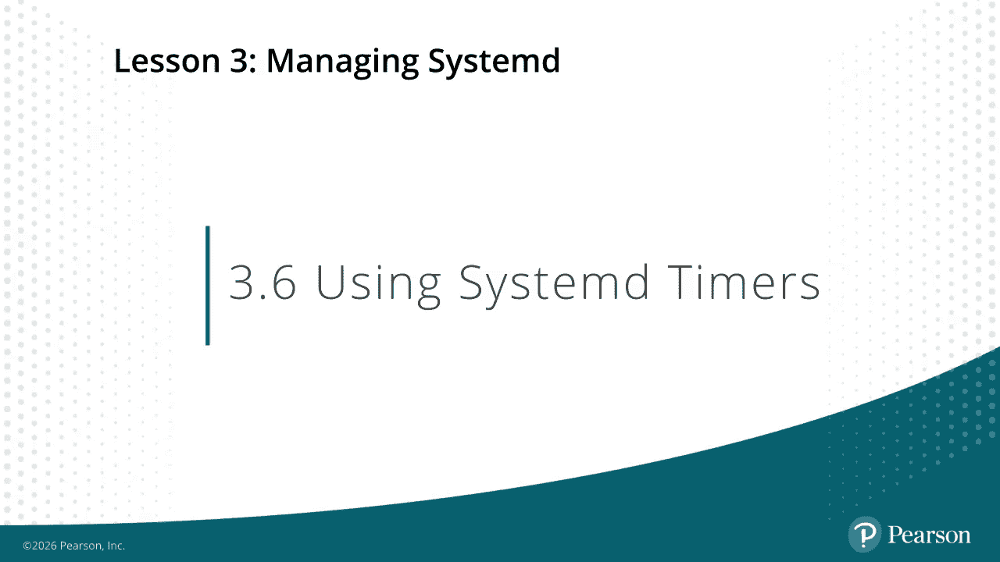
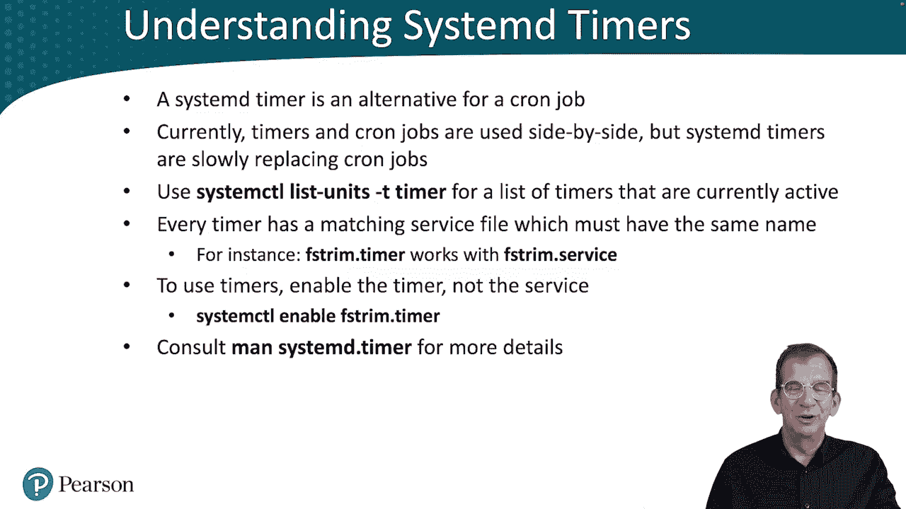
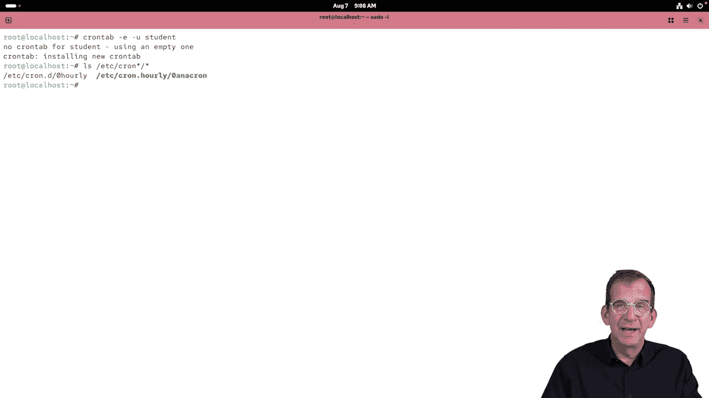

CompTIA Linux+ V8：36：使用 Systemd 定时器 ⏰




在本节课中我们将要学习 systemd 定时器的基本概念和使用方法。我们会看看它为什么可以替代传统的 Cron 任务，如何查看系统中当前活跃的定时器，定时器和服务文件是如何对应的，以及如何启用和查看定时器的状态。此外，我们还会分析一个真实的定时器配置文件，了解常见的时间设置选项。最后，我们会简要对比 Cron 任务和 systemd 定时器，看看在现代 Red Hat Linux 系统中，哪一种才是更推荐的选择。

## 什么是 Systemd 定时器 ⏰

上一节我们可能介绍过系统任务调度的基础，本节中我们来看看 systemd 定时器。

systemd 定时器是 Cron 的替代方案。在过去，Cron 一直被用来在特定时刻启动某些任务。目前，定时器和 Cron 并行使用，但 systemd 定时器正在逐渐在 Red Hat Linux 上取代 Cron。例如，你会注意到不再有默认的 Cron 任务，所有需要周期性执行的操作，现在都由定时器来完成。

简单理解，定时器就是一个“闹钟”，到了时间它会去叫醒某个服务执行任务。

## 如何查看当前活跃的定时器

刚才我们了解了 systemd 定时器的基本概念，接下来我们看看如何在系统中查看当前活跃的定时器。

以下是查看系统中当前活跃定时器的方法：

- 使用 `systemctl list-units --timer` 命令。
- 或者使用 `systemctl list-unit-files --timer`，这个命令通常能提供更多信息。

## 定时器与服务的对应关系

了解了如何查看定时器之后，我们继续看看定时器和服务文件之间的关系。



定时器有一个对应的服务文件，这个服务文件通常和定时器同名。这就是定时器找到匹配文件的方式。例如，`fstrim.timer` 会调用 `fstrim.service`。

使用定时器时，你要启用的是定时器，而不是服务，因为你不希望服务一直运行。你希望定时器一直在运行，并在时间到达时触发服务。

所以你会执行类似下面的操作：

```bash
systemctl enable fstrim.timer
```

你可以查阅 `man systemd.timer` 了解更多关于定时器单元类型的信息，也可以查阅 `man systemd.time` 了解可用的时间设置细节。

## 查看定时器状态

刚才我们学习了如何启用定时器，接下来我们来看看如何查看定时器的运行状态。

让我来演示一下。我执行 `systemctl list-unit-files --timer`，看看有什么有趣的内容。我们可以看到 `fstrim.timer`，可以分析一下这个定时器里的内容。

接着使用 `systemctl status fstrim.timer`，可以看到这个单元文件已经被加载，它是启用状态，预设也是启用的，也就是说它默认处于启用状态，并且当前处于活动等待状态。然后我们可以看到还有三天触发，当触发时它会启动 `fstrim.service`。

用 `systemctl status fstrim.service` 只能看到 active/inactive 以及被 fstrim.timer 触发，绿色圆点表明 fstrim.timer 确实在监听。

## 查看定时器配置内容

查看了定时器状态之后，我们可以进一步查看定时器的具体配置内容。

如果我们想看具体的配置，可以用 `systemctl cat fstrim.timer` 查看定时器的内容。

在配置文件中，我们会看到 `[Timer]` 部分，在里面定义如何启动。以下是常见的选项含义：

- `OnCalendar=weekly`：表示每周执行一次。
- `AccuracySec=1h`：意思是大约在上次启动后的一小时内触发。
- `Persistent=true`：表示在重启之间保留定时器活动信息。
- `RandomizedDelaySec=100min`：每次会给出 100 分钟的随机延迟。

如果你想了解更多关于如何运行定时器的方法，我强烈建议查看 `man systemd.timer` 了解单元类型，查看 `man systemd.time` 了解如何定义时间。里面有时间戳和日历事件的信息，可以非常精确地控制运行时刻。

查看 `systemd.timer` 还能了解更多选项，比如 `OnActiveSec`、`OnBootSec`、`OnUnitActiveSec` 等。

- `OnActiveSec`：表示在定时器激活后的特定时刻运行。
- `OnBootSec`：表示在启动后运行。
- `OnUnitActiveSec`：会监控另一个单元，并在该单元激活后的几秒、几分钟或几小时运行。

systemd 定时器有很多选项，可以让你以条件方式运行定时器。

## Cron 任务是否还能用

介绍完 systemd 定时器的常用选项之后，我们最后看看 Cron 任务在现代系统中的现状。

如果你愿意，仍然可以运行 Cron 任务。我是说，我仍然可以运行 `crontab -e` 编辑用户的 crontab，然后写入类似 `*/10 * * * *` 表示每10分钟执行一次，这依然有效。

但定时器已经成为默认方案。所以在较新的系统版本上，你已经找不到任何 Cron 任务了，如果用 `ls /etc/cron*` 看，几乎是空的。正如所见，现在定时器才是主流。

## 总结



本节课中我们一起学习了 systemd 定时器的基本概念，了解了它作为 Cron 替代方案的地位，学会了如何使用 `systemctl list-units --timer` 和 `systemctl status` 查看定时器，掌握了定时器与同名服务文件的对应关系，以及如何启用定时器而非服务。我们还分析了 `fstrim.timer` 的配置，了解了 `OnCalendar`、`AccuracySec`、`Persistent`、`RandomizedDelaySec` 等常用选项，并简要回顾了 Cron 任务在现代系统中的现状。
