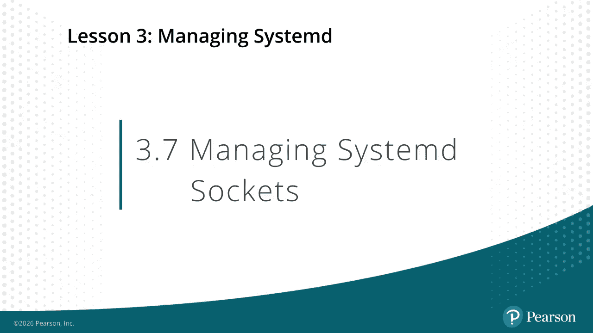
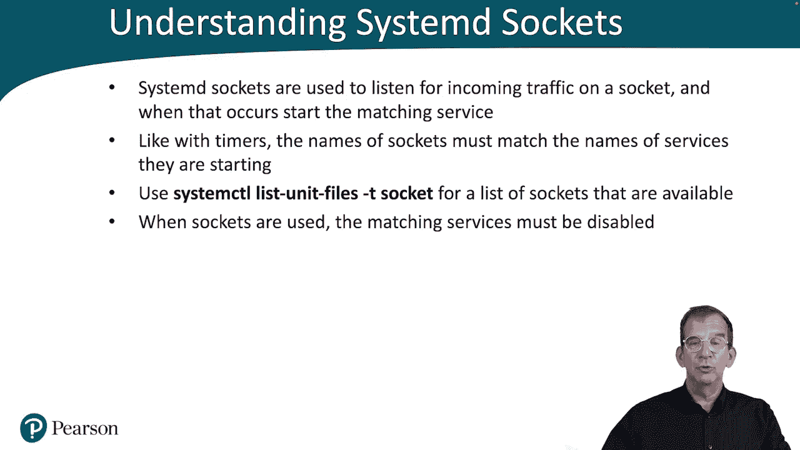
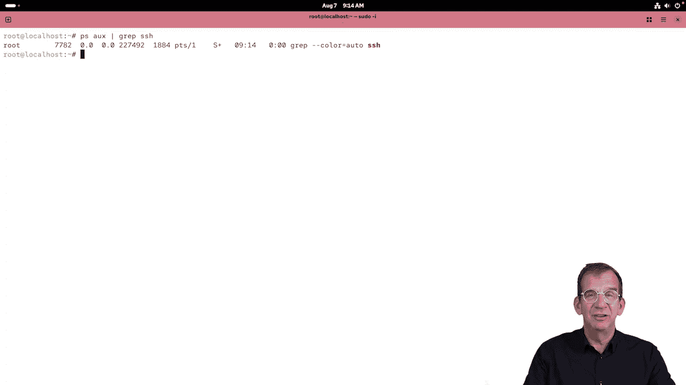

# Linux系统管理：第3章：管理Systemd套接字 📡

## 本节概述




在本节教程中，我们将一起学习关于Systemd套接字的基础知识。Systemd套接字是Linux系统中一种用来监听网络流量的机制。当外部数据发送到某个端口时，套接字会首先收到这个信号，然后决定是否启动对应的服务来处理请求。

这篇教程适合刚开始接触Linux系统管理的初学者，内容会尽量用大白话来解释，避免过于深奥的专业术语。我们会先了解套接字的基本原理，然后通过实际命令操作，看看如何查看套接字、如何启用套接字，以及套接字激活服务的完整流程。学完本节之后，你应该能够理解Systemd套接字的作用，并且能够在自己的系统中进行简单的配置和测试。

## 什么是Systemd套接字

Systemd套接字的主要作用是监听进入的网络流量。你可以把套接字想象成一扇专门等待敲门的门，当有人从外部尝试连接时，套接字就会发现，并通知Systemd去启动对应的服务。

从技术角度来看，一个套接字通常由两部分组成，一个是IP地址，另一个是端口号。

**公式**：套接字 = IP地址 + 端口

举个例子，我们可以定义一个套接字来监听22号端口。如果有数据流量发送到22号端口，Systemd就会启动对应的服务，通常这就是SSH服务。

在Systemd中，套接字的名字必须和它要启动的服务名字完全一样。这是一个很重要的规则，如果名字不匹配，套接字就不知道该启动哪个服务，也就无法正常工作。

如果你想查看系统中所有套接字单元，可以使用下面这个命令：

**代码**：
```bash
systemctl list-unit-files --type=socket
```

当套接字被使用的时候，我们启用的是套接字本身，而不是它对应的服务。这一点非常容易让初学者混淆，所以在后面的演示中我们会特别留意这个区别。

## 查看套接字单元

上一节我们介绍了Systemd套接字的基本概念，本节中我们来看看如何在系统中查看这些套接字单元。

要列出系统中所有类型为socket的单元，可以运行下面的命令：



**代码**：
```bash
systemctl list-unit-files -t socket
```

执行这个命令后，屏幕上会列出相当多的套接字单元。其中有一个名为sshd.socket的单元，非常适合用来做演示，因为SSH服务是大多数Linux系统上都有的常见服务。

在开始实际操作之前，我们先来看看SSH服务当前的运行状态。使用下面的命令可以查看sshd服务是否正在运行：

**代码**：
```bash
systemctl status sshd.service
```

你会发现sshd服务当前是运行中的，而且处于启用状态，预设也是启用的。这意味着SSH服务已经正常工作，并且系统在启动时也会自动启动它。

## 禁用SSH服务并启用套接字

为了演示套接字激活的效果，我们需要先禁用SSH服务，然后启用对应的套接字。这样操作之后，系统中就不会一直运行SSH服务进程，而是只在有客户端连接时才临时启动它。

首先，我们要禁用sshd服务，并且让它立即停止运行：

**代码**：
```bash
systemctl disable --now sshd.service
```

执行完这个命令之后，sshd服务就被禁用了，也不会在系统启动时自动运行。

接下来，我们需要查看sshd套接字的当前配置。套接字的配置文件比较简单，主要包含几个关键设置：

**代码**：
```ini
[Socket]
ListenStream=22
Accept=yes
```

ListenStream表示监听TCP端口。如果是UDP端口，对应的配置项叫ListenDatagram。Accept=yes表示套接字会接受进入的连接请求。套接字默认会根据名字来匹配对应的服务，所以不需要额外的配置就能把sshd.socket和sshd服务关联起来。

现在我们启用sshd套接字，并且让它立即生效：

**代码**：
```bash
systemctl enable --now sshd.socket
```

使用状态命令来查看sshd套接字：

**代码**：
```bash
systemctl status sshd.socket
```

你会看到套接字处于活跃状态，并且正在监听22号端口。这说明套接字已经就绪，正在等待外部流量到达。

此时如果再查看sshd服务的状态：

**代码**：
```bash
systemctl status sshd.service
```

你会发现sshd服务虽然被加载了，但当前是非活跃状态，也就是处于停止状态。这很正常，因为我们刚才已经禁用了服务，而套接字只负责监听端口，并不负责一直运行服务进程。

## 套接字激活的工作原理

上一节我们完成了禁用服务和启用套接字的操作，本节中我们来看看套接字是如何按需启动服务的。

现在SSH服务并没有在运行，系统中也没有显示任何SSH服务进程。但是，当我们尝试使用SSH连接到本地主机时，会发生什么情况。

**代码**：
```bash
ssh student@localhost
```

你会发现，即使SSH服务当前是停止状态，连接依然可以成功建立，并且能够收到回应。这是因为sshd套接字一直在监听22号端口，一旦有流量进来，Systemd就会立即启动sshd服务来处理这个连接。

我们在另一个终端窗口中查看sshd服务的状态：

**代码**：
```bash
systemctl status sshd.socket
systemctl status sshd.service
```

你会看到一个有趣的现象：sshd服务显示为禁用且非活跃，但实际上它已经被启动了。使用下面的命令可以确认SSH进程确实存在于进程列表中：

**代码**：
```bash
ps aux | grep ssh
```

这充分证明了套接字激活机制是如何工作的。套接字负责监听端口，而服务只在真正需要的时候才运行。

当我们结束SSH连接，退出会话后，再次检查SSH进程：

**代码**：
```bash
ps aux | grep ssh
```

你会发现没有任何SSH进程了。这是因为当监听的端口上没有流量时，对应的服务会立即停止。这就是Systemd套接字的核心优势，它可以节省系统资源，只在有请求时才启动服务。

## 本节总结



本节课中我们一起学习了Systemd套接字的基本概念和实际操作。我们了解到套接字由IP地址和端口组成，套接字名字必须和服务名字匹配，可以使用systemctl list-unit-files --type=socket来查看所有套接字单元。通过禁用sshd服务并启用sshd套接字的实验，我们验证了套接字激活的完整工作流程：当没有流量时服务保持停止，当有连接进入时Systemd自动启动服务，当连接断开后服务又会立即停止。希望这篇教程能帮助你更好地理解和使用Systemd套接字。

