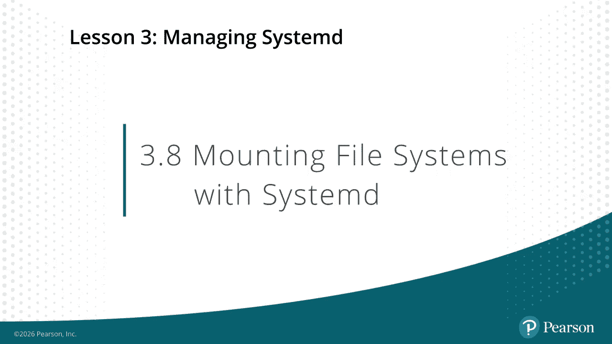
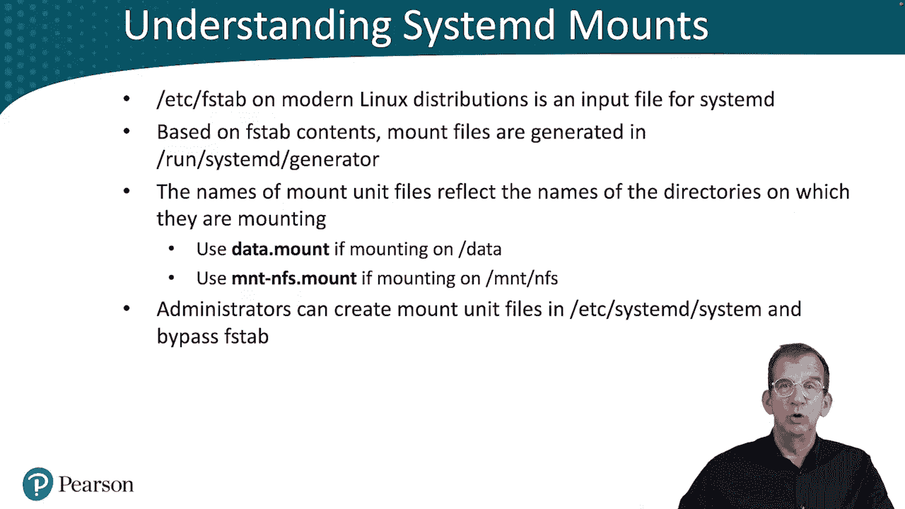
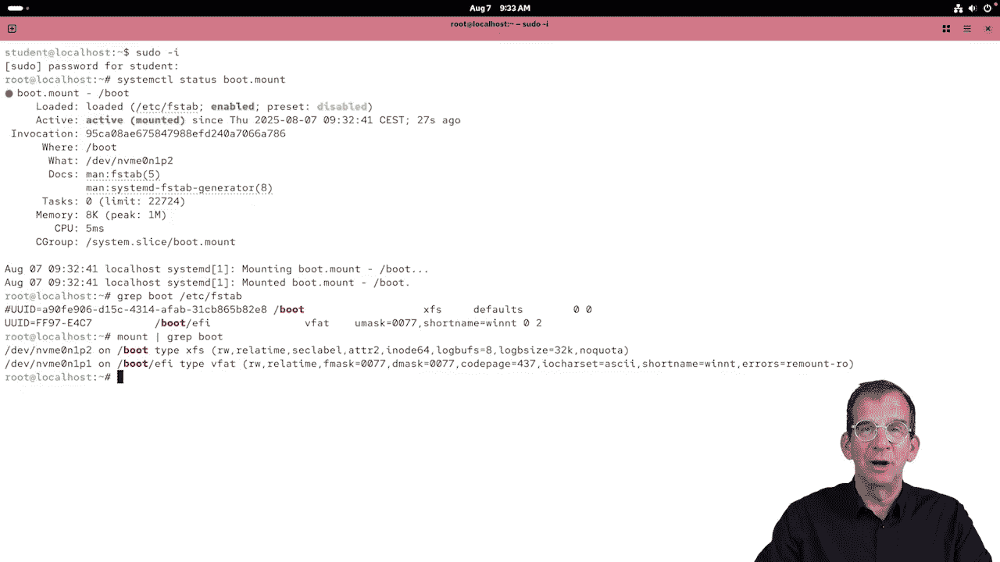

# CompTIA Linux+ V8：269.38：使用 Systemd 挂载文件系统 💿

在本节课中我们将要学习 systemd 如何管理 Linux 系统中的文件系统挂载。具体来说，我们会了解 /etc/fstab 文件与 systemd 挂载单元之间的关系，学习挂载单元文件的命名规则，掌握如何手动创建并启用挂载单元，最后通过重启系统来验证配置是否生效。本节内容适合初学者，会用大白话把每个步骤讲清楚，并且会在每个关键点上多做解释，让你即使是第一次接触 systemd 也能跟上节奏。


## Systemd 与 /etc/fstab 的关系

上一节我们概述了本课的学习目标，本节中我们来看看 systemd 与 /etc/fstab 的关系。

在大多数 Linux 发行版中，/etc/fstab 文件只是 systemd 的一个输入文件。systemd 会读取这个文件，然后根据里面的内容来决定如何挂载文件系统。如果你希望，甚至可以让系统完全不依赖 /etc/fstab 来运行，所有的挂载工作都可以交给 systemd 来处理。换句话说，/etc/fstab 并不是强制性的，它只是 systemd 获取挂载信息的一种来源，系统可以在没有它的情况下正常工作。

当系统启动时，systemd 会运行一个名为 systemd-fstab-generator 的生成器。这个生成器会读取 /etc/fstab 的内容，并在 /run/systemd/generator 目录下生成相应的挂载单元文件。这些生成的单元文件是 systemd 实际用来执行挂载操作的依据，也就是说，真正挂载文件系统的是 systemd 而不是 /etc/fstab 文件本身。


## 挂载单元文件的命名规则

上一节我们介绍了 systemd 如何读取 /etc/fstab，本节中我们来看看挂载单元文件的命名规则。

挂载单元文件的名称直接对应它要挂载的目录路径。系统会根据目录名来生成单元文件名，并且会把路径中的斜杠替换为短横线，以符合 systemd 的文件命名要求。这样管理员就能一眼看出一个挂载单元对应的是哪个目录，而不需要打开文件去查看内容。



以下是具体的命名示例：
- 如果要挂载到 /boot，对应的单元文件名是 boot.mount。
- 如果要挂载到 /mnt/data，对应的单元文件名是 mnt-data.mount。

核心命名规则可以用下面的公式表示：

```
挂载单元文件名 = 目标目录路径中的斜杠替换为短横线 + ".mount"
```


## 手动创建挂载单元文件

上一节我们了解了命名规则，本节中我们来看看如何手动创建挂载单元文件。

管理员不需要完全依赖 /etc/fstab，也可以在 /etc/systemd/system 目录下自己创建挂载单元文件，从而绕过 /etc/fstab 完全由 systemd 来管理挂载。接下来我们通过一个实际的例子来演示这个过程，你可以跟着操作步骤在自己的系统上尝试。

首先，我们查看系统当前是如何挂载 /boot 的。通常 /etc/fstab 会负责这个挂载工作。但在 systemd 背后，实际运行的是 /run/systemd/generator 目录中的 boot.mount 文件，这才是系统真正在使用的挂载单元，而不是 /etc/fstab 中的那一行。

我们可以查看 boot.mount 的具体内容，从中了解它挂载的是哪个设备、挂载点在哪里、使用的是什么文件系统类型。这些信息通常包括通过 UUID 指定的设备、挂载位置以及文件系统类型，掌握这些信息后我们才能正确地手动创建单元文件。

现在我们要把这个生成的 boot.mount 复制到 /etc/systemd/system 目录下。然后使用编辑器打开 /etc/systemd/system/boot.mount 文件。在这个文件中，我们需要添加一个 Install 部分，并在 Install 部分里加入 WantedBy 指令，指定这个挂载单元属于哪个目标单元。

为了确定应该把它加入哪个目标，我们可以使用 systemctl list-dependencies 命令查看依赖关系。查找 boot.mount 之后，我们会发现它属于 local-fs.target。因此在 Install 部分中，我们设置 WantedBy=local-fs.target。

接下来执行 systemctl enable boot.mount 命令。系统会创建一个符号链接，表明这个挂载单元已经启用，将在系统启动时自动加载，而不需要再依赖 /etc/fstab。


## 启用挂载单元并移除 /etc/fstab 配置

上一节我们演示了如何创建挂载单元文件，本节中我们来看看如何启用它并移除 /etc/fstab 中的配置。

在完成挂载单元的创建和启用之后，我们需要让 /etc/fstab 不再负责 /boot 的挂载，以免产生冲突。使用 Vim 或其他编辑器打开 /etc/fstab，找到挂载 /boot 的那一行，将其注释掉或删除。这样 systemd 就会完全通过 boot.mount 来管理 /boot 的挂载，而不再读取 /etc/fstab 中的对应条目，从而实现从传统配置文件向 systemd 单元文件的平稳过渡。


## 重启验证与总结

上一节我们完成了配置修改，本节中我们来看看如何重启系统并验证挂载结果。

配置完成后，重启系统。重新进入系统之后，使用 systemctl status boot.mount 命令来检查挂载状态。你会看到 boot.mount 显示为 loaded 并且 active，同时状态为 mounted，说明设备已经成功挂载到 /boot。

此时如果再查看 /etc/fstab，你会发现之前关于 /boot 的那一行已经被注释掉，不再显示为激活状态。这证明文件系统的挂载已经从 /etc/fstab 完全转移到了 systemd 的管理之下，系统可以在没有 /etc/fstab 中该条目的情况下正常挂载文件系统。




本节课中我们一起学习了 systemd 挂载文件系统的基本原理。我们了解到 /etc/fstab 只是 systemd 的输入文件，systemd-fstab-generator 会根据它在 /run/systemd/generator 中生成挂载单元。我们学习了挂载单元的命名规则，例如 /boot 对应 boot.mount。我们还演示了如何手动创建挂载单元文件，添加 Install 部分，使用 systemctl enable 启用它，接着从 /etc/fstab 中移除相关配置，最后通过重启和 systemctl status 验证挂载是否成功。掌握这些内容后，你就可以灵活地使用 systemd 来管理系统中的文件系统挂载，而不仅仅依赖传统的 /etc/fstab 文件。

