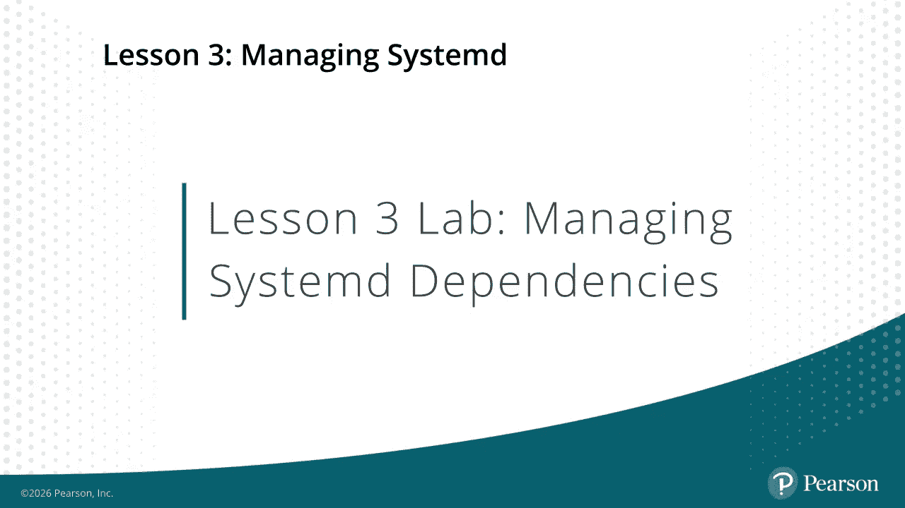
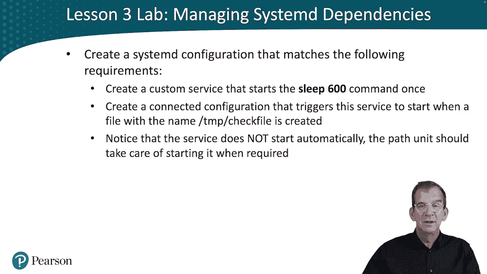

# CompTIA Linux+ V8：Lesson 3：Managing Systemd Dependencies 📋

在本节课中，我们将一起学习如何管理 Systemd 的单元依赖关系。本节的实验稍微有一些挑战性，但只要你跟着步骤一步步来，就一定能够完成。我们将重点放在创建自定义服务和路径单元上，让服务只在特定文件出现时才启动，而不是随系统自动启动。


## 实验目标 🎯


在本节中，我们需要完成几个具体的任务，以便掌握 Systemd 依赖关系的配置方法。以下是本次实验的具体目标：

- 创建一个自定义服务，该服务执行 `sleep 600` 命令，并且只运行一次。
- 创建一个关联的配置，当指定的检查文件被创建时，触发上述服务启动。
- 确保服务不会在系统启动时自动开始运行。
- 由路径单元负责在需要时启动服务。
- 当检查文件被创建时，服务将会被启动，祝你实验顺利。




## 核心概念说明 💡

在动手配置之前，我们先来理解几个关键概念，这样后面的操作会更容易理解。Systemd 中的服务启动可以通过不同的单元类型来控制，这里主要涉及服务单元和路径单元。

服务单元的作用是定义一个后台进程应该如何运行，包括它执行什么命令、运行什么类型。路径单元的作用是监控文件系统中的某个路径，当路径发生变化时，触发其他单元的启动。两者的关系可以用下面这个简单的公式来表示：

触发条件 = 文件路径被创建 → 路径单元检测到变化 → 启动关联服务

在代码层面，服务单元的执行命令通常写在配置文件的 `ExecStart` 字段中，例如：

```ini
ExecStart=/usr/bin/sleep 600
```

这条命令的意思是让系统睡眠 600 秒，相当于一个占位任务，用来验证服务是否真的被启动了。


## 创建自定义服务 🛠️

上一节我们介绍了 Systemd 的基本单元类型，本节中我们来看看如何创建一个自定义服务。按照实验要求，这个服务需要执行 `sleep 600` 命令，并且只运行一次，不随系统自动启动。

以下是创建自定义服务的配置示例：

```ini
[Unit]
Description=Custom sleep service

[Service]
Type=oneshot
ExecStart=/usr/bin/sleep 600

[Install]
WantedBy=multi-user.target
```

这里需要注意几个要点。首先，`Type=oneshot` 表示这个服务只运行一次，运行完毕后就会退出，不会常驻后台。其次，我们没有在 `[Install]` 部分启用自动启动，因为实验要求服务不能自动开始。最后，`ExecStart` 指定了具体要执行的命令，即让系统睡眠 600 秒。


## 配置路径单元触发器 📁

在完成自定义服务的编写之后，本节中我们来看看如何配置路径单元。路径单元的作用是监控某个文件，当该文件被创建时，自动启动关联的服务。

以下是路径单元的配置示例：

```ini
[Unit]
Description=Watch for check file creation

[Path]
PathExists=/path/to/checkfile

[Install]
WantedBy=multi-user.target
```

在这个配置中，`PathExists` 指定了要监控的文件路径。当系统检测到这个文件存在时，路径单元就会触发关联的服务启动。你需要将 `/path/to/checkfile` 替换为实验中指定的实际文件路径。这样一来，服务就不会在系统启动时自动运行，只有当检查文件出现时才会被启动，这正好符合实验的设计思路。


## 验证与总结 📝

配置完成之后，本节中我们来看看如何验证这些设置是否生效。在实际操作中，你可以使用 `systemctl` 命令来检查服务和路径单元的状态，例如：

```bash
systemctl status your-service-name
systemctl status your-path-unit
```



如果配置正确，服务应该处于非运行状态，直到检查文件被创建为止。文件创建后，路径单元会自动触发服务启动，执行 `sleep 600` 命令。

本节课中我们一起学习了如何管理 Systemd 的依赖关系，包括创建只运行一次的自定义服务，以及使用路径单元根据文件变化来触发服务启动。希望这个实验能帮助你更好地理解 Systemd 单元之间的协作机制。

