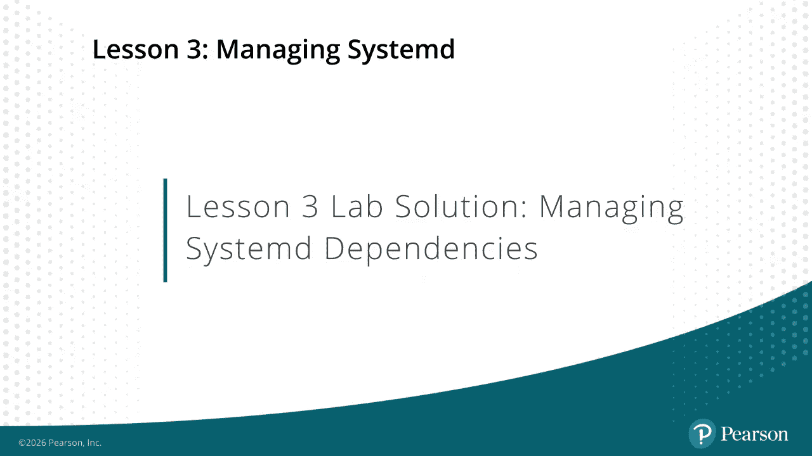
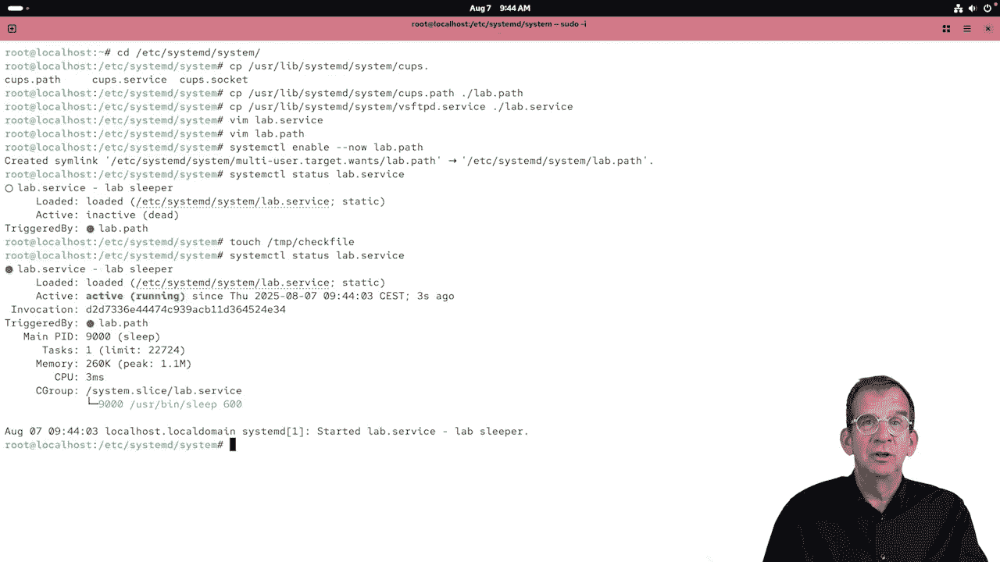

🔧 CompTIA Linux+ V8：271：管理 Systemd 依赖关系实验解答


## 课程概述



在本节课中我们将要学习如何在 Linux 系统中管理 Systemd 单元之间的依赖关系。Systemd 是现代 Linux 发行版里非常常见的系统和服务管理器，它能让我们把服务、路径、定时器等不同类型的单元定义好，并且让这些单元之间相互配合工作。本节课的核心任务是创建一个自定义的服务单元和路径单元，让路径单元在监测到特定文件出现时，自动去触发服务单元运行。通过这个实验，你会了解 Systemd 单元文件的基本结构，学会如何复制现有单元文件作为模板，还会学习怎么使用 systemctl 命令来启用、启动和查看单元状态。这些内容对日常系统维护和故障排查都非常有用，建议大家跟着讲解的步骤动手操作一遍。

## 第一步：进入 Systemd 配置目录

在正式创建单元文件之前，我们先来准备好工作目录。

所有的 Systemd 单元文件通常都放在 /etc/systemd/system 这个目录下面。我们要在这个目录里面创建自定义配置，所以第一件事就是进入这个目录。之所以要进入这个目录，是因为这里存放的是系统管理员自己定义的单元文件，Systemd 会优先读取这里的配置。进入目录之后，我们就可以开始复制模板文件了。

以下是需要执行的命令：

- `cd /etc/systemd/system`

## 第二步：复制模板文件

上一节我们进入了配置目录，本节中我们来看看如何从现有示例中复制模板文件。

讲师喜欢从已有的示例开始工作，因为这样可以参考标准的写法，避免在结构上漏掉重要段落。在这里我们要复制两个文件，一个是路径单元的示例，一个是服务单元的示例。复制完成后，我们会给它们起新的名字，分别叫作 lab.path 和 lab.service。这些文件暂时只是占位符，等下我们再修改里面的具体内容。

以下是需要执行的复制操作：

- `cp /usr/lib/systemd/system/cups.path ./lab.path`
- `cp /usr/lib/systemd/system/vsftpd.service ./lab.service`

## 第三步：编辑服务单元文件 lab.service

模板文件复制好之后，我们需要开始修改服务单元文件，让它按照我们的要求运行。

现在我们来编辑 lab.service 文件。这个文件定义了一个简单的服务，名字叫“睡眠程序”。在单元段落里，我们只需要写一个描述，说明这个单元的作用。接着在服务段落里，类型设置为 simple，这是最简单也最常用的类型。启动命令使用 /usr/bin/sleep 600，意思是让系统睡眠 600 秒。我们不需要写 install 段落，因为路径单元会负责处理启用和启动的事情。

以下是 lab.service 的完整内容：

```
[Unit]
Description=Lap sleeper

[Service]
Type=simple
ExecStart=/usr/bin/sleep 600
```

## 第四步：编辑路径单元文件 lab.path

服务单元文件编辑完成之后，我们需要继续编辑路径单元文件，让它知道什么时候该去触发服务。

lab.path 文件的作用是监视某个路径，当路径满足条件时就去启动关联的服务。在这里描述写成“Sleeper Path”，大写字母只是个人习惯，没有特殊含义。我们要监视的路径是 /tmp/checkFile，当这个文件存在时，路径单元就会触发服务。在 WantedBy 段落里使用 multi-user.target，这是标准的做法，表示在多用户模式下启用这个路径单元。

以下是 lab.path 的完整内容：

```
[Unit]
Description=Sleeper Path

[Path]
PathExists=/tmp/checkFile

[Install]
WantedBy=multi-user.target
```

## 第五步：启用路径单元并查看状态

配置文件都写好之后，下一步就是告诉 Systemd 去加载并启用这些单元。

我们使用 systemctl enable --now lab.path 命令来启用路径单元，并且立即启动它。--now 参数的作用是在启用的同时直接启动服务，不需要再分别执行 start 命令。启用完成后，我们可以用 systemctl status lab.service 来查看服务当前的状态。此时你应该能看到服务已经加载，并且状态显示为 active，同时被 lab.path 触发。这说明路径单元已经在后台监视指定的路径了。

以下是需要执行的命令：

- `systemctl enable --now lab.path`
- `systemctl status lab.service`

## 第六步：触发服务并验证结果

一切就绪后，我们还需要手动创建被监视的文件，来验证路径触发机制是否真的生效。

最后一步是使用 touch 命令创建 /tmp/checkFile 文件。touch 命令如果文件不存在就会创建一个空文件，如果存在就会更新时间戳。一旦这个文件出现，lab.path 就会检测到路径存在，然后立刻去启动 lab.service。我们再次执行 systemctl status lab.service 查看状态，这时应该能清楚地看到服务已经被触发并运行。这就是 Systemd 路径单元的工作原理，相当实用。

以下是需要执行的命令：

- `touch /tmp/checkFile`
- `systemctl status lab.service`

## 课程总结



本节课中我们一起学习了如何管理 Systemd 依赖关系。我们创建了 lab.service 作为睡眠服务，又创建了 lab.path 作为路径触发器，并使用 systemctl 命令完成了启用与状态查询。通过触发 /tmp/checkFile 文件的出现，我们验证了路径单元可以自动启动关联的服务。希望这个实验能帮助你更好地理解 Systemd 单元之间的协作方式。

