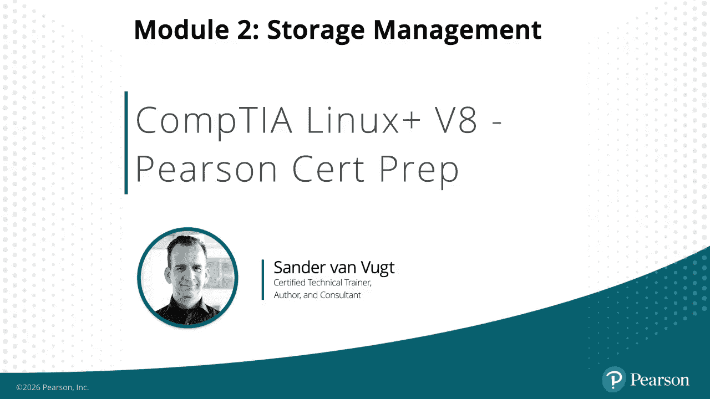
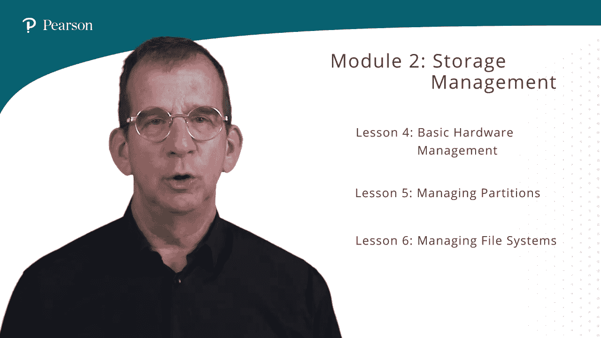
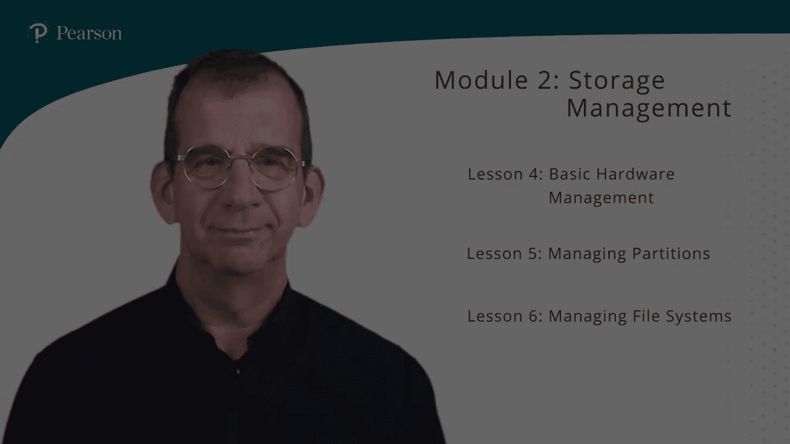

# CompTIA Linux+ V8：02：存储管理模块介绍 💾


在本节课中，我们将一起学习 CompTIA Linux+ V8 课程中的第 2 个模块，这个模块的主题是存储管理。我们会先了解模块包含哪几节课，然后逐节介绍每一节课会讲解什么具体内容，帮助你建立对 Linux 存储管理的整体认知，为后续的实际操作打下基础。




本模块总共包含三节课，分别是第 4 节、第 5 节和第 6 节。以下是本模块的课程安排：

- 第 4 节：介绍从 Linux 内核到存储设备的访问路径，以及自动硬件设备的处理方式。
- 第 5 节：介绍如何创建分区，以及以其他方式使用磁盘。
- 第 6 节：介绍不同的文件系统类型，以及如何在存储设备之上创建文件系统。


上一节我们简单概述了本模块包含的三节课，本节中我们来看看第 4 节课的具体内容。这一节的核心在于理解操作系统如何找到并使用存储硬件。

Linux 内核是系统与硬件交互的核心，它负责把抽象的设备请求转换成具体的硬件操作。当你插入一块新硬盘或者系统启动时，内核需要识别存储设备，并为其分配设备文件。以下是内核与存储设备之间的关系：

```text
Linux 内核 → 设备驱动程序 → 块设备 → /dev/sdX
```

系统还需要自动识别新插入的硬件设备，这通常由 udev 等机制完成，无需手动干预即可让设备可用。


上一节我们介绍了 Linux 内核如何连接存储设备，本节中我们来看看第 5 节课的具体内容，即分区和磁盘的使用方式。

存储设备识别之后，通常不能直接使用，需要先划分成一个或多个分区，或者通过其他方式组织磁盘空间。以下是常见的磁盘使用方法：

- 创建分区：将整块硬盘切分成独立的逻辑部分，每个分区可以单独格式化和挂载。
- 使用 LVM：采用逻辑卷管理器，使磁盘空间的分配更加灵活，可以动态扩容或缩容。
- 使用 RAID：将多个物理磁盘组合成一个逻辑设备，以提升性能或数据冗余。


上一节我们介绍了分区和磁盘的使用方法，本节中我们来看看第 6 节课的具体内容，即文件系统及其在存储设备上的应用。

分区创建完成后，仍然不能直接存放文件，必须在分区之上建立文件系统。文件系统决定了数据如何组织、如何命名以及如何查找。以下是常见的文件系统及其用途：

- ext4：Linux 最常用的通用文件系统，兼容性好且稳定。
- XFS：适合处理大文件和高并发场景，常用于服务器环境。
- Btrfs：支持快照、压缩和自我修复等高级特性。
- vfat/FAT32：常用于 U 盘或需要与 Windows 交换数据的场景。



把文件系统放在存储设备上的过程通常称为“格式化”，格式化完成后，还需要通过挂载操作才能访问其中的文件：



```bash
mkfs.ext4 /dev/sdX1
mount /dev/sdX1 /mnt/data
```


本节课中，我们一起学习了 CompTIA Linux+ V8 第 2 模块存储管理的介绍内容。我们先了解了本模块包含的三节课，然后分别介绍了第 4 节关于内核到存储设备的访问、第 5 节关于分区和磁盘使用、以及第 6 节关于文件系统的创建与应用。希望这些内容能帮助你建立对 Linux 存储管理的初步认识。
