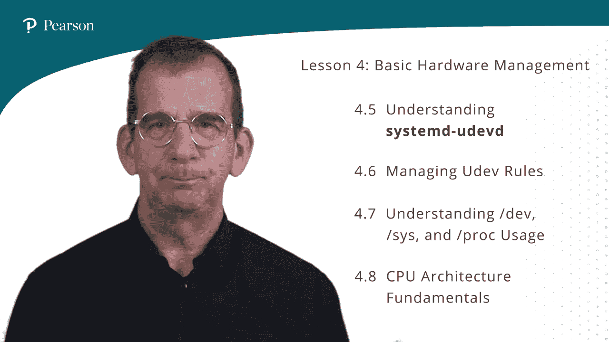

CompTIA Linux+ V8：01：硬件管理学习目标 🖥️


在本节课中我们将要学习计算机硬件管理的基础知识。本节内容主要围绕硬件管理展开，会带你了解计算机内部各个硬件部件是如何一起工作的，以及在 Linux 系统中该怎样查看、识别和管理这些硬件资源。不管你是刚接触 Linux 的新手，还是想要系统复习硬件相关知识的学习者，这节课都会用比较直白的方式把核心概念讲清楚，方便你后续进行实操练习。


我们先来看看整节课的具体安排，帮助你对接下来的内容有一个整体的印象。教师会先用通俗易懂的方式解释计算机是如何与硬件组件协同工作的，这是整节课的理论基础部分，掌握了这个原理，你后面再学具体的命令和操作就会容易得多。


接下来，我们将进入实际操作演示环节，你会看到教师如何在系统中列出并识别各种硬件组件。以下是你在这一部分会接触到的常用命令：

```bash
lspci
lsusb
lsblk
```

这些命令可以帮助你快速查看系统里连接了哪些硬件设备，比如显卡、网卡、U 盘或者硬盘。学会使用它们之后，你就能在不拆开机箱的情况下，清楚知道电脑里到底装了什么硬件，这对后续排查故障或者升级配置都很有用。


在演示结束后，课程会继续讲解如何管理内核模块，以及系统中的 UFD 是如何在这个过程中提供帮助的。内核模块可以理解为 Linux 内核的可加载插件，用于支持不同的硬件设备。核心概念可以用下面这个简单的公式来表示：

内核模块管理 = 加载模块 + 卸载模块 + 查看模块状态


内核模块管理的意思就是告诉系统什么时候应该加载某个驱动，什么时候应该卸载它，以及怎样查看当前已经加载了哪些模块。UFD 在此过程中起到辅助作用，帮助系统更好地识别和匹配硬件设备。


随后，教程会安排关于 UW 规则的视频，并教你如何从本地文件系统中获取存储信息。UW 规则用于定义系统如何响应硬件设备的热插拔事件，而本地文件系统则保存了关于磁盘分区、挂载点和存储容量等关键数据。以下是你会接触到的相关知识点：

- UW 规则的基本作用
- 查看本地存储设备的方法
- 文件系统与存储信息的关系


这部分内容虽然比较零散，但把它们串起来之后，你就能比较完整地理解 Linux 系统是怎么跟存储设备打交道的。掌握这些知识之后，无论是插入 U 盘还是添加新硬盘，你都能更从容地处理。


在课程的最后几个视频中，你将学习如何管理内核参数，以及如何查看 CPU 架构信息。内核参数允许你调整系统的运行行为，而 CPU 架构则决定了你的处理器支持哪种指令集。核心操作可以用下面这段伪代码来概括：



```text
修改内核参数 -> 重新加载配置 -> 验证系统运行状态
查看 CPU 架构 -> 执行 uname -m 或 lscpu -> 确认处理器类型
```

这两部分内容虽然比较偏底层，但对理解 Linux 系统如何控制硬件非常重要，建议你在学习的时候多花点时间理解背后的原理，不要只死记硬背命令。


课程结束时，你会看到一个实验环节，以及对应的实验参考答案。实验是巩固所学知识的关键步骤，建议你在观看完所有视频之后，亲自动手操作一遍，对照参考答案检查自己的步骤是否正确，这样才能真正把知识内化成自己的技能。


本节课中我们一起学习了硬件管理的基础知识，包括计算机如何与硬件组件协同工作、如何列出和识别硬件、如何管理内核模块与 UFD、UW 规则与本地存储信息的获取、以及内核参数和 CPU 架构的管理方法。希望这些内容能帮助你建立起对 Linux 硬件管理的初步认识。
