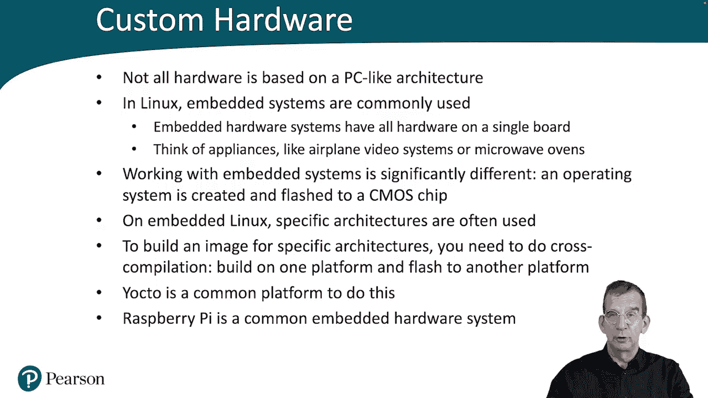

CompTIA Linux+ V8：01：计算机硬件与操作系统基础 🖥️

在本节课中，我们将学习计算机硬件的基础知识，以及操作系统如何管理这些硬件。内容包括中央处理器、内存、硬盘、外设等硬件组件，还会讲解操作系统、驱动程序、内核模块，最后简单介绍嵌入式系统和交叉编译。无论你是刚接触 Linux 的新手，还是想要系统了解计算机工作原理的学习者，本节内容都会帮你打下坚实基础。

首先，我们先来看看什么是计算机硬件，以及它由哪些核心部分组成。

计算机硬件是让电脑能够干正事的实体部分。没有硬件，软件就无从运行。

以下是计算机硬件的主要组成部分：

- 中央处理器（CPU）：CPU = 计算机的指令接收与执行单元。它负责接收并执行计算机程序发出的各种指令，是电脑的核心部件。
- 随机存取内存（RAM）：RAM = 当前运行程序的数据暂存区。CPU 需要和内存协作，内存里存放着程序正在使用的数据。内存很重要，但实际上你总觉得内存不够用。
- 硬盘：硬盘 = 用于永久存储数据的部件。大多数电脑至少有一块硬盘，很多电脑有多块硬盘。
- 外设：外设 = 用于执行其他操作的设备。外设的种类取决于你使用电脑的具体用途。

有了硬件之后，还需要一个“总管”来让这些硬件工作起来，这个总管就是操作系统。

操作系统是让计算机运转的主程序。Linux 是操作系统，Windows 也是操作系统，市面上还有其他操作系统。

操作系统的核心功能可以用下面这个公式来概括：

- 操作系统 = 控制硬件 + 管理文件 + 运行程序 + 提供用户界面

具体来说，操作系统负责控制硬件、管理文件、运行程序，还要给用户提供操作界面。这些就是操作系统最基本的职责。

操作系统要管控硬件，必须要有办法和硬件“说话”，这时候就要用到驱动程序了。

操作系统与硬件通信需要借助驱动程序。在 Linux 世界里，我们把驱动程序称为内核模块。

驱动程序的作用可以这样表示：

- 有合适驱动 = 操作系统能够正常使用硬件
- 没有合适驱动 = 电脑无法对硬件做任何事

Linux 的驱动程序可以由开源社区提供，也可以由硬件厂商提供。由厂商提供的驱动程序通常被称为专有驱动程序。

除了普通的笔记本电脑和服务器，还有一种特殊的硬件叫做嵌入式系统，它的工作方式与普通电脑不同。

嵌入式硬件系统的所有硬件都集成在一块电路板上，常见于飞机娱乐系统、微波炉等设备。嵌入式系统需要用不同的方式来编程。

嵌入式系统与普通电脑的主要区别如下：

- 普通电脑：操作系统安装在硬盘上
- 嵌入式设备：操作系统被烧录到芯片里，而不是安装到电脑硬盘

嵌入式 Linux 常常使用特定的架构。如果你要为某个特定架构构建镜像，需要经过一个叫作交叉编译的过程。

交叉编译可以这样理解：

- 交叉编译 = 在你的笔记本电脑上准备镜像，然后烧录到嵌入式设备上

做这件事时，常用的基于 Linux 的平台是 Yocto。另外，树莓派是一种常见的嵌入式硬件系统，价格不贵，适合用来玩嵌入式硬件开发。

以上就是本节的主要内容了，下面我们来做个总结。

本节课中，我们一起学习了计算机硬件的基础知识，包括中央处理器、内存、硬盘和外设的作用。我们还了解了操作系统的核心功能，以及驱动程序和内核模块在操作系统与硬件通信中的作用。最后，我们简单介绍了嵌入式系统、交叉编译、Yocto 和树莓派等相关内容。希望这些知识能帮助你更好地理解 Linux 如何管理计算机硬件。
