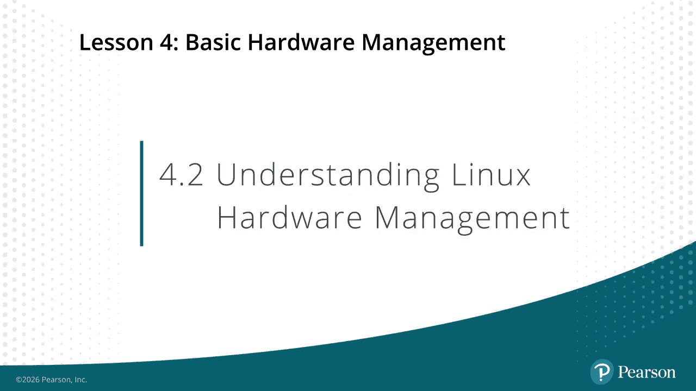
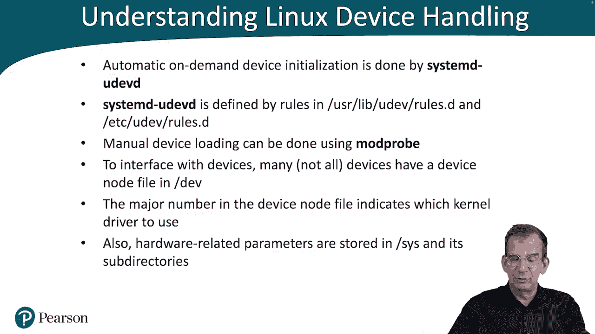
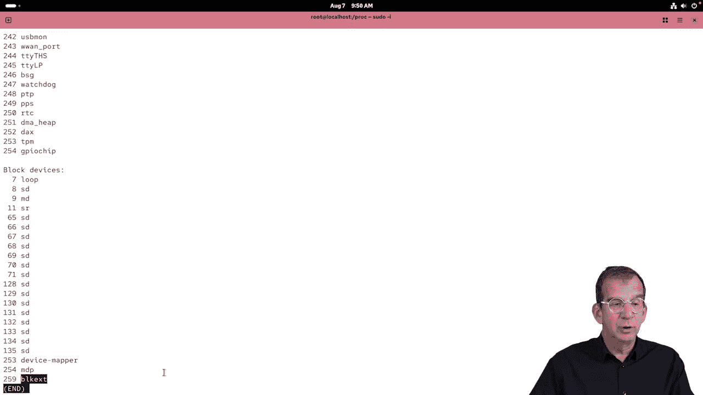

# 🐧 Linux硬件管理：第1课：理解Linux硬件管理


在本节课中，我们将一起学习 Linux 硬件管理的基础知识。你会了解到 Linux 内核是如何负责管理计算机硬件的，内核模块又是如何为不同类型的设备提供驱动支持的。此外，我们还会看看 systemd udev 如何实现设备的自动初始化，以及 /dev 目录里的设备节点到底代表什么。最后，我会带你查看主设备号和次设备号，并说明如何通过 /proc 文件系统确认设备对应的驱动程序。这些内容是理解 Linux 系统与硬件交互的重要基础。




## 1. Linux 内核负责设备管理

在 Linux 系统中，内核起着核心作用。当你想要使用任何一块硬件时，都需要 Linux 内核来负责设备管理。简单来说，没有内核的支持，硬件就无法被操作系统识别和使用。

每种硬件设备都有对应的内核模块，这些模块专门负责特定类型的设备。内核模块可以理解为内核的插件，它告诉内核如何与某块硬件通信。

以下是内核模块的核心作用：

- 为特定设备类型提供驱动支持
- 在系统启动时确保关键驱动可用
- 作为内核与硬件之间的桥梁


## 2. 内核模块与 initramfs

上一节我们介绍了 Linux 内核负责设备管理，本节中我们来看看内核模块与 initramfs。

有些内核模块会被包含在 initramfs 中。initramfs 在你安装 Linux 时创建，它会根据检测到的硬件进行构建，目的是确保引导过程中所有必要的驱动程序都可用。

换句话说，initramfs 是一个临时的初始化文件系统，它包含启动系统所需的基本模块，让内核在加载真正的根文件系统之前就能访问磁盘等关键设备。

initramfs 的作用可以用下面这个简单公式来表示：

```
系统启动 = 内核 + initramfs 中的必要驱动 + 根文件系统
```


## 3. systemd udev 与自动设备初始化

上一节我们介绍了 initramfs，本节中我们来看看 systemd udev 与自动设备初始化。

除了 initramfs，还有一部分模块可以由即插即用管理器加载。在 Linux 中，这个管理器就是 systemd udev。systemd udev 负责按需自动初始化设备，它的规则通常定义在 /etc/udev 目录中。

systemd udev 的一个好处是，你可以自定义规则，使得当特定设备被插入时，系统执行特定的动作。比如，你可以设置将消息记录到 syslog，或者创建某个文件。不过，这些定制规则的内容超出了 Linux+ 认证考试的要求，所以在这里我就不再详细展开。

当你插入设备时，systemd udev 会检测设备，并加载所需的内核模块。当然，除了自动方式，也有手动加载模块的方法，常用的命令是 modprobe。

以下是设备初始化的两种常见方式：

- 自动方式：由 systemd udev 根据规则自动检测并加载模块
- 手动方式：使用 modprobe 命令手动加载指定的内核模块


## 4. /dev 目录下的设备节点

上一节我们介绍了 systemd udev 与自动设备初始化，本节中我们来看看 /dev 目录下的设备节点。

如果你想与设备进行交互，大部分但不是全部的设备都会在 /dev 目录下有一个对应的设备节点文件。设备节点可以看作是访问硬件的入口，程序通过读写这些文件来与硬件通信。

举个例子，如果你要使用某块硬盘，可能会使用类似下面的命令：

```
mount /dev/sda1
```

在这里，/dev/sda1 指的是你的第一个分区。这个分区会关联到合适的内核模块，从而确保设备被正确初始化并可以使用。

/dev 目录下的设备节点具有以下特点：



- 每个节点对应一个具体的硬件设备或分区
- 通过挂载命令可以访问对应的存储设备
- 设备节点是用户程序与内核驱动交互的接口


## 5. 主设备号与次设备号

上一节我们介绍了 /dev 目录下的设备节点，本节中我们来看看主设备号与次设备号。

在 /dev 目录中，设备节点不仅有名字，还带有主设备号和次设备号。这两个数字用来指明应该使用哪个内核驱动程序，以及该驱动下的具体设备参数。

主设备号决定了使用哪个内核驱动，次设备号则用于区分同一驱动下的不同设备或分区。你可以通过下面的命令查看设备节点及其主次设备号：

```
ls -l /dev
```

例如，在我的系统中，有一块 NVMe 磁盘，它的设备节点显示为 259,0。这里的 259 是主设备号，0 是次设备号。主设备号 259 指向负责该磁盘的内核驱动。同样，第一个分区会显示为 259,1，以此类推。所有这些设备节点都有对应的主设备号。


## 6. /proc 文件系统与 devices 文件

上一节我们介绍了主设备号与次设备号，本节中我们来看看 /proc 文件系统与 devices 文件。

如果你想了解某个主设备号到底对应什么设备，可以查看 /proc 文件系统。/proc 是关于当前内核状态的伪文件系统，通过它你可以了解系统运行时的大量信息。

/proc 下有一个名为 devices 的文件，里面列出了字符设备和块设备。你可以使用 less 命令来查看这个文件：

```
less /proc/devices
```

在这个文件中，你会先看到字符设备列表，接着是块设备列表。例如，主设备号 259 被标识为块设备 NVMe。块设备类型对应了内核提供的功能，这意味着有一个内核模块负责让该设备可以正常使用。


## 本节总结



本节课中，我们一起学习了 Linux 硬件管理的基础知识。首先介绍了 Linux 内核负责设备管理，所有硬件都需要通过内核模块来驱动。接着说明了 initramfs 在安装时创建，确保引导时关键驱动可用。然后介绍了 systemd udev 如何实现即插即用设备的自动初始化，并提到可以使用 modprobe 手动加载模块。之后解释了 /dev 目录下的设备节点，以及如何使用 mount /dev/sda1 这类命令访问存储设备。随后重点说明了主设备号和次设备号的含义，主设备号决定使用哪个驱动，次设备号区分具体设备。最后介绍了如何通过 /proc/devices 文件查询设备号对应的设备类型。希望这些内容能帮助你建立对 Linux 硬件管理的直观认识。
