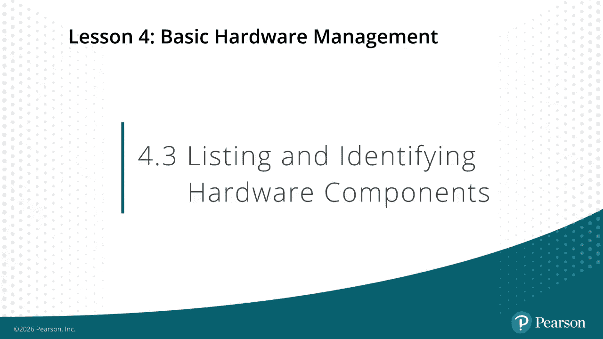

# CompTIA Linux+ V8：276.43：列出并识别硬件组件 🖥️




在本节课中，我们将学习如何在 Linux 系统中列出并识别硬件组件。无论你是想查看电脑里安装了什么设备，还是想确认某个硬件是否被系统正确识别，这些命令都是必备的基础技能。我们将一起看看通用工具和专用工具，并通过实际例子理解它们的输出含义。


Linux 对硬件设备的处理有一个很重要的特点，那就是无论对应的驱动程序是否已经安装，系统都会列出设备。也就是说，你在命令行里能看到某个设备，并不意味着 Linux 已经为它加载了正确的驱动。设备可见与驱动正常是两回事，这点在排查硬件问题时非常关键。


如果你想知道某个 PCI 设备到底使用了哪个内核驱动，最直接的方法就是使用 `lspci -k` 命令。这个命令会扫描 PCI 总线上的所有设备和驱动程序，如果系统找到了匹配的驱动，输出中就会显示驱动程序的名称。

```
lspci -k
```


除了针对特定总线的工具之外，Linux 还提供了一些通用的硬件查看工具，以及专门针对某个设备子系统的实用程序。接下来我们来看看这些常用命令。


以下是常见的通用硬件查看命令及其作用：

- `lsdev`：列出系统中的所有设备。
- `lsusb`：列出 USB 总线上连接的设备。
- `lspci`：列出 PCI 总线上的设备。
- `lsblk`：列出块设备，比如硬盘、光驱等。
- `lscpu`：列出 CPU 及其属性信息。


为了让你更直观地理解这些命令，我们来看几个实际的使用场景。首先是 `lsusb` 命令，它用来查看 USB 总线上的设备。在虚拟机环境中，你通常会看到 VMware 相关的设备，还有鼠标接口和键盘接口等信息。

```
lsusb
```


再来看 `lspci` 命令，它用于列出 PCI 总线上的设备。在虚拟机里这个输出可能不太丰富，但如果你加上 `-k` 参数，就能看到内核模块信息，从而判断特定 PCI 设备是否使用了正确的驱动程序。

```
lspci -k
```


`lsblk` 命令专门用来列出块设备。在示例系统中，你可以看到两个块设备，分别是 `sr0` 和 `nvme0n1`。其中 `sr0` 是光驱，而 `nvme0n1` 是 NVMe 固态硬盘，它是一种特殊的 SSD 类型。在 NVMe 磁盘上通常还会有分区，关于分区的内容我们会在后续章节详细讲解。

```
lsblk
```


`lscpu` 命令用于显示 CPU 的详细属性。如果你使用的是基于 ARM 的 Apple Silicon 处理器，输出的信息可能比较少；但在 Intel 处理器上，你会看到主频、处理器类型等更多内容。无论用什么平台，`lscpu` 都是了解 CPU 状态的简单方式。

```
lscpu
```


除了列出设备，有时候我们还需要查看设备初始化过程中的相关信息。这时可以使用 `dmesg` 命令，它显示的是内核环形缓冲区（也叫 ring buffer）中的消息。内核会把与系统运行相关的消息写入这里，其中包含很多设备和驱动程序的信息。比如你可以看到 `E1000` 以太网控制器的相关记录，而这个控制器就挂在 PCI 总线上，所以它和 `lspci` 的输出是有关联的。

```
dmesg
```


使用 `dmesg` 工具，你可以进一步了解驱动程序和其他内核级别的运行情况，这对深入排查硬件问题非常有帮助。


在本节课中，我们一起学习了如何在 Linux 中列出和识别硬件组件。我们了解了无论驱动是否可用，Linux 都会列出设备，也学会了使用 `lspci -k` 查看 PCI 设备驱动，掌握了 `lsusb`、`lsblk`、`lscpu` 等通用工具的使用方法，最后还介绍了通过 `dmesg` 查看内核消息来获取设备初始化信息。希望这些内容能帮助你更好地管理和排查 Linux 系统中的硬件设备。

