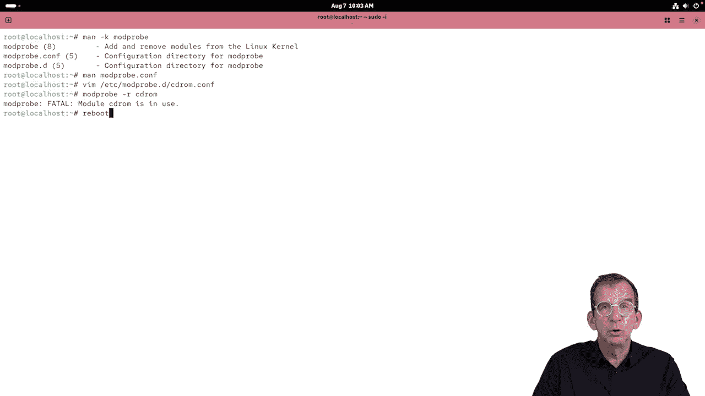
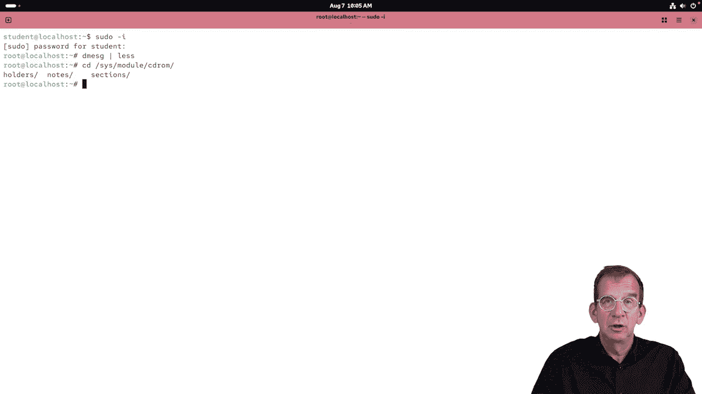

# Linux内核模块管理：01：内核模块与引导加载 🐧

在本节教程中，我们将一起学习Linux系统中内核模块的管理方法。内容包括内核模块是什么，系统在启动时如何加载模块，如何手动加载和卸载模块，以及如何为内核模块设置参数。无论你是刚接触Linux的新手，还是正在准备CompTIA Linux+认证的学习者，这篇教程都会用大白话把这些概念讲清楚，让你明白电脑里的硬件设备是如何和操作系统打交道的。

在Linux系统里，跟硬件设备打交道，本质上就是在跟内核模块打交道。你使用的每一块硬件设备，背后都需要一个对应的内核模块来支持。如果没有这个模块，系统就无法识别和使用这个设备。简单来说，内核模块就是操作系统和硬件之间的翻译官，没有翻译官，双方就没法沟通。

当你启动电脑的时候，系统会先加载一些内核模块，这些模块存放在initramfs或者initrd里面。initramfs在Red Hat系列的系统里能找到，initrd在Ubuntu系列的系统里是对应的东西，它们都放在/boot目录下。安装系统的时候，这些文件会自动生成，目的是确保你拥有启动所需要的全部配置，这样开机时系统才不会缺少关键驱动。

以下是引导阶段涉及的关键概念和命令：

- initramfs = 启动时加载的临时文件系统，Red Hat系列系统使用
- initrd = Ubuntu等系统中的等价引导镜像
- /boot = 存放引导文件和内核镜像的目录
- dracut -f = 强制重新生成initramfs的命令
- update-initramfs = Ubuntu上重新生成initrd的命令

如果你需要手动触发生成initramfs，可以使用Dracut工具，它是Red Hat系的实用工具。对应的，在Ubuntu上使用update-initramfs命令。为什么要手动重新生成？比如你刚装了一块漂亮的新显卡，initramfs里面还不知道这个设备的存在，这时候就得重新生成一下，让系统知道有这块新硬件。可以使用dracut -f或者dracut --force来强制生成。

# Linux内核模块管理：02：按需加载与自动机制 🔄

上一节我们介绍了系统启动时如何加载内核模块，本节中我们来看看系统运行中如何按需加载模块。

在系统启动完毕后，不是所有模块都会一直留在内存里，很多时候是需要什么设备再加载什么模块。systemd会启动systemd-udev服务，负责按需加载内核模块。也就是说，当你把某个设备插进电脑的时候，系统才会去加载这个设备需要的内核模块，而不是把所有可能的模块都预先加载进去，这样可以节省内存资源。

举个具体的例子，当你插入一个带有VFat文件系统的USB拇指驱动器，而这个文件系统还没有被挂载时，systemd-udev会确保vfat这个内核模块被加载进来，这样系统才能读取U盘里的文件。整个过程对用户来说是透明的，你插上U盘，系统自动识别，背后就是systemd-udev在忙活。

除了自动加载，也可以手动加载模块，使用modprobe命令。还有一个老命令叫insmod，不过现在已经不推荐使用了，属于被废弃的工具。因为系统自动加载的机制已经非常完善，绝大多数情况下你根本不需要手动去加载模块，除非你在做一些特殊的内核调试或者硬件排查工作。

以下是自动加载相关的核心命令：

- systemd-udev = 按需加载内核模块的系统服务
- modprobe = 手动加载内核模块的命令
- insmod = 已废弃的手动加载命令，不推荐继续使用

# Linux内核模块管理：03：手动加载与卸载模块 🔧

上一节我们介绍了systemd-udev的按需加载机制，本节中我们来看看如何手动加载和卸载内核模块。

虽然自动加载很好用，但作为Linux学习者，你仍然需要知道手动加载和卸载模块的方法，以便在排查问题时使用。如果你想判断是不是需要手动加载某个模块，第一步得先确认你的设备是否已经有对应的内核模块了。这里有个非常好用的命令，叫做lspci -k，它可以帮你查看PCI设备当前使用的是哪个内核模块，让你心里有个底。

在决定加载模块之前，你可以用modinfo命令来查看这个内核模块的详细信息，包括它支持哪些参数。modinfo后面跟上你要使用的内核模块名称即可，输出会告诉你这个模块是做什么的，以及有哪些可选配置。

当你确定要手动加载模块时，使用modprobe命令。modprobe的好处在于，它会把模块以及模块依赖的所有其他模块一并加载进来，你不需要一个一个去找依赖项，省去了很多麻烦。如果你想把手动加载的模块移除，使用modprobe -r命令。这个命令会卸载你指定的内核模块，把它从内存中移走。

至于模块之间的依赖关系，系统有一个depmod进程会自动生成模块依赖信息。平时你完全不需要操心depmod，但如果你正在研究某个内核模块，感觉好像缺少了什么依赖，手动运行一次depmod工具也没有什么坏处，最多也就是多花几秒钟时间。

在早期的Linux发行版里，insmod和rmmod命令被用来加载和卸载模块，但这些命令现在已经过时了，基本不再使用。现在的标准做法就是统一用modprobe来处理。

以下是手动管理模块的常用命令：

- lspci -k = 查看PCI设备及其对应的内核模块
- modinfo <模块名> = 查看内核模块信息和支持的参数
- modprobe <模块名> = 加载模块及其所有依赖
- modprobe -r <模块名> = 卸载手动加载的模块
- depmod = 生成内核模块之间的依赖关系

# Linux内核模块管理：04：内核模块参数配置 ⚙️

上一节我们介绍了手动加载与卸载内核模块的方法，本节中我们来看看如何为内核模块配置参数。

加载模块只是第一步，很多模块还支持参数，可以让你改变模块的运行方式。内核模块可以带有参数，这些参数用来控制模块的具体行为。你可以用modinfo命令来查看某个模块有哪些可用参数，这样你就知道能调节哪些开关。

参数可以写在配置文件里，常见的位置是/etc/modprobe.conf，或者/etc/modprobe.d/目录下的文件。你也可以在手动加载模块的时候，直接把参数名和参数值作为参数传进去。不过要注意，关于加载参数的消息并不总是很一致，这意味着你可能不容易一眼看出模块是否正确识别了参数。你可以尝试使用dmesg命令，或者查看/sys/modules这个文件系统，来寻找线索，确认参数是否真的生效了。

以下是配置模块参数的相关命令和路径：

- modinfo <模块名> = 查看模块支持的参数列表
- /etc/modprobe.conf = 模块参数的主配置文件
- /etc/modprobe.d/ = 存放模块参数配置片段的目录
- dmesg = 查看内核日志，确认参数是否生效
- /sys/modules/ = 通过文件系统查看模块参数的路径

# Linux内核模块管理：05：实战演示与验证 🖥️

上一节我们介绍了内核模块参数的配置方法，本节中我们来看一个完整的实际操作例子。

首先使用lsmod命令，它会列出当前系统里所有已经加载的内核模块。我们要关注的是cdrom模块，这是一个比较安全、不会惹事的模块。可以看到cdrom模块有一些依赖项，比如sr_mod，sr_mod是支持SCSI CD/DVD设备的模块，它就在后面支撑着cdrom模块工作，两者缺一不可。

如果想知道cdrom模块具体有哪些参数，可以用modinfo命令查看。modinfo会列出一系列参数，其中有一个叫debug的参数，它是布尔值类型。debug参数的作用是，当光驱发生什么事情时，在dmesg输出里记录更多信息。布尔值就是开关值，通常0和1就可以了，1代表开启调试信息，0代表关闭。

接下来进入/etc/modprobe.d目录，这个目录里存放着一些示例配置文件。我们先排除掉黑名单文件，因为黑名单是用来阻止特定内核模块加载的，我们不需要那部分。然后去看看/usr/lib/modprobe.d目录，这是存放标准配置的地方，也许里面有些我们喜欢的默认设置。在那里可以看到一个针对ALSA声音模块的示例文件，不过我们不需要那个，我们要关注的是光驱模块。

我们要查询一下modprobe.d.conf的文档，可以使用man -k modprobe命令，或者直接查man modprobe.d.conf，看看这个配置文件里能写些什么。经过查找，我们需要关注的是options选项。最终决定，给cdrom模块加上debug=1这个选项，这样光驱相关的调试信息就会被记录下来。

使用vim打开/etc/modprobe.d/cdrom.conf文件，写入内容：options cdrom debug=1。保存退出后，配置就生效了，下次系统加载cdrom模块时就会带上这个参数。

然后尝试用modprobe -r cdrom命令来卸载cdrom模块。但系统会提示cdrom模块正在被使用，无法卸载，这是因为模块已经自动启动并被占用了。这时候需要重启电脑，重启之后再来检查这些选项是否生效，重启是确保新配置被加载的最可靠方式。

重启完成后，使用dmesg | less命令来查看内核日志，less命令允许你在日志里搜索内容，不用一行一行往下翻。搜索CDR，可以看到cdrom相关的条目，不过信息不算多。另一种查看方式是查看/sys/modules文件系统，进入cdrom目录，看看有没有名为parameters的子目录。在这个例子里并没有看到，说明这个模块并没有明确记录它的参数，也就这样。

以下是实战演示中使用的命令：

- lsmod = 列出当前已加载的所有内核模块
- modinfo cdrom = 查看cdrom模块的参数列表
- options cdrom debug=1 = 在配置文件中为cdrom开启调试模式
- modprobe -r cdrom = 尝试卸载cdrom模块
- dmesg | less = 分页查看内核日志，支持关键词搜索
- /sys/modules/cdrom/parameters = 查看模块参数的具体路径

本节教程中，我们一起学习了Linux内核模块的管理方法。内容包括内核模块与硬件设备的关系，系统启动时通过initramfs/initrd加载模块的机制，systemd-udev如何按需加载模块，modprobe和modprobe -r如何手动加载与卸载模块，depmod如何生成依赖关系，以及modinfo和配置文件如何设置模块参数。最后通过cdrom模块的实战演示，完整走了一遍查看模块、查询参数、修改配置和验证结果的过程。希望这篇教程能帮助你初步掌握Linux内核模块管理的核心知识，在实际使用中能更加从容地处理设备驱动相关的问题。

