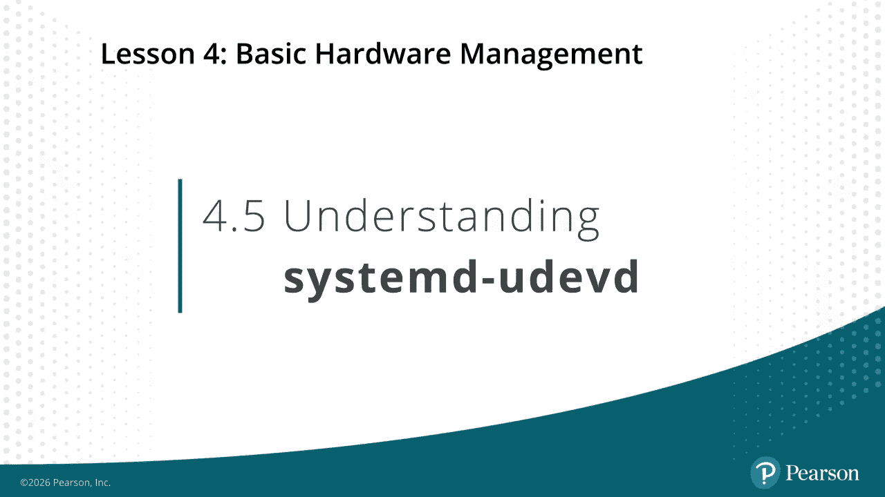
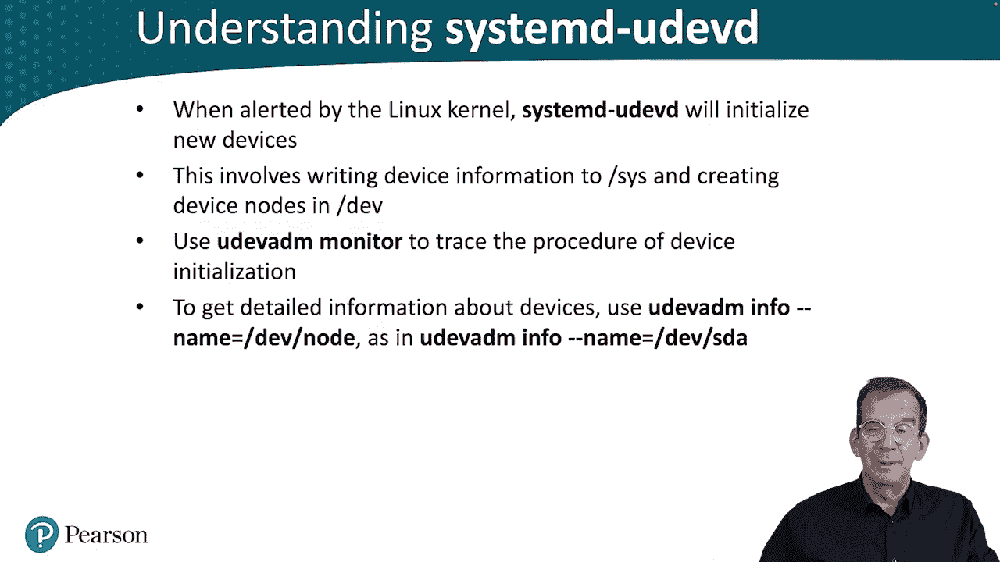
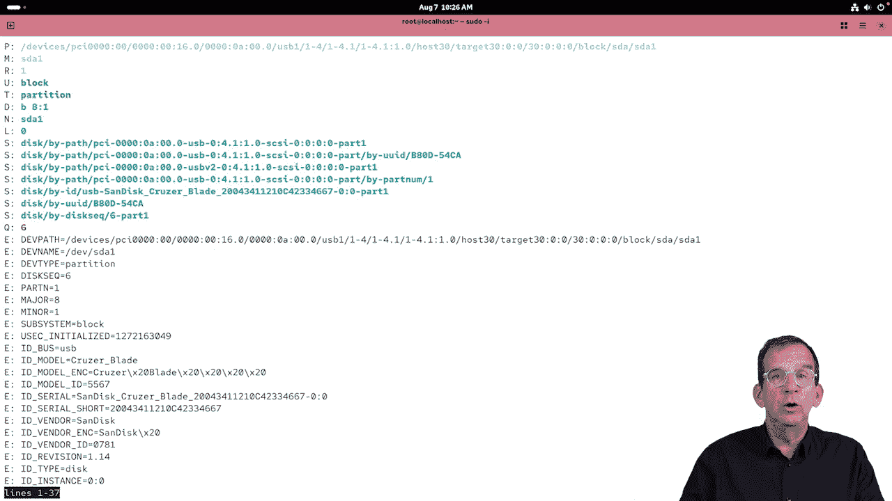

# Oreilly - CompTIA Linux+ V8 - Pearson Cert Prep (Video) part3 p78：278.45：Understanding systemd-udevd 📟




本节课中我们将要学习 Linux 系统里非常重要的一个后台服务，叫做 systemd-udevd。简单来说，它负责在你把新硬件插进电脑之后，帮助系统认识这些设备，并在合适的位置创建设备文件，这样你才能正常使用 U 盘、键盘或者其他外设。如果你以前插过设备却发现没有任何反应，那很可能就是这个环节出了问题，所以掌握它的工作原理对排查硬件故障很有帮助。


systemd-udevd 的基本工作流程

上一节我们大概聊了聊 Linux 设备管理的背景知识，本节中我们来看看 systemd-udevd 具体是如何运作的。当 Linux 内核检测到新设备时，它会发出一个通知，systemd-udevd 收到通知之后就会开始初始化这个设备。整个过程可以用下面这段伪代码来概括：

```text
内核发现新设备 -> 发送 uevent -> systemd-udevd 接收通知
    -> 读取设备参数 -> 写入 /sys 目录 -> 创建 /dev 下的设备节点
    -> 应用 udev 规则 -> 设备可用
```

在这个流程里，有两个关键目录需要记住。第一个是 /sys，系统会把设备的详细信息写到这里，这样内核和管理工具都能随时查看设备的完整状态和参数。第二个是 /dev，systemd-udevd 会在这里创建设备节点，这些节点就像是设备的门面，普通用户和程序就可以通过它们跟硬件进行通信。没有这些节点，即使硬件已经被电脑识别，你也没办法直接操作它。


使用 udevadm monitor 跟踪设备事件

刚才介绍了 systemd-udevd 的大致流程，不过光说不练假还是假。要想知道设备插入之后系统内部到底发生了什么，最直接的方法就是使用 udevadm monitor 命令。这个命令就像一个监视器，会把内核发出的每一个设备事件，以及 systemd-udevd 处理规则的每一个步骤，都实时打印到屏幕上。

以下是使用该命令时常见的输出示例：

```bash
udevadm monitor
```

运行之后，你会看到两种主要的事件信息。一种来自内核，代表实际的硬件变化，比如某个设备被插入或者拔出；另一种来自 udev，代表规则处理阶段，也就是系统根据预设规则决定如何配置这个设备。如果你有一天插入设备后发现毫无反应，打开这个命令再插一次，通常就能看出卡在哪个环节了。




使用 udevadm info 查看设备详细信息

掌握了怎么看事件之后，我们还需要知道如何查看某个具体设备的所有参数。这时候 udevadm info 就派上用场了，它可以把系统发现的关于某个设备的详细信息全部列出来，方便你编写 udev 规则或者排查问题。

以下是查看指定设备信息的命令格式：

```bash
udevadm info --name=/dev/sda
```

这里的 /dev/sda 只是个例子，你可以把它换成你想查看的任意设备节点。命令执行后，屏幕上会列出大量键值对形式的参数，包括设备的厂商、型号、序列号、总线类型等等。这些信息非常宝贵，因为后面的 udev 规则很多时候就是基于这些参数来匹配和处理设备的。


实战演示：插入 U 盘并观察完整过程

讲了这么多理论，下面我们来做一个实际演示，看看插入一个普通的 USB 拇指盘时，系统里到底经历了哪些变化。首先我们在终端里启动 udevadm monitor，然后再把 U 盘插进电脑的 USB 接口。

以下是你可能会看到的关键步骤顺序：

- 内核首先发现新设备，并报告设备所在的具体 PCI 地址。
- systemd-udevd 收到通知后，开始检查是否有相关的 udev 规则需要处理。
- 系统加载 USB 存储驱动程序，常见的包括 usb-storage 模块和 UAS 模块。
- 驱动加载完成后，内核会创建一个块设备，通常会显示为 /dev/sda 这样的设备节点。
- 在块设备上，系统会进一步检测分区表，发现上面的分区。

每一步都会在监视器窗口里打印出详细日志，你可以耐心向上滚动查看，从中了解内核和 udev 是如何协同工作的。


使用 lsblk 确认块设备

观察完内部事件之后，我们还需要从用户层面确认设备是否真的被系统识别了。这时候 lsblk 命令就非常实用，它的全称是 list block devices，专门用来列出系统当前所有的块设备和分区情况。

以下是常用的查看命令：

```bash
lsblk
```

运行之后，如果你刚才插入的 U 盘一切正常，应该能在列表里看到类似 /dev/sda 这样的设备，以及它下面的分区。看到这一行说明设备节点已经成功创建，分区也被正确检测到了，这时候你就可以去挂载分区，开始往里面读写文件了。


本节课总结



本节课中我们一起学习了 systemd-udevd 的核心作用，理解了它如何在内核通知新设备后，将设备信息写入 /sys、在 /dev 创建设备节点，并让用户能够与硬件通信。我们还学习了如何用 udevadm monitor 跟踪设备事件，如何用 udevadm info 查看设备详细参数，以及通过插入 U 盘的实战演示，观察到了从内核发现设备到块设备出现的完整过程。最后还用 lsblk 确认了设备是否被系统正确识别。下一节课我们将会介绍 udev 规则，敬请期待。

