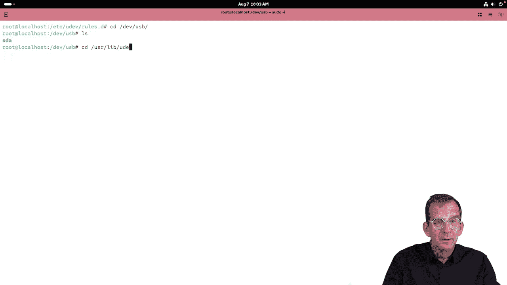

# CompTIA Linux+：03：管理 Udev 规则 🔧

在本节课中，我们将一起学习 Linux 系统中 Udev 规则的基本概念、规则文件的存放位置与优先级，以及如何通过一个实际的演示来编写和验证自定义的 Udev 规则。通过本节内容，你将了解系统是如何自动识别和初始化硬件设备的，并且能够自己为 USB 存储设备等设备添加个性化的处理逻辑，让设备在插入系统时按照你的预期行为工作。


## 什么是 Udev 规则

Udev 规则就是 Linux 内核在检测到新硬件设备时，用来决定该如何处理这个设备的一组指令。简单来说，当你插入一根 U 盘或者连接其他外设时，系统需要知道这个设备是什么，应该放在哪个目录下，是否需要创建符号链接，或者是否需要运行某些辅助命令。Udev 规则就是用来完成这些工作的，它充当了硬件检测和系统配置之间的桥梁。

每一条规则都可以设置特定的设备属性，比如设备的名称、所属的子系统、使用的驱动程序，以及设备被添加到系统时需要执行的操作。通过规则，管理员可以精确控制设备在系统中的表现形式和行为，而不需要每次插入设备都手动去配置。

下面是一条典型的 Udev 规则结构示例，你可以把它看作是一组“条件-动作”对：

```text
SUBSYSTEM=="block", DRIVER=="usb-storage", SYMLINK+="usb/%k", RUN+="/usr/bin/logger custom udev added %k"
```

这条规则的意思是：当检测到的设备属于块设备子系统，并且使用的是 USB 存储驱动程序时，在 /dev 目录下创建一个名为 usb 的子目录，并在其中生成设备节点；同时执行 logger 命令，在系统日志中记录一条自定义信息。这样你就可以通过固定的路径访问设备，并且在日志里清楚地知道设备什么时候被添加了。


## 规则文件的存放位置与优先级

上一节我们介绍了 Udev 规则的基本含义，本节中我们来看看这些规则文件到底放在哪里，以及系统是如何决定哪条规则先生效的。在实际使用中，规则的位置直接影响它的优先级，优先级高的规则会优先被应用，如果同一个设备匹配到多条规则，优先级高的会覆盖优先级低的。

以下是常见的 Udev 规则目录及其优先级顺序：

- `/etc/udev/rules.d`：管理员自定义规则存放位置，优先级最高。
- `/run/udev/rules.d`：系统动态生成的规则存放位置，优先级居中。
- `/lib/udev/rules.d`：系统默认规则存放位置，优先级最低。

你可以把优先级关系用一个简单的公式表示出来：

```
/etc/udev/rules.d > /run/udev/rules.d > /lib/udev/rules.d
```

这意味着，如果你在 `/etc/udev/rules.d` 中写了一条规则，它的效力会高于系统在 `/lib/udev/rules.d` 中预设的同类规则。在实际管理中，我们通常把自定义规则放在 `/etc/udev/rules.d` 目录下，这样可以确保我们的设置优先于系统默认行为，避免被系统自带的规则覆盖。


## 准备演示所需的文件

介绍完规则的存放位置和优先级之后，我们现在进入实战环节。为了演示如何创建自定义 Udev 规则，我们需要先从课程的 Git 仓库中获取一些示例文件。Git 是一个版本控制工具，方便我们下载课程提供的资料，而不需要手动一个一个地复制粘贴。

以下是准备工作的具体步骤：

- 确保你的系统中已经安装了 Git 客户端，如果没有，请先使用包管理器安装。
- 打开终端，使用 Git 命令克隆课程仓库，仓库地址是 `https://github.com/sovoververt/linux+`。
- 克隆完成后，进入仓库目录，找到名为 `50-custom.rules` 的示例规则文件。

克隆仓库的命令示例如下：

```bash
git clone https://github.com/sovoververt/linux+
```

完成这些准备之后，我们就可以把示例规则文件复制到系统的 Udev 规则目录中，并查看它的具体内容了。


## 部署并查看自定义规则

有了示例文件之后，下一步就是将自定义规则部署到系统中，让 Udev 能够识别它。我们需要把刚才从 Git 仓库中找到的 `50-custom.rules` 文件复制到 `/etc/udev/rules.d` 目录下，因为这个目录的优先级最高，能够确保我们的规则被优先读取。这里需要使用 sudo 命令，因为写入系统目录需要管理员权限。

复制文件的命令如下：

```bash
sudo cp 50-custom.rules /etc/udev/rules.d/
```

复制完成后，我们进入 `/etc/udev/rules.d` 目录，打开这个文件来看看里面到底定义了什么。以下是该规则文件的核心内容及其含义：

- 触发条件：`SUBSYSTEM=="block"` 且 `DRIVER=="usb-storage"`。这意味着，只有当使用 USB 存储驱动程序的块设备被连接时，这条规则才会被触发。
- 创建符号链接：`SYMLINK+="usb/%k"`。系统会在 /dev 目录下创建一个 usb 子目录，并在其中放置对应的设备节点，方便我们通过固定路径访问设备。
- 执行自定义命令：`RUN+="/usr/bin/logger custom udev added %k"`。系统会运行 logger 命令，向系统日志中写入一条记录，表明有新的 USB 存储设备被 Udev 添加了。

通过这条规则，我们可以看到 Udev 规则的真正威力：它不仅能改变设备在系统中的表现形式，还能在设备被添加时执行任意的自定义命令，比如记录日志、运行脚本或者发送通知。


## 测试规则的效果

规则文件已经部署到位，接下来我们需要验证它是否真的起作用了。Udev 通常会自动加载新的规则文件，不需要重启系统。为了观察设备被连接时的详细过程，我们可以使用 `udevadm monitor` 工具来监控内核和 Udev 的事件，当然这一步不是强制性的，只是为了让我们更清楚地看到发生了什么，就像给设备插拔过程装了一个实时监控摄像头。

以下是验证规则效果的操作步骤：

- 在一个终端窗口中运行 `udevadm monitor`，观察设备连接时的事件输出。
- 在另一个终端窗口中，再次插入你的 USB 存储设备，比如 U 盘。
- 使用 `journalctl` 查看系统日志，滚动到日志的末尾，你应该能看到类似 `custom udev added sda` 和 `custom udev added sda1` 的记录。
- 进入 `/dev` 目录，检查是否出现了 `usb` 子目录，并在其中查看设备节点是否已经创建。

如果以上现象都出现了，就说明我们的自定义 Udev 规则已经成功生效了。这时，设备不仅被正常添加到了系统中，还按照我们的规则在 `/dev/usb` 下创建了符号链接，并且在日志中留下了相应的记录，证明规则已经按照我们的预期运行了。


## 关于系统默认规则的注意事项

在演示结束后，我们还需要了解一些关于系统默认规则的重要背景知识。虽然自定义 Udev 规则非常有用，但我们不应该随意修改系统预置的规则，除非你非常清楚自己在做什么，否则很容易造成意想不到的后果。

以下是几点需要注意的内容：

- 系统默认规则存放在 `/lib/udev/rules.d` 目录中，这些规则负责处理系统上可能发生的所有硬件初始化工作。
- 这些默认规则往往比较复杂，涉及大量的硬件类型和特殊情况，是由系统开发者经过仔细设计的。
- 除非你确切知道某条默认规则的作用，否则不要修改或删除它们，以免导致系统无法正确识别重要硬件设备，比如键盘、鼠标或者磁盘控制器。

在日常管理中，我们建议所有的自定义规则都放在 `/etc/udev/rules.d` 目录下，这样既能发挥 Udev 的灵活性，又不会干扰到系统核心的硬件初始化流程，保证系统的稳定性。




## 本节总结


本节课中，我们一起学习了 Udev 规则的基本概念，了解了规则文件在 `/etc/udev/rules.d`、`/run/udev/rules.d` 和 `/lib/udev/rules.d` 三个目录中的存放位置与优先级关系，并通过一个实际的演示学习了如何从 Git 仓库获取示例规则、将其复制到系统目录、编写触发条件与动作，以及使用 `udevadm monitor` 和 `journalctl` 验证规则是否生效。希望通过本节内容，你能够掌握 Udev 规则的使用方法，并在实际工作中根据需要为自己的 Linux 系统编写合适的自定义规则。

