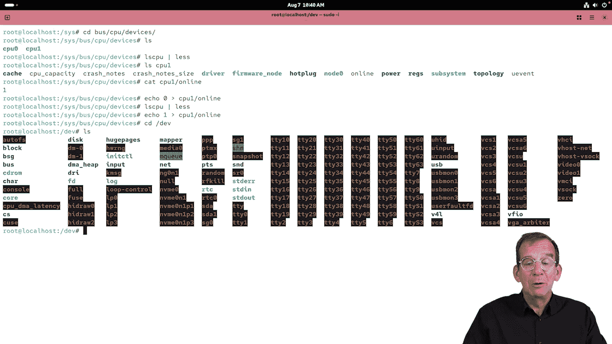

🐧 CompTIA Linux+ V8：第3节：理解 /dev、/sys 和 /proc 的使用


在本节课中，我们将学习 Linux 系统中三个特殊目录的作用，分别是 /dev、/sys 和 /proc。这些目录并不是普通的文件夹，它们属于伪文件系统，只存在于内存中，不存储在硬盘上。内核利用它们来记录硬件和内核运行时的各种事件。除了查看系统状态，你还可以通过修改这些目录里的参数来调整内核行为。通过本节内容，你将了解如何查看这些目录里的信息，以及如何使用简单命令来修改内核参数。


### 伪文件系统的基本概念

上一节我们介绍了本节的学习目标，本节中我们先来看看什么是伪文件系统。

伪文件系统是一种特殊的文件系统，它不像普通文件系统那样把数据写入磁盘，而是直接存在于内存之中。内核使用伪文件系统来追踪正在发生的硬件事件和内核相关事件。当你查看这些目录时，看到的文件和目录实际上是内核提供的接口，而不是真实的磁盘文件。因为它们不在磁盘上，所以重启系统后，里面的内容会根据内核当前的状态重新生成。


### /proc 目录的作用和使用方法

了解了伪文件系统的基本概念之后，本节中我们来看看 /proc 目录的具体用途。

/proc 目录用于提供内核运行时信息和可调参数。你可以从 /proc 中获取大量系统信息，也可以通过修改该目录下的参数来调整内核行为。需要注意的是，/proc 目录并不是为了给用户直接阅读而设计的，作为普通用户，你通常会使用工具来获取这些信息，而不是直接打开里面的文件。此外，/sys 目录也可以用于内核优化，和 /proc 类似，它也提供了很多只读或可写的接口。

以下是查看 /proc 信息的常用命令：

- `mount | grep proc`：查看 proc 文件系统的挂载情况，输出会显示 proc 被挂载到 /proc 目录，类型为 proc。
- `cat /proc/cpuinfo`：查看 CPU 详细信息。
- `cat /proc/modules`：查看当前加载的内核模块信息。
- `lsmod`：这是查看内核模块信息的用户界面，底层获取的信息与 /proc/modules 相同。

在 /proc 目录中，除了状态文件之外，还有一些以数字命名的目录，这些就是 PID 目录。每个运行中的进程都有一个对应的 PID 目录，里面包含该进程的详细信息。通过这些 PID 目录，你可以了解每个进程当前的运行状态和资源占用情况。


### /sys 目录的作用和使用方法

介绍完 /proc 目录之后，本节中我们继续来看看 /sys 目录的使用方法。

/sys 也是一个伪文件系统，它只存在于内存中，不存储在磁盘上。当你运行 `mount | grep sys` 时，可以看到 sysfs 被挂载到 /sys 目录。/sys 目录主要用于提供硬件相关信息，内部包含许多接口，用于告诉你系统中硬件和驱动的当前状态。

以下是 /sys 目录中的常见子目录和用途：

- `/sys/modules`：包含系统中所有内核模块的目录。例如 e1000e 是用于网络的模块，在它的目录下可能有一个 parameters 子目录，其中包含如 copybreak 这样的参数，值可能被设置为 256。
- `/sys/devices/cpu`：包含 CPU 相关设备目录。你可以使用 `ls /sys/devices/cpu` 查看当前系统的 CPU 数量，通常会看到 cpu0 和 cpu1。

在 /sys 目录中，有些文件的内容不能用文本编辑器打开，如果你想修改里面的值，需要使用 echo 命令将新值写入文件。以下是一个具体的操作示例：

```bash
cat /sys/devices/cpu/cpu1/online
echo 0 > /sys/devices/cpu/cpu1/online
```

执行第一条命令，你会看到文件中包含数字 1，表示 CPU1 当前在线。执行第二条命令后，CPU1 会被暂时下线。此时再使用 `ls /sys/devices/cpu` 查看，虽然仍然显示两个 CPU，但只有其中一个处于在线状态，另一个已经离线。如果你希望恢复，可以将 1 再次写入该文件。这种操作在你需要暂时禁用某个 CPU 时非常有用。同样的规则也适用于 /proc 目录，你不能用编辑器打开这些文件，如果要改变内容，就需要把新值写入文件。


### /dev 目录的作用

介绍完 /proc 和 /sys 之后，本节中我们最后来看看 /dev 目录的作用。

/dev 目录是用于创建设备节点的目录。设备节点允许用户与系统上的硬件设备进行交互。当你挂载设备或者访问硬件时，系统实际上就是通过 /dev 目录下的设备节点来完成通信的。每一个硬件设备在系统中都有对应的设备节点，用户程序可以通过读写这些设备节点来控制硬件。


### 总结



在本节课中，我们一起学习了 /dev、/sys 和 /proc 三个目录的使用方法。我们了解到，/proc 和 /sys 都是伪文件系统，只存在于内存中，内核利用它们来追踪系统运行状态和硬件事件。/proc 主要提供内核运行时信息和可调参数，/sys 主要提供硬件相关信息，而 /dev 则是创建设备节点的地方，让用户能够与系统设备交互。通过 cat 和 echo 等命令，你可以查看并修改这些目录中的内容，从而更好地理解和管理 Linux 系统。

