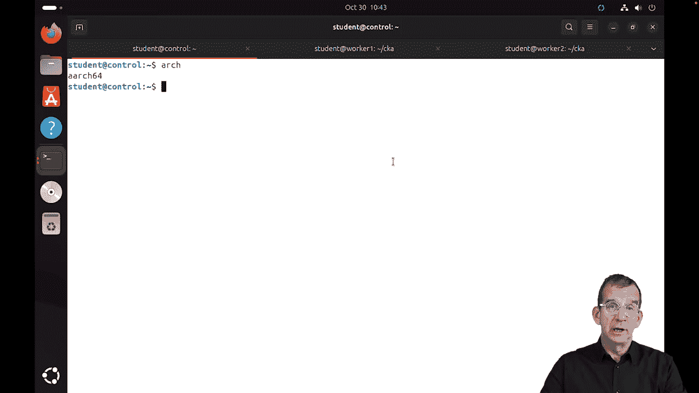
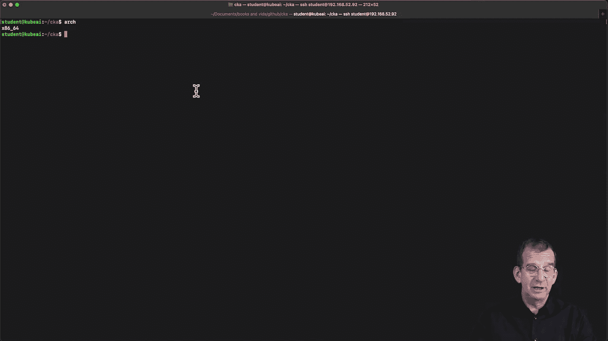

# CompTIA Linux+ V8：48：CPU 架构基础 🖥️

在本节课中，我们将一起学习 CPU 架构的基础知识，重点了解 CISC 和 RISC 两种主要指令集架构的区别，以及这些区别在实际使用 Linux 系统时会带来什么影响。


## CPU 指令集基础

CPU 在执行任何操作之前，都需要一套指令集来告诉处理器该做什么。你可以把指令集想象成 CPU 的“操作说明书”，它定义了 CPU 能够识别和执行哪些指令。这是 CPU 工作的最基本方式，也是程序和硬件之间沟通的桥梁。


以下是关于 CPU 指令集的几个核心概念：

- 指令集是 CPU 地址和寻址的基础方式。
- 不同的 CPU 架构使用不同的指令集。
- 指令集的设计直接影响程序的编写方式和执行效率。


## CISC 与 RISC 架构对比

上一节我们介绍了 CPU 指令集的基本概念，本节中我们来看看两种主流架构：CISC 和 RISC。

首先来看 CISC，也就是复杂指令集计算机。CISC 的设计思路是让每一条指令能够完成更多的工作，这样程序员写代码时需要的代码行数就更少，编程变得更简单。不过这种设计也意味着每条指令本身比较复杂。典型的例子就是我们常见的 Intel 处理器。


以下是 CISC 架构的主要特点：

- 每个程序包含的指令数量较少。
- 每条指令的功能比较强大，能完成较复杂的操作。
- 编程相对简单，代码行数更少。
- 常见于 Intel 处理器。

```text
CISC: 指令数量少 × 每条指令功能复杂 = 代码更短，编程更简单
```


然后是 RISC，也就是精简指令集计算机。RISC 的设计思路和 CISC 不同，它把指令做得更简单，每条指令只做一件小事。虽然一个程序需要的指令数量会更多，但每条指令执行得很快，而且硬件更容易优化，整体程序运行速度可以更快。ARM、PowerPC 等平台都采用这种架构。


以下是 RISC 架构的主要特点：

- 每个程序包含的指令数量较多。
- 每条指令功能简单，执行速度快。
- 硬件更容易优化，程序执行效率更高。
- 常见于 ARM、PowerPC 等平台。

```text
RISC: 指令数量多 × 每条指令功能简单 = 执行更快，硬件更易优化
```


## 架构兼容性与 Linux

本节我们了解了 CISC 和 RISC 的区别，接下来看看这些差异在实际使用中的影响，尤其是对 Linux 系统的影响。

最重要的一点是，RISC 架构编译的程序无法在 CISC 架构上运行，反过来也是一样。也就是说，程序和硬件架构之间必须匹配，不能混用。


由于 RISC 和 CISC 之间存在根本性的差异，针对某一平台开发的应用程序无法在另一个平台上执行。正因为如此，Linux 发行版会针对特定平台制作不同的版本，比如针对 Intel 或 x86 平台的版本无法在 ARM 平台上使用，ARM 平台的版本也无法在 x86 平台上使用。


## 查看当前系统架构

了解了架构兼容性之后，我们需要知道自己当前使用的系统到底是什么架构。在 Linux 中，你可以使用 arch 命令来查看，这个命令会直接打印出当前系统的架构名称。


以下是查看架构的方法和示例：



- 使用 arch 命令查询当前系统架构。
- 命令输出会直接显示架构标识符，例如 aarch64 或 x86_64。


举个实际的例子。假设你正在使用一台 Ubuntu 虚拟机，运行 arch 命令后，屏幕上显示 aarch64，这就说明当前系统运行在 ARM 架构上。

如果你远程连接到另一台电脑，运行同样的 arch 命令，输出显示 x86_64，那么说明这是 64 位 Intel 架构。通过这种方式，你就可以轻松确认自己当前所使用的架构类型。


## 总结



本节课中，我们一起学习了 CPU 架构的基础知识，重点掌握了 CISC 和 RISC 两种指令集架构的区别，了解了它们在程序兼容性上的限制，也学习了如何在 Linux 系统中使用 arch 命令查看当前架构。希望这些内容能帮助你更好地理解 Linux 在不同硬件平台上的运行方式。

