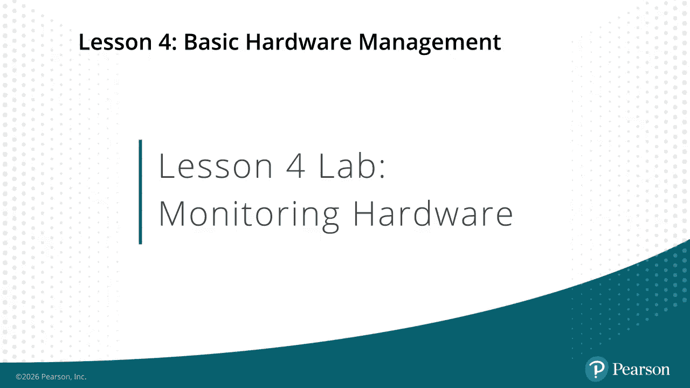
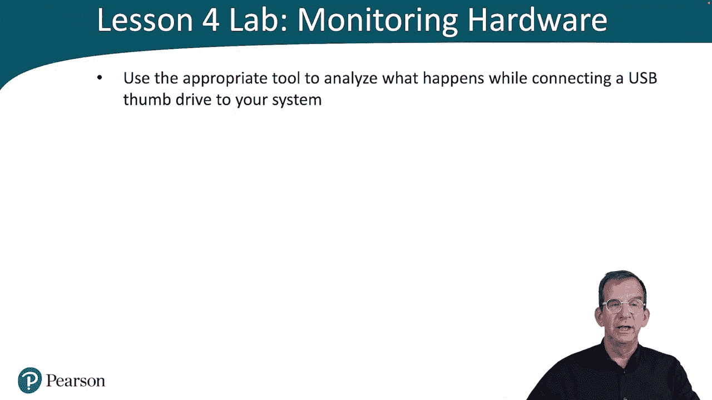

# CompTIA Linux+ V8：第4课：监控硬件实验 🔧


在本节课中，我们将要学习如何在把USB拇指驱动器插到电脑上的时候，用合适的工具去分析系统里发生了什么。这是本课的最后一个实验环节，整体难度不大，适合刚开始学Linux的朋友动手练习。通过这次实验，你可以把书本上的理论知识和实际操作联系起来，慢慢建立起对硬件监控的直观感觉，为后续学习更复杂的系统管理内容打下基础。


上一节我们介绍了Linux系统的基础硬件知识，本节中我们来看看这个实验的具体目标和需要完成的任务。


本实验非常简单，主要目标如下：



- 使用合适的工具观察系统在连接USB拇指驱动器时的反应。
- 分析设备连接过程中产生的内核日志和系统事件。
- 确认硬件被系统正确识别并挂载的过程。


以下是实验中需要用到的核心概念描述：

```bash
dmesg | grep -i usb
lsblk
tail -f /var/log/syslog
```

用公式表示硬件监控的基本流程如下：

设备插入 → 内核检测 → 日志记录 → 设备节点创建 → 文件系统挂载


上一节我们了解了实验目标和核心命令，本节中我们来看看具体的操作步骤。


以下是实验的详细步骤说明：



1. 打开终端，确保你拥有管理员权限，或者可以使用sudo命令。
2. 将USB拇指驱动器插入计算机的USB接口。
3. 执行dmesg命令查看内核缓冲区里的最新消息，寻找与usb相关的条目。
4. 使用lsblk命令列出所有块设备，确认新插入的设备是否出现在列表中。
5. 如果需要，使用tail命令实时监控系统日志文件，观察设备挂载过程。
6. 把观察到的关键信息记录下来，包括设备名称、容量和挂载点。


在本节课中，我们一起学习了如何在连接USB拇指驱动器时使用合适的工具分析系统行为。通过查看内核日志、块设备列表和系统日志，你可以直观地理解Linux如何处理硬件连接事件。希望这个简单的实验能帮助你建立对硬件监控的基本认识，为后续更复杂的系统管理工作打下基础。

